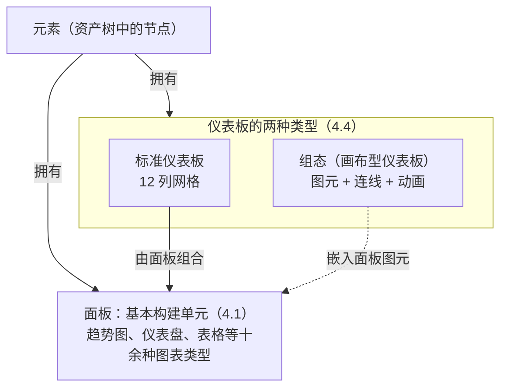

# 4. 可视化

TDengine IDMP 的可视化设计围绕一个核心原则：工业用户思维以资产为中心，而非以信号为中心。监控生产线的操作员关心的是 3 号锅炉、A 号冷却回路或 7 号压缩机站，而不是数据库中一堆没有关联的指标列。TDengine IDMP 的可视化正是围绕这一现实构建的。

## 核心概念：面板、仪表板与组态

TDengine IDMP 的可视化由三个核心概念构成：**面板**、**仪表板**与**组态**。面板是可视化的基本构建单元；标准仪表板由面板组合而成；组态是仪表板的另一种类型，其画布中可通过"面板图元"嵌入面板。

**面板是所有可视化的基本构建单元。** 每个面板都属于资产树中的某个元素，并从该元素及其后代子元素的属性中获取数据。面板是数据驱动的图表组件，包括趋势图、柱状图、饼图、仪表盘、统计值、表格、状态时间线、地图等十余种图表类型，详见[4.2 图表类型](./02-chart-types/index.md)。

**标准仪表板由面板组合而成。** 标准仪表板归属于某个元素，通过 12 列网格汇集当前元素及其子元素的多张面板，让操作员对某项资产或工艺一目了然，详见[4.4 仪表板](./04-dashboards.md)。

**组态是仪表板的另一种类型。** 组态是一块自由布局的画布：通过"拖拉拽"图元搭建工艺画面，面向 SCADA 式的设备与流程状态监控；图元与元素属性绑定后，实时数据自动驱动图元的状态、动画与显示效果。组态既可手工搭建，也可由 AI 根据自然语言自动生成或从既有画面截图复刻，详见[第 5 章](../05-canvas/index.md)。

**组态画布中可以嵌入面板。** 组态编辑器的图元库提供"面板图元"：将当前元素（可含子元素）已保存的面板拖入画布，面板即在工艺画面中实时渲染，查看态下点击面板图元可跳转至面板详情。由此，面板既可组合成标准仪表板，也可作为面板图元嵌入组态画布。

:::note
由 AI 自动生成或从截图复刻的组态画面中不包含图表面板；趋势数据通过双击图元弹出的趋势卡片查看。
:::

**标准仪表板与组态的定位互补：标准仪表板面向数据分析，组态面向状态监控。**

| 需求场景 | 推荐使用 |
|---|---|
| 跨指标、跨设备的趋势对比与聚合统计，需要统一时间范围、缩放、图例切换、过滤条件等分析交互 | 标准仪表板 |
| 按工艺布局总览设备与流程的实时运行状态——SCADA 式监控画面，运行/停止/报警随数据自动切换，动画驱动 | 组态 |
| 在工艺画面中同时查看部分属性的实时图表 | 组态 + 面板图元 |

**面板与仪表板均可模板化复用。** 任一面板或仪表板都可转换为模板，并绑定到元素模板，批量应用于同类资产——新增资产自动获得标准面板，更新模板即可将变更传播至整个机群，详见[4.7 面板与仪表板模板](./07-panel-dashboard-templates.md)。

下图概括了上述概念之间的关系：

## 构建于现代可视化的最佳实践之上

TDengine IDMP 的可视化层大量借鉴了 Grafana 等现代通用工具。面板类型、配置体验和仪表板布局都经过刻意设计，保持熟悉感：趋势图、柱状图、饼图、仪表盘、统计值面板、散点图、状态时间线、表格、地图等——配备了工程师和分析师对现代工具期望的丰富可视化配置。

面板完全交互式。您可以在时间范围内放大、通过图例单独切换系列的显示/隐藏、在亮色和暗色模式之间切换、将面板下载为图片，以及分享限时链接。仪表板通过拖拽方式组装，支持自由排列和调整面板大小。每种面板类型的可视化设置与 Grafana 规范高度一致，对于曾使用过 Grafana 的团队来说，系统可以立即上手。

这种熟悉感是刻意设计的——没有必要重新设计通用可视化工具已经做得很好的部分。TDengine IDMP 在此基础之上增加的是工业上下文层。

## 以资产为中心的可视化

Grafana 等通用工具在工业环境中的根本局限在于其以信号为中心的设计。在 Grafana 中，每个仪表板都从空白画布开始——你需要手动选择数据源、编写查询、选择可视化类型并配置面板。对于单个仪表板，这尚可应对；但对于分布在数十个站点的数百台设备，每台设备有数十个传感器，这种方式就无法维持。团队最终不断重复构建相同的仪表板，各站点和团队之间的不一致性也在不断积累。

TDengine IDMP 颠覆了这一模式。可视化以资产为中心：资产树中的每个元素都拥有自己的面板和仪表板，这些面板可用的数据已经围绕该元素的属性进行了组织。当您导航到一个元素时，不是从零开始——而是看到该特定资产的结构化视图，其上下文已经就位。

这带来了几个实际意义：

**模板在规模化中驱动一致性。** 面板模板和仪表板模板可以为资产类（如泵、电表、风机）定义，并应用于该类型的每个元素。当添加新资产时，其标准面板已经定义好了。当可视化标准发生变化时，更新模板会将变更传播到整个机群。

**层级结构实现多层次视图。** 由于元素组织在树形结构中——企业 → 站点 → 生产线 → 设备 → 传感器——可视化自然遵循相同的结构。工厂级仪表板汇总生产线上所有设备的数据；设备级仪表板显示各传感器的趋势。用户通过导航层级找到当前任务所需的适当细节级别，无需为每个层级单独维护仪表板。

**上下文始终存在。** 每个面板都知道它属于哪个元素、属性的工程单位是什么、定义的限值是什么，以及资产在层级中的位置。这些上下文自动流入趋势着色、限值标记、单位换算和 AI 生成的分析中，无需在每个面板中手动配置。

## 强大的趋势分析

TDengine IDMP 的趋势图远不止于简单的时序绘图。它是一整套高级分析能力的主要入口——散点图同样如此，它支持跨属性的相关性分析。

**时间偏移与叠加。** 任何趋势线都可以按可配置的时间偏移进行位移——小时、天或自定义时长——并叠加在当前数据之上。将今天的行为与上周的，或与上次维护周期之前对应时段的进行比较，无需任何额外工具。

**批次比较。** 当为某个流程定义了事件（如批次开始和结束），趋势图可以在归一化时间轴上叠加多个批次的数据。这立即揭示当前批次与历史批次的对比——哪里偏差、哪里匹配，以及哪些批次定义了最优操作曲线。

除此之外，趋势图、散点图和分析工作台也是广泛高级分析功能的入口：预测、异常检测、缺失数据填补、聚类、回归、相关性分析、窗口分析、事件与批次分析等。相关能力分别在第 8 章和第 9 章中介绍：第 8 章侧重实时分析与 AI 驱动能力，第 9 章侧重图表内交互式过程分析。关键设计要点是这些功能不是独立的应用——它们直接从图表中启动，在上下文中，针对您正在查看的数据。

## AI 驱动的可视化

TDengine IDMP 的 AI 引擎以三种方式直接集成到可视化层中。

**AI 生成面板。** 当您导航到元素的"面板"选项卡时，AI 引擎会分析该元素的属性、属性类型、单位和限值，并建议该资产最相关的面板。风机元素会得到功率曲线散点图和转速趋势图的建议；电表元素会得到电流和电压趋势图以及用电量统计值面板的建议。您可以一键接受建议、请求更多建议，或用自然语言描述面板让 AI 直接生成。

**面板数据解读。** 任何现有面板都可以被 AI 引擎分析，生成该数据含义的文字解读报告。解读报告能识别当前时间范围内数据中可见的趋势、异常、阈值违反和规律——将图表数据转化为工程师和管理者可以据此行动的语言。这使可视化从"展示发生了什么"转变为"帮助您决定下一步做什么"。

**带可视化输出的 AI 问答。** 在 AI 问答界面中，用户可以用自然语言提问工业数据相关问题。AI 可以直接在对话回复中嵌入生成的面板、表格或趋势可视化，利用底层数据模型的完整资产上下文。

这些能力共同体现了一个核心设计理念：工业可视化的目标不是展示数据——而是生成理解。通用仪表板不断积累；TDengine IDMP 面板则经过精心策划、充满上下文，并由其上方的智能层持续丰富。

import DocCardList from '@theme/DocCardList';

<DocCardList />
