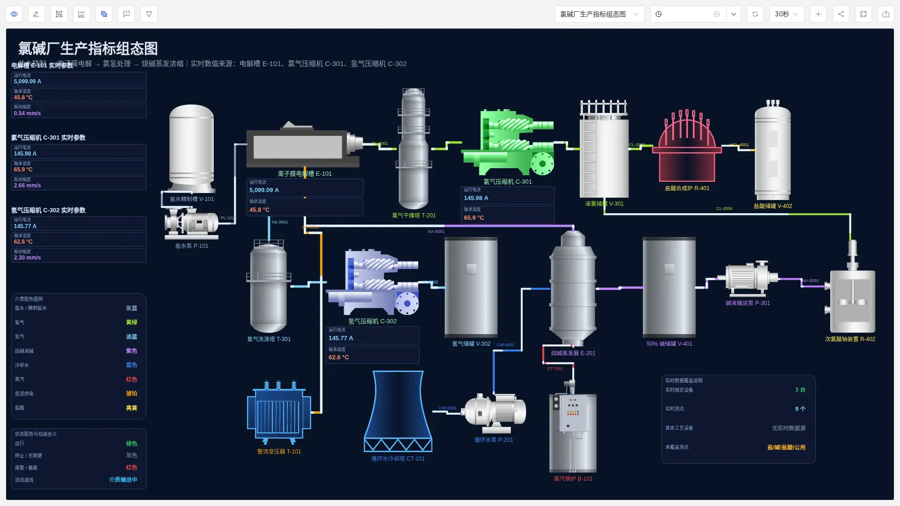
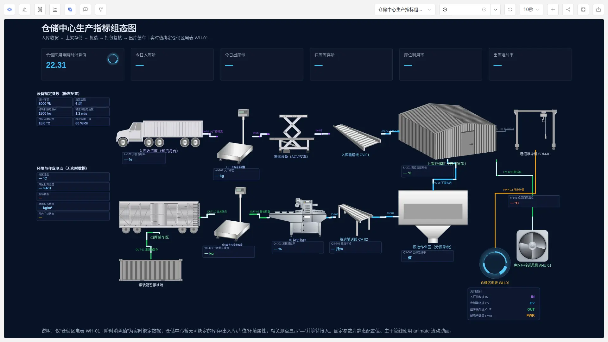

# 5.8 自动生成组态

TDengine IDMP 支持在 AI 助手中用自然语言描述监控场景，由 AI 自动生成可继续编辑的组态画面。生成结果是包含设备图元、管线连线与数据绑定的组态骨架，可直接打开查看，也可在 2D 组态编辑器中继续微调布局与绑定。

自动生成组态面向"生成可编辑骨架"的使用方式：AI 负责理解需求、选择图元与规划绑定，图元的几何位置与画布数据由确定性编译流程生成，因此每次生成的结果都可在现有编辑器中完整编辑。

## 5.8.1 前提条件

使用自动生成组态之前，需要确认以下条件已满足：

- 已配置可用的 [AI 连接](../08-ai-powered-insights/01-connecting-to-llm.md)，且 AI 服务处于可用状态。
- 已在元素浏览器中选中作为数据来源的元素，或在描述中给出准确的元素名称与 ID。
- 目标元素下已定义要绑定的属性；绑定的属性名必须来自元素上下文，AI 不会推测属性名。
- 当前用户对该元素具有创建仪表板的权限。
- AI 助手仅在元素浏览器的右侧工作区提供。面板、元素和仪表板的全屏编辑页面不显示 AI 助手，自动生成组态需在元素浏览器中发起。

## 5.8.2 操作步骤

自动生成组态在 AI 助手中完成，整个过程分为描述需求、核对布局计划、确认创建三个阶段：

1. 在元素浏览器中选中目标元素，打开右侧的 [AI 助手](../08-ai-powered-insights/06-natural-language-queries.md)。
2. 在输入框中用自然语言描述监控需求，说明监测主题与需要绑定的指标。例如：

   ```text
   生成一个比较复杂的"氯碱厂生产指标组态图"，绑定我的子元素的真实数据，有动画和配色
   ```

3. 发送后，AI 读取元素树、属性列表与子元素模板，建立"业务语义 → 属性"的候选映射，并从图元库白名单中检索可用图元。信息不足时，AI 按行业组态模式取默认值，最多追问一个问题。
4. AI 在对话中返回布局计划摘要，包含分区结构、设备与图元清单、绑定清单（属性 → 图元或指标卡片）以及预计的待绑定项。
5. 核对摘要。如需调整分区、设备清单或绑定指标，在确认前直接提出；调整只会重写布局计划，不会写入任何资源。
6. 在确认卡片中点击**执行**。生成组态必须经过确认，该确认由系统强制要求，不受**个人设置**中**执行前确认**开关的影响。
7. 创建完成后，AI 返回仪表板名称、图元数量、绑定槽位数量与未绑定项清单，并提示在 2D 编辑器中继续微调。

布局计划校验失败时，AI 会修正报告的问题并重新提交一次；若创建请求已到达后端而结果未知或失败，系统不会自动重试，需先核对元素下是否已生成仪表板，再决定是否重新发起。名称与已有仪表板冲突时创建会被拒绝，需要更换名称后重新发起。

## 5.8.3 生成结果的结构

生成的组态保存为一张画布型仪表板，全部内容位于单张画布中，并按区域组织。常见区域如下：

| 区域 | 内容 |
|---|---|
| 标题区 | 画面标题与副标题，固定位于画布顶部 |
| 工艺拓扑区 | 设备图元与连接管线，按工艺流向排布，管线端点吸附到设备边缘 |
| 指标卡片区 | 关键指标卡片，显示实时数值与单位 |
| 说明与图例区 | 介质配色说明、状态色定义等文字说明 |
| 测点清单区 | 密集 P&ID 场景下的位号与分析数据表 |

下图为按提示词生成的氯碱厂生产指标组态图，左侧为指标与图例说明，中部为设备与管线拓扑：



下图为按提示词生成的仓储中心组态图，仅电表测量值完成实时绑定，其余测点显示占位符：



## 5.8.4 数据绑定与待绑定项

生成过程遵循"先探索后绑定"的原则，所有绑定属性名必须来自元素上下文，并严格匹配属性名的大小写。

- **直接绑定：** 图元的值文本绑定到元素属性的实时值，数据随采集结果刷新。
- **占位降级：** 系统中不存在与业务语义对应的属性时，图元保留占位符（显示为"—"），并不阻断整图生成。
- **未绑定清单：** 生成结果中列出所有未绑定的槽位，便于后续补充数据接入或手动绑定。
- **绑定覆盖率：** 结果以已绑定槽位与总槽位的比例反映生成质量。按示例场景的验收标准，绑定槽位成功率不低于 70%；该比例是验收参考值，系统不以此阻断生成。
- **趋势查看：** 已绑定图元支持双击弹出趋势卡片，时间范围继承画布当前范围，无需额外配置趋势区。

## 5.8.5 查看与编辑生成结果

生成的仪表板出现在所选元素的**仪表板**标签页列表中，与手动创建的仪表板行为一致：

1. 在元素浏览器中切换到**仪表板**标签页，找到 AI 生成的仪表板。
2. 点击**查看**打开画布，或点击**编辑**进入 2D 组态编辑器。
3. 在编辑器中调整图元位置、尺寸、样式、动画、连线与绑定。生成结果携带完整的可编辑字段，保存后与手动组态无差异。
4. 如需分享或复用到其他元素，按仪表板的常规操作处理；画布型仪表板不参与仪表板模板转换。

## 5.8.6 限制与注意事项

使用自动生成组态时需了解以下限制：

- 生成质量依赖所配置模型的推理能力与元素属性的完整度。
- 复杂工艺画面（设备多、管线密集）的生成耗时较长，生成期间请保持会话开启。
- 生成只创建新的仪表板，不修改、不覆盖也不删除已有资源。
- 画布型仪表板不嵌入图表面板，趋势能力由双击图元弹出的趋势卡片承接。
- 当前版本不支持对已生成组态的自然语言二次编辑，布局与绑定的调整需在 2D 组态编辑器中完成。
- 建议在生成结果上做人工微调，而不是期待一次生成即达到最终交付效果。
