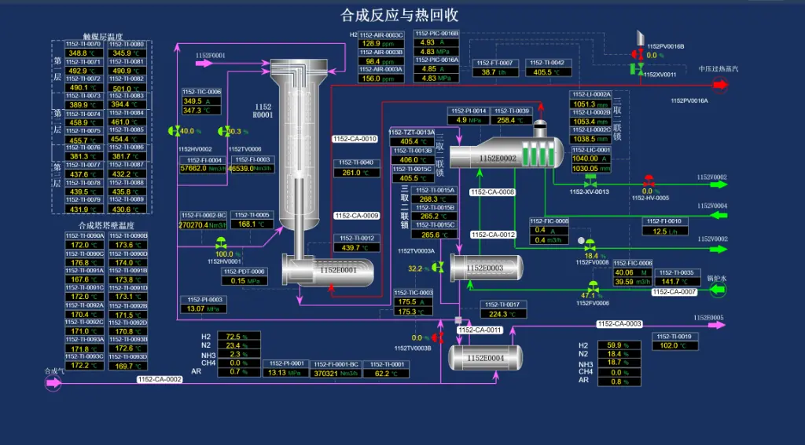
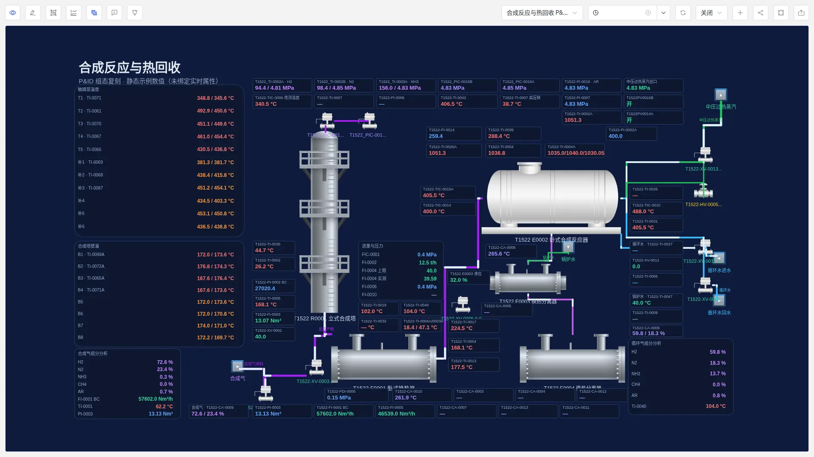
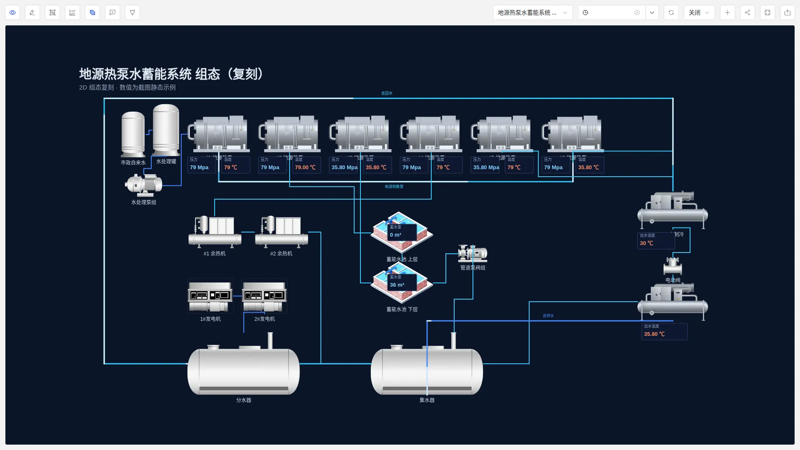
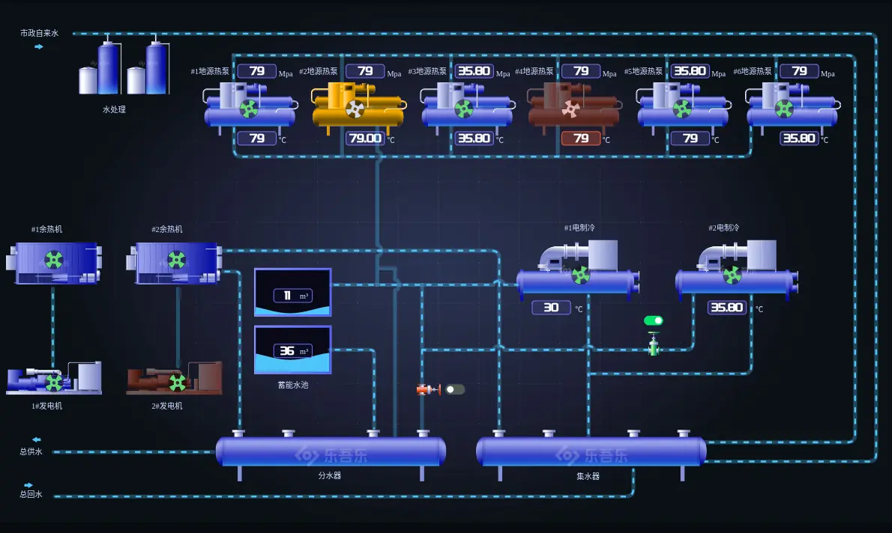

# 5.9 复刻组态画面

复刻组态画面指上传已有组态画面或工艺流程图的截图，由 AI 识别图中的设备、管线拓扑与测点标注，并将其重建为可编辑的组态画面。该功能用于把只存在于图片中的画面（其他平台导出的大屏、纸质图纸的截图、历史组态存档）快速搬入 IDMP，避免从零手工拖拽。

复刻得到的是与原图结构一致的组态骨架：设备布局、管线连接关系与图面标注被还原为原生图元与连线，可在 2D 组态编辑器中继续调整，并补充真实的数据绑定。

复刻复用[自动生成组态](./08-ai-generate.md)的同一能力：界面中没有单独的复刻按钮，附加图片并在提示中说明复刻意图即可触发。

## 5.9.1 前提条件

使用复刻组态画面之前，需要确认以下条件已满足：

- 已配置可用的 [AI 连接](../08-ai-powered-insights/01-connecting-to-llm.md)，且 AI 服务处于可用状态。
- 需要识别图片内容时，可在连接管理中将支持图片解析的连接设为[默认视觉模型](../08-ai-powered-insights/01-connecting-to-llm.md)。若主模型本身支持图片输入，可不设置默认视觉模型，由主模型直接读图。
- 截图格式为 PNG、JPEG、WebP 或 GIF，单张不超过 4 MB，单次最多添加 4 张。
- 已在元素浏览器中选中承载该组态的元素，并展开右侧的 AI 助手。面板、元素和仪表板的全屏编辑页面不显示 AI 助手。

## 5.9.2 操作步骤

复刻组态画面通过 AI 助手的图片附件能力完成，操作步骤如下：

1. 在元素浏览器中选中目标元素，打开右侧的 [AI 助手](../08-ai-powered-insights/06-natural-language-queries.md)。
2. 点击输入框左下方的 **+** 按钮，选择**添加图片**，在文件选择器中选中组态画面截图。选中的图片以缩略图显示在输入框上方，可单张移除。
3. 在输入框中说明复刻意图，例如：

   ```text
   请帮我复刻此组态画面
   ```

4. 发送后，AI 识别图中的设备、管线走向与测点标注，并规划设备清单、连线拓扑与标签内容。
5. AI 在对话中返回布局计划摘要，包含设备与图元数量、管线连接关系、图面标签与预计的待处理项。
6. 核对摘要。如需调整设备清单或排布，在确认前直接提出。
7. 在确认卡片中点击**执行**。复刻组态同样必须经过确认，不受**个人设置**中**执行前确认**开关的影响。
8. 创建完成后，AI 返回仪表板名称与图元统计，并提示在 2D 编辑器中继续调整与绑定。

下图为一幅外部组态画面的原图，作为复刻输入：



下图为复刻生成的组态画面，设备布局、管线拓扑与位号标注按原图重建：



## 5.9.3 还原范围

复刻以"结构一致、可继续编辑"为目标，重点还原以下内容：

- 设备图元的位置与相对布局，按原图的分区与顺序排布。
- 管线的连接关系与走向，端点吸附到设备可见边缘。
- 图面上的位号、标签与单位，按原样保留识别结果。
- 介质配色与流动方向等动画效果，按图面风格近似还原。

复刻不保证逐像素一致：字体细节、装饰性元素与原图尺寸比例可能与原图存在差异，图外的说明文字不会被重建为独立区域。

## 5.9.4 数据绑定说明

复刻只重建画面结构，当前版本不会为复刻结果建立实时数据绑定：

- 图中的数值以静态示例值呈现，用于还原原图的视觉形态，不代表真实的采集数据。
- 系统中不存在原图对应的测点与元素属性时，AI 不会推测属性名，也不会生成无效绑定。
- 复刻完成后，需在 2D 组态编辑器中为图元配置元素属性绑定，绑定后数值即可随采集数据实时刷新。

下图为一幅其他平台大屏截图的复刻结果，图中数值为静态示例值：



对应的输入原图如下：



## 5.9.5 提高复刻效果的技巧

复刻质量与输入图片的可读性直接相关，建议按以下方式准备截图：

- 使用原始分辨率的截图，避免缩放或二次压缩。
- 保留完整的工艺拓扑，不要裁掉设备、管线端点或位号。
- 保证测点文字清晰可读。小字号位号容易识别错误。配置默认视觉模型后，系统会将首张 PNG 或 JPEG 截图切分为带重叠的高分辨率区块再解析，可提高小字识别率；WebP、GIF 图片以及后续附加的图片不做切分。
- 一次复刻一张画面。设备与管线密集的复杂画面生成耗时较长，可拆分为多个区域分别复刻，再在编辑器中人工拼接。
- 在提示中补充关注重点，例如主要设备清单或工艺主线，便于 AI 优先还原关键结构。

## 5.9.6 约束与限制

使用复刻组态画面时需了解以下限制：

| 项目 | 限制或说明 |
|---|---|
| 输入格式 | PNG、JPEG、WebP、GIF，单张不超过 4 MB |
| 输入数量 | 单次最多添加 4 张图片，复刻按画面逐个进行 |
| 识别准确度 | 依赖图片清晰度与拓扑完整度，模糊或遮挡严重时识别效果有限 |
| 数据绑定 | 复刻结果不含实时绑定，数值为静态示例值 |
| 生成耗时 | 设备多、管线密集的复杂画面耗时较长 |
| 写入行为 | 每次复刻创建一张新的画布型仪表板，不修改已有资源 |
| 文本保留 | 只保留图面可见的位号与单位，不推测被遮挡或不可辨认的内容 |

复刻结果与手动创建的组态完全一致，可在元素**仪表板**标签页中查看、编辑、分享或删除。
