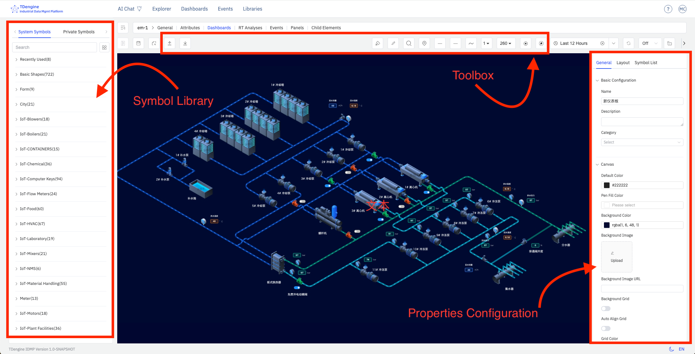

# 5. 组态

组态是 IDMP 中与标准仪表板并列的一种可视化方式：标准仪表板以网格布局组合多个分析面板，组态则以一块自由画布，通过"拖拉拽"图元搭建工艺画面，让业务人员"零代码"实现 Web 组态、SCADA 等解决方案，可视化地呈现设备、流程的当前运行状态。目前它支持 2D 与 2.5D，今后将支持 3D。组态与 IDMP 的资产模型无缝结合，能快速交付方案、降低开发成本。它具有如下的特点：

1. **直观易用的拖拽编辑**：无需技术背景，像搭积木一样轻松创建监控画面
2. **智能数据驱动**：配置一次即可让实时数据自动更新画面，减少重复操作
3. **丰富的动画效果**：内置多种动画，支持自定义，让监控画面生动直观
4. **灵活的状态管理**：通过数据变化自动切换设备状态，如运行/停止/报警
5. **可扩展的图元库**：内置系统图元，支持上传自制图形（JS、SVG、图片等），还可将已有面板嵌入画面，满足特殊需求
6. **强大的性能表现**：单画面可支持上万个图元，满足大型工业场景需求

下面是一个典型的组态编辑界面：

整个编辑画面由几大块组成：

1. **画布**：画布即中央的绘画区域，将图元拖拽到画布进行编辑，绘制组态图。画布有各种属性，比如背景颜色、网格、标尺等，它们都可以个性化配置。
2. **图元**：它是画布的基本单元，图形表达的基本元素，图上的各种设备、组件都是图元。图元有各种属性，比如颜色、背景颜色、大小、显示的文本、进度 (Progress)、值 (value)、状态 (State) 等。
3. **工具栏**：位于编辑器顶部，提供钢笔、铅笔、放大镜、鹰眼地图（缩略图）、格式刷、连线起点、连线终点、连线线宽、视图比例、自动锚点、禁用锚点等画图工具，以及默认配置、导入导出、保存等操作。
4. **图元库**：位于编辑器左侧，包含系统图元、私有图元与面板图元三类素材，并且容许用户自己上传绘制的图形。
5. **配置**：对画布、画布上的各个图元进行配置，比如颜色、背景颜色、字体、事件、动画等，可以修改其显示、交互行为等。

本文档仅对基本概念与基本操作做简要介绍，更多细节可在实际使用中进一步探索。

除手动拖拽创建外，也可以让 AI 根据自然语言描述自动生成组态画面，或将已有组态画面、其他平台大屏的截图复刻为可编辑的组态。详见 [5.9 自动生成组态](./09-ai-generate.md) 与 [5.10 复刻组态画面](./10-ai-replicate.md)。

import DocCardList from '@theme/DocCardList';

<DocCardList />
