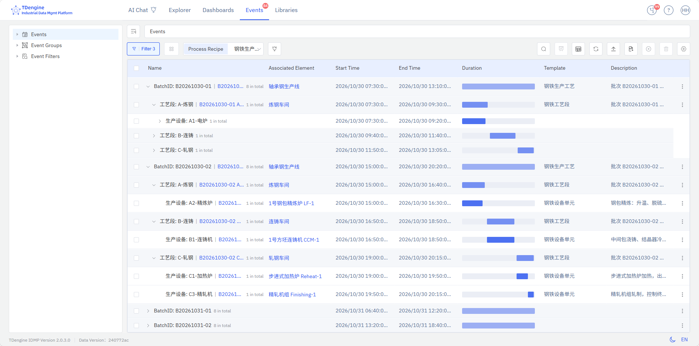
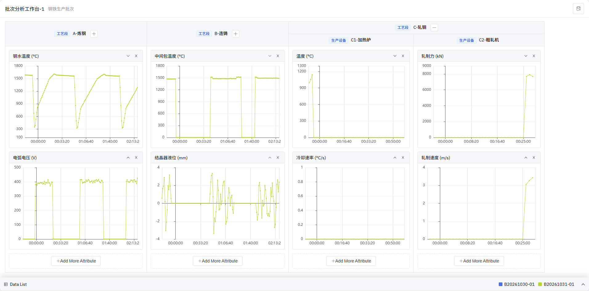

# 6.9 批次分析工作台

本文面向需要配置批生产工艺、导入批次事件并进行多批次对比分析的用户，介绍从工艺配方配置到批次分析面板保存的完整操作流程。

## 6.9.1 功能概述

工艺配方用于定义批次生产的层级过程，事件导入用于生成符合配方结构的事件数据，批次分析工作台用于对比不同批次在各生产阶段的工艺参数。完整流程如下：

```text
配置工艺配方
  ↓
按配方下载事件导入模板
  ↓
填写并导入 CSV 事件
  ↓
在事件列表中按配方分组
  ↓
将一个或多个批次添加到批次分析工作台
  ↓
按工艺阶段对比元素属性曲线
  ↓
保存为批次分析面板，供后续恢复和继续分析
```

工艺配方用于定义“订单 → 批次 → 设备单元 → 工艺操作 → 操作步骤”等层级。导入事件时，系统按照配方检查事件模板及层级属性。批次分析工作台再以配方层级组织事件，并按工艺阶段对比不同批次的指标曲线。

通用的事件对比、时间归一化和包络线分析，请参阅[事件、批次分析](../09-advanced-analytics/06-batch-event-analysis.md)。

## 6.9.2 使用前准备

开始操作前，需要确认模板、权限和分析数据满足以下要求：

- 当前账号具有工艺配方查看、新建或编辑权限，以及事件导入权限。
- 已创建可作为配方基础的**基础事件模板**，且该模板允许扩展继承。
- 基础事件模板中已定义订单号、批次号、设备单元、工艺操作等层级属性。
- 如需为不同层级使用不同事件模板，已创建继承自该基础事件模板的子事件模板。
- 如需工作台自动生成指标对比图，事件应关联相应的实时分析，并在触发或输出配置中引用需要分析的元素属性；相关属性应有时序数据。

## 6.9.3 配置工艺配方

工艺配方在基础库中统一维护。配方包含基本信息和有序层级，层级定义决定事件分组方式及工作台的分析粒度。

### 6.9.3.1 新建配方

按照以下步骤创建配方并填写基本信息：

1. 进入**基础库 → 事件模板** ，创建批次的基础事件模板，包括顶层的批次事件，以及不同生产环节的过程事件。
2. 进入**基础库 → 工艺配方**。
3. 在配方列表右上角单击**新建**图标；列表为空时，也可以单击空态区域中的**新建工艺配方**。
4. 填写工艺配方的基本信息：

| 字段         | 是否必填 | 填写说明                                         |
| -------------- | ---------- | -------------------------------------------------- |
| 名称         | 是       | 配方名称，需保持唯一，不能包含路径分隔符及 `<>:"` |
| 基础事件模板 | 是       | 选择配方所依据的事件模板；层级属性来自该模板     |
| 分类         | 否       | 可选择一个或多个分类，也可以就地新建分类         |
| 描述         | 否       | 填写配方的用途、适用产线或其他说明               |

4. 配置配方层级，具体见下一节。
5. 单击**保存**。保存成功后，配方会出现在左侧菜单树和配方列表中。

新建配方时，系统默认预置 5 个层级，第 2 行默认勾选为批次行。可以直接在此基础上修改，也可以增删或调整层级。

### 6.9.3.2 配置配方层级

层级表格用于指定每一层的分组属性、批次锚点和可选事件模板。各列的含义如下：

| 列   | 说明                                                                         |
| ------ | ------------------------------------------------------------------------------ |
| 层级 | 层级顺序，从 1 开始；事件分组和工作台阶段拆分均按照该顺序执行                |
| 批次 | 标识唯一的批次行，只能在第 1 行或第 2 行设置                                 |
| 属性 | 选择基础事件模板中的一个属性，作为该层级的分组依据，例如“订单号”“批次号” |
| 模板 | 可选；选择该层级使用的事件模板，只能在批次行及其下方层级设置                 |
| 操作 | 上移、下移或删除层级                                                         |

按实际工艺顺序逐行配置。例如：

| 层级 | 批次   | 属性     | 模板         | 系统推导的层级类型 |
| ------ | -------- | ---------- | -------------- | -------------------- |
| 1    | 未勾选 | 订单号   | 不可设置     | 订单               |
| 2    | 已勾选 | 批次号   | 批次事件     | 批次               |
| 3    | 未勾选 | 设备单元 | 设备单元事件 | 设备单元           |
| 4    | 未勾选 | 工艺操作 | 工序事件     | 工艺操作           |
| 5    | 未勾选 | 操作步骤 | 阶段事件     | 操作步骤           |

配置时遵循以下规则：

- 每个层级都必须选择属性。
- 全表必须有且仅有一个批次行。不能直接取消当前批次行的勾选；如需更换，请勾选第 1 行或第 2 行中的另一行。
- 批次行下方至少要保留一个层级，否则无法用于批次分析，也无法保存。
- 批次行不能删除，也不能移动到第 3 行或更低位置。
- 当所选属性名包含 `batch` 或“批次”时，系统会自动将所在行标识为批次行；如已有其他批次行，以后选择的行为准。
- 批次位于第 2 行时，第 1 行自动作为订单层；批次下方依次作为设备单元、工艺操作、操作步骤。调整顺序后，系统会重新推导。
- 模板选项来自基础事件模板的后代模板。一个事件模板只能被一个配方的层级引用；编辑当前配方时，本配方已经引用的模板仍可保留。
- 如需新增层级，先选择基础事件模板，再单击“工艺配方层级”标题右侧的 **+**。
- 更换基础事件模板后，系统会清除不再适用的属性和模板选择，请逐项复核后再保存。

### 6.9.3.3 查看、编辑、复制或删除配方

在工艺配方列表中，可以按名称搜索、按分类筛选，并从行尾操作菜单执行以下操作：

- **查看**：进入只读详情页。
- **编辑**：修改基本信息和层级后保存。
- **复制**：以现有配方为基础另存一个新配方，系统会在名称后添加“副本”后缀。
- **删除**：删除单个配方；也可以在列表中勾选多个配方后批量删除。

删除配方不会删除已经导入的事件，但之后不能再通过该配方下载模板、分组事件或添加新的批次分析。删除前请确认不再需要该配方。

## 6.9.4 根据工艺配方导入事件

选择工艺配方后，系统可以生成包含配方属性的 CSV 模板，并在导入时校验事件模板和层级属性。建议选择配方后重新下载模板，不要沿用普通事件导入或其他配方的模板。

### 6.9.4.1 打开导入对话框并选择配方

按照以下步骤进入配方导入模式：

1. 进入**事件列表**，单击工具栏中的**导入事件**图标。
2. 在**工艺配方（可选）**下拉框中选择刚配置的配方。
3. 根据需要设置**关联元素**：
   - 在通用事件列表中，可以从元素树选择关联元素，为本次导入统一指定元素。
   - 在元素上下文的事件页面中，当前元素会自动作为关联元素。
   - 也可以不统一选择，而在 CSV 的“元素路径”列中逐行指定。
4. 保持**事件模板（可选）**为空。

工艺配方和事件模板两种导入方式互斥。选择配方后，事件模板下拉框会被清空并禁用；如需改用单模板导入，先清空工艺配方，再选择事件模板。

### 6.9.4.2 下载配方导入模板

选择配方后，按照以下步骤下载并打开模板：

1. 在导入对话框的模板区域单击 **EventImportTemplate.csv**。
2. 保存下载的 CSV 文件。
3. 使用 Excel 或文本编辑器打开文件，保留原有说明行和表头。

选择配方后，下载模板包含：

- “元素路径”和“事件模板”列；
- 事件名称、开始时间、结束时间等固定列；
- 配方基础事件模板及各层级模板所含属性的并集列，同名属性只保留一列；
- 配方模式专用说明，其中列出了允许填写的事件模板名称。

### 6.9.4.3 填写 CSV

中文模板包含固定事件字段和配方属性列。主要固定字段如下：

| 字段     | 填写说明                                                                                      |
| ---------- | ----------------------------------------------------------------------------------------------- |
| 元素路径 | 事件所属元素的完整路径；未在导入对话框统一指定关联元素时，可在此逐行填写                      |
| 事件模板 | 配方模式下必填，必须与配方基础事件模板或某一层级绑定模板的名称完全一致                        |
| 事件名称 | 必填                                                                                          |
| 开始时间 | 必填                                                                                          |
| 结束时间 | 必填                                                                                          |
| 描述     | 可选，自由文本                                                                                |
| 严重程度 | 可选：`Default`、`Information`、`Warning`、`Minor`、`Major`、`Critical`；为空时使用模板默认值 |
| 事件时间 | 可选；为空时，系统在开始时间和结束时间之间取值                                                |
| 原因     | 可选，自由文本                                                                                |
| 分类     | 可选；多个分类名称用英文逗号分隔，并将整个字段用双引号包裹                                    |

时间字段支持 `yyyy-MM-dd HH:mm:ss`、ISO-8601 或毫秒级时间戳。以 `#` 开头的行是注释，导入时会被忽略；第一个非注释行必须是表头。

除固定字段外，还需按以下规则填写配方层级属性：

- 某行使用哪个层级的事件模板，就必须填写该层级及其之前所有层级的属性。
- 例如，使用“工序事件”模板时，必须填写订单号、批次号、设备单元和工艺操作；更深层级的“操作步骤”可以留空。
- 同一批次下的事件应使用完全相同的订单号和批次号；同一设备单元、工序或阶段也应保持对应属性值一致，否则会被分到不同分组。
- 如果同一模板绑定在配方的多个层级，系统按该模板所在的最深层级检查属性完整性。
- CSV 不需要“父事件名称”列，也不通过父子事件字段建立配方层级；层级关系由各行的配方属性值体现。

以下示例使用第 6.9.3.2 节的配方。为便于阅读，仅展示主要字段：

```csv
元素路径,事件模板,事件名称,开始时间,结束时间,订单号,批次号,设备单元,工艺操作,操作步骤
/工厂/涂布线A,批次事件,批次B20261018-01,2026-10-18 08:00:00,2026-10-18 12:00:00,PO20261018,B20261018-01,,,
/工厂/涂布线A,设备单元事件,涂布机1号单元,2026-10-18 08:05:00,2026-10-18 11:50:00,PO20261018,B20261018-01,涂布机1号,,
/工厂/涂布线A,工序事件,涂布工序,2026-10-18 08:10:00,2026-10-18 10:30:00,PO20261018,B20261018-01,涂布机1号,涂布,
/工厂/涂布线A,阶段事件,恒温干燥,2026-10-18 09:00:00,2026-10-18 10:00:00,PO20261018,B20261018-01,涂布机1号,涂布,恒温干燥
```

如需导入第二个批次，继续追加该批次的批次、设备单元、工序和阶段事件，并将批次号改为新的值。

### 6.9.4.4 上传并导入

填写完成后，按照以下步骤上传文件并执行导入：

1. 返回**导入事件**对话框，确认仍选择同一工艺配方。
2. 在文件区域选择或拖入填写完成的 `.csv` 文件，一次导入一个文件。
3. 选择文件编码。通常保持**自动**即可；如果自动识别不正确，手动选择实际编码。UTF-32 文件不受支持。
4. 单击**确认**开始导入。
5. 导入成功后，系统提示成功导入的事件数量，事件列表自动刷新。

配方模式会检查每一行的事件模板和层级属性，并汇总必填项、时间格式、严重程度、分类、元素路径等校验结果：

- 任一行校验失败，系统会集中返回错误信息，**本次文件中的事件均不会写入**。
- 根据错误提示修正 CSV 后，重新选择文件并导入。
- 如果下载模板后配方已被修改或删除，应重新下载最新模板，再按新配方填写和导入。

## 6.9.5 将批次添加到分析工作台

事件导入成功后，可以在事件列表中按配方分组，并将一个或多个批次添加到同一工作台：

1. 进入**事件列表**。
2. 在工具栏的**工艺配方**下拉框中选择导入时使用的配方，列表切换为配方分组模式。
3. 展开订单等上层分组，找到目标批次行。批次行通常显示为“批次号：批次值”。
4. 单击该批次行右侧的操作菜单，选择**添加到批次分析工作台**。
5. 系统打开批次分析工作台窗口并自动加载：
   - 当前工艺配方及层级；
   - 该批次下的全部事件，包括批次级、阶段级等中间层事件；
   - 批次下一层级的工艺阶段列；
   - 各阶段相关事件所引用的元素属性对比图。
6. 返回事件列表，以同样方式添加同一配方下的其他批次。已打开的工作台会被复用并聚焦，新批次会追加到现有图表中。

下图是一个基于钢铁生产配方的批次事件列表示例。



注意：

- “添加到批次分析工作台”只出现在配方分组模式的**批次行**上，普通事件行或其他层级行没有该入口。
- 一个工作台只能分析同一工艺配方的批次。添加其他配方的批次时，系统会拒绝并提示；如需分析另一配方，请关闭当前工作台后重新添加。
- 重复添加同一批次不会重复生成曲线，系统会提示该批次已存在。
- 如果浏览器阻止弹窗，请允许当前站点打开弹窗后重试。

## 6.9.6 使用批次分析工作台

批次分析工作台以工艺阶段组织工艺参数对比图，并提供阶段拆分、属性管理、明细查看和面板保存等能力。下图是一个钢铁生产领域的批次分析工作台界面示例。



### 6.9.6.1 认识页面布局

工作台顶部显示当前工艺配方名称；保存为面板后，顶部显示面板名称。主体由以下区域组成：

- **阶段列表头**：默认显示配方中批次下一层级的实际分组，例如设备单元或工艺操作。
- **指标对比图区**：每个阶段列包含一张或多张属性曲线图，每张图叠加显示各批次曲线。
- **底部数据列表**：可展开查看批次、事件、属性和工艺配方明细。
- **批次图例**：位于底部数据列表标题栏右侧，以“色块 + 批次号”标识批次；同一批次在所有图表中使用相同颜色。
- **保存按钮**：位于页面右上角，用于保存或更新批次分析面板。

当列或图表较多时，可在图表区域横向或纵向滚动，表头会保持固定并同步横向位置。

### 6.9.6.2 阅读多批次对比图

每张图表示一个元素属性，每个批次对应一条曲线：

- **单个可见批次**：横轴显示实际时间。
- **多个可见批次**：各批次按所在阶段的开始时间对齐，阶段开始为相对时间 0，便于比较相同工艺进度下的指标差异。
- 图表查询范围会在阶段起止时间前后各扩展 15%，用于观察阶段开始前后的上下文；阶段时间缺失时回退到批次时间窗。
- 对尚未结束的批次，时间窗右端按当前时间处理。
- 横轴负值表示阶段开始前的数据；跨天时，相对时长会附加天数信息。

单击底部标题栏中的某个批次图例，可在所有图表中同时隐藏或重新显示该批次曲线。图例变暗表示对应批次当前隐藏；图例操作不会展开或收起数据列表。

### 6.9.6.3 拆分或合并工艺阶段

阶段列支持按配方层级细分，以便在合适的粒度比较指标：

- 单击叶子列标题中的 **+**，将该阶段拆分到配方的下一层级。
- 只有配方中存在下一层级，且当前已加载事件中存在实际下级分组时，才显示 **+**。
- 拆分后，父级标题跨子列显示。单击父级标题中的 **-**，可合并回父级。
- 合并后，父列展示全部子列图表的合集；再次展开时，保留此前的子列、图表删除状态和列宽。
- 拖动叶子列表头右缘可调整列宽。拆分子列时，初始宽度根据各子阶段时长分配。

### 6.9.6.4 管理指标对比图

工作台会根据阶段内事件的触发或输出引用属性，自动去重生成初始图表。也可以手动调整：

- **追加属性**：单击阶段列底部的**添加更多属性**，在元素树中选择一个或多个普通元素属性，确认后生成对比图。
- **调整顺序**：单击图表标题右侧的上移或下移图标，调整同一阶段列内的图表顺序。
- **删除单张图**：单击图表标题右侧的关闭图标。需要时可通过“添加更多属性”重新添加。
- **隐藏属性**：在底部数据列表的“属性”页签取消勾选，隐藏该属性在各阶段列中的图表；重新勾选即可恢复。
- **删除属性**：在“属性”页签单击删除，移除该属性在各阶段列中的全部图表。

同一阶段列不能重复添加同一属性。批次对比图暂不支持表达式属性，请选择普通元素属性。

### 6.9.6.5 查看数据列表

单击底部**数据列表**标题栏展开抽屉，包含以下页签：

| 页签     | 内容与操作                                                                         |
| ---------- | ------------------------------------------------------------------------------------ |
| 批次     | 查看批次号、时间窗、持续时长和事件数；可移除批次。进行中的批次持续时长显示为 `-`   |
| 事件     | 查看事件名称、所属批次、所属阶段、事件模板和起止时间；单击事件行进入事件详情       |
| 属性     | 查看属性名、元素路径、当前值、最后更新时间和数据引用设置；可统一显隐或删除属性图表 |
| 工艺配方 | 查看当前配方的层级序号、绑定属性和绑定事件模板                                     |

在“批次”页签单击删除图标并确认后，可以从工作台移除批次。该操作只会删除工作台中的批次曲线和图例，**不会删除事件列表中的原始事件**。移除最后一个批次后，页面回到空态，仍可继续接收同配方的新批次。

## 6.9.7 保存和恢复批次分析面板

保存面板可以保留当前分析配置，并在后续会话中恢复配方、批次和图表布局。

### 6.9.7.1 保存面板

按照以下步骤将当前工作台保存为面板：

1. 至少添加一个批次，并完成阶段拆分、属性选择、图例显隐等调整。
2. 单击页面右上角的**保存为面板**图标。
3. 首次保存时填写：
   - **面板名称**；
   - **关联元素**，从候选元素树中选择面板的归属位置。
4. 单击**保存**。

面板会保存当前配方、批次、阶段拆分结构、列宽、属性图表及批次显隐状态。再次单击保存时，会更新当前面板；关联元素保持不变。

未保存为面板的调整只存在于当前工作台窗口中。关闭窗口前，如需保留分析结果，请先保存。

### 6.9.7.2 恢复面板

按照以下步骤从已保存面板恢复工作台：

1. 进入保存面板所在元素的面板列表，或通用面板列表。
2. 找到批次分析面板，打开其操作菜单。
3. 选择**打开为批次分析工作台**。

系统会在新窗口恢复保存时的配方、批次、阶段列和属性配置，并按原时间窗重新查询曲线数据。恢复后的工作台可继续调整并再次保存。

## 6.9.8 常见问题

以下问题覆盖配方配置、事件导入和批次分析中的常见异常情况。

### 6.9.8.1 保存配方时提示层级不合法

检查是否满足以下条件：每行均已选择属性；仅有一个批次行；批次位于第 1 或第 2 行；批次下方至少还有一行；批次上方未设置模板；所选模板未被其他配方占用。

### 6.9.8.2 导入时提示事件模板不合法

确认 CSV 的“事件模板”名称与配方中的模板名称完全一致，没有多余空格，并且该模板属于配方基础模板或层级绑定模板。不要使用导入对话框中的“事件模板”下拉框代替 CSV 的模板列。

### 6.9.8.3 导入时提示缺少层级属性

根据该行使用的事件模板，补齐其所在层级及之前所有层级的属性。例如工序事件缺少批次号时，即使批次号已在该文件的其他行填写，也必须在这一行重复填写。

### 6.9.8.4 事件列表中没有出现目标批次

确认导入时和工作台入口选择的是同一配方，并检查批次号及上层属性是否填写一致。上层属性值不同会形成不同分组，可能导致批次出现在其他订单或分组下。

### 6.9.8.5 阶段列中没有自动生成对比图

检查该阶段事件是否关联了有效的实时分析，以及分析的触发或输出配置是否引用元素属性。也可以通过阶段列底部的**添加更多属性**手动添加普通元素属性。

### 6.9.8.6 如何刷新已添加批次的数据

重复添加同一批次会被去重，不会刷新曲线。可先在“批次”页签移除该批次，再从事件列表重新添加；也可以关闭工作台后重新打开并添加。

### 6.9.8.7 能否在一个工作台比较不同配方的批次

不能。不同配方的层级和分析口径可能不同，工作台只接受同一配方的批次。请关闭当前工作台，再从另一配方的批次行重新打开。
