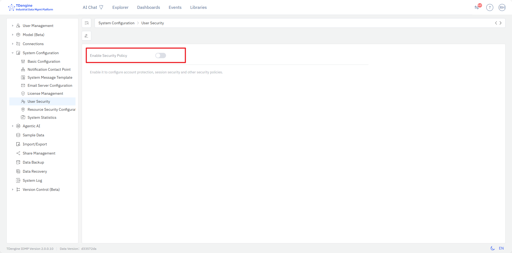
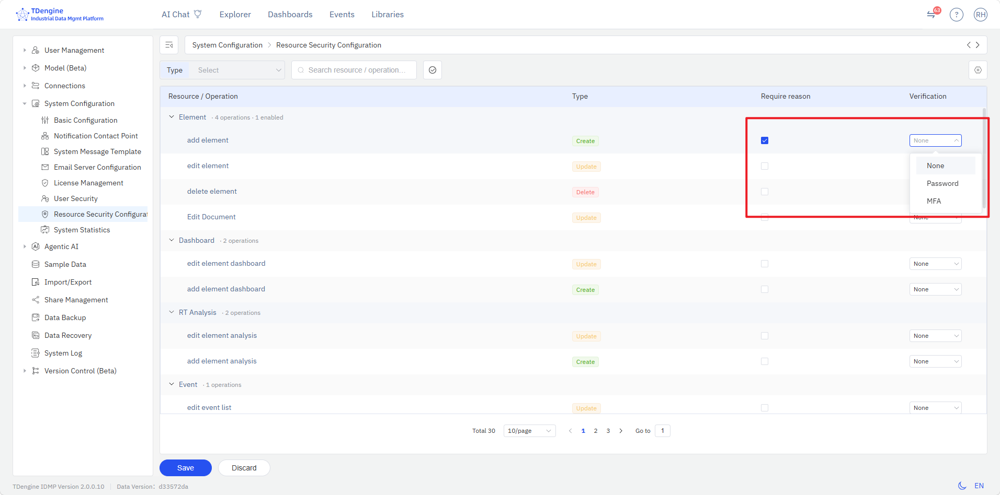

# 14.5 系统配置

系统配置通过**管理控制台 → 系统配置**访问，包含 8 个部分：基本配置、通知途径、系统消息模板、邮件服务器配置、许可管理、用户安全配置、资源安全配置与系统统计，其中许可管理部分请单独参考 [第 14.12 章节](./30-activate.md)。

## 14.5.1 基本配置

基本配置包含系统级的全局基础设置：

| 设置项                       | 说明                                                               |
| ---------------------------- | ------------------------------------------------------------------ |
| **语言**               | 界面的默认显示语言                                                 |
| **启用用户行为采集**   | 是否收集匿名使用数据以改进产品                                     |
| **上传崩溃报告**       | 是否自动上传崩溃报告                                               |
| **自动刷新资源浏览器** | 元素变化时，资产浏览器是否自动刷新                                 |
| **系统日志**           | 是否开启生成不可修改的系统操作日志，以及相关日志的筛选、查询与导出 |
| **质量分析菜单**           | 是否开启独立的质量分析菜单 |
| **公网访问地址**           | 当前系统的公网访问地址 |
| **周开始**           | 当前系统每周的第一天是周日或周一 |
| **元素排序规则**           | 全局默认的元素排序规则：系统默认、元素名称或创建时间 |
| **系统颜色**           | 系统默认颜色的配置 |
| **质量位配置**           | 全局质量码到质量类别（良好/存疑/坏）的映射，详见下方说明 |

点击编辑（铅笔）图标即可修改这些设置。

### 元素排序规则详细说明

元素排序规则用于定义元素树与子元素列表在未单独指定排序方式时采用的默认顺序，可选值如下：

| 选项 | 排序依据 |
| --- | --- |
| **系统默认** | 按元素的 `element_order` 字段排序。该字段在元素创建时自动生成，并随用户对元素执行**上移**、**下移**、**置顶**等操作动态调整，因此「系统默认」本质上是「创建顺序叠加用户自定义顺序」——新元素按创建先后排列，用户可在此基础上手动调整相对位置。 |
| **元素名称** | 按元素名称的字典序（升序）排序。 |
| **创建时间** | 按元素的创建时间排序（最新创建在前）。 |

:::info
该设置仅作为**全局默认值**。在元素树中，用户可通过元素节点旁的「排序」按钮为单个节点覆盖此默认规则；在子元素列表中，也可通过表头排序单独指定排序方式。
:::

### 质量位配置详细说明

质量位配置用于定义全局的质量码到质量类别的映射：以**区间规则**（起始码 - 结束码 → 类别）的形式，把数据携带的整数质量码划分为**良好（Good）**、**存疑（Questionable）**、**坏（Bad）**三种质量类别，并为未匹配任何规则的质量码指定默认类别。当元素属性指定了质量位数据后，系统会自动读取该配置形成数据质量评价——趋势、柱状、散点、饼图、表格、统计值、仪表盘等面板与属性列表会按质量类别渲染数据点，帮助用户快速识别不可信的数据。

质量码来自属性数据引用中配置的质量列，格式为 `连接名/数据库名/表名/列名:质量列名`，质量列类型必须为 `INT`。OPC UA 接入与 CSV 导入的数据同样支持携带质量位，参见[属性](../03-data-modeling/02-attributes.md)。

**查看配置**

「质量位配置」条目默认为查看态，显示区间汇总（如 `1 条良好 / 1 条存疑 / 1 条坏区间`）、未匹配默认类别，以及各区间规则的名称、类别与范围。

点击编辑（铅笔）图标进入编辑态，需要系统配置的管理权限。

**编辑配置**

区间规则包含以下字段：

| 字段 | 说明 |
| --- | --- |
| **名称** | 可选，区间或质量码的显示名称（如 `I/O Timeout`），最长 100 字符。配置了名称时，面板与提示中以名称展示质量；未配置时展示原始码值 |
| **类别** | 落在该区间内的质量码归属的质量类别：`良好`、`存疑` 或 `坏` |
| **范围** | 起始码 - 结束码构成的闭区间，为非负整数。单个质量码可表示为 `246 - 246` |

编辑区顶部的操作：

| 操作 | 说明 |
| --- | --- |
| **未匹配默认类别** | 未落在任何区间内的质量码按该类别处理，默认为 `坏` |
| **新增区间**（+ 图标） | 在表格末尾追加一行，默认范围为 `0 - 0`、类别为 `坏` |
| **恢复默认**（复原图标） | 将编辑内容重置为内置默认配置，仍需点击保存才会生效 |
| **删除**（行内垃圾桶图标） | 删除对应的区间行 |

**校验规则**

保存时系统会校验以下规则，违反时对应行标红并在表格下方提示，且无法保存：

- 起始码不能大于结束码
- 区间两两不重叠。如需表达「大区间内个别码值例外」，请拆分为多个区间分别配置

**默认配置**

| 范围 | 类别 |
| --- | --- |
| 0 - 0 | 良好 |
| 1 - 1 | 存疑 |
| 2 - 2 | 坏 |

未匹配默认类别为 `坏`，即任何未配置的质量码都会按坏质量处理。现场若使用 PI、OPC 等系统自身的质量码体系（如 `246` 表示 I/O Timeout、`308` 表示 Doubtful），可将这些码值按需添加为区间规则并命名。

若已开启系统日志，点击保存时会弹出确认框，可填写操作原因；保存成功后变更记入系统日志。

**展示效果**

配置保存后对所有在线用户实时生效，已打开的面板与属性列表会在数秒内自动按新配置重新渲染，无需刷新页面。

| 质量类别 | 图形面板（趋势/柱状/散点/饼图） | 统计值/仪表盘 | 表格与属性列表 |
| --- | --- | --- | --- |
| 良好 | 按系列原色正常绘制 | 无标记 | 无标记 |
| 存疑 | 以橙色标记，保留绘制 | 值后追加橙色 `!` | 值旁显示橙色 `!` |
| 坏 | 置灰显示 | 值后追加红色 `*` | 值旁显示红色 `*` |

补充说明：

- 图形面板默认隐藏坏质量数据点，点击「显示异常点」按钮后坏质量点以置灰样式显示；存疑点始终显示。
- 表格面板与属性历史值对话框中的质量列显示 `码值 名称`（如 `308 Doubtful`），未配置名称时仅显示码值。
- 属性列表最新值旁的质量标记，鼠标悬浮时提示 `质量: 码值 名称`。

**权限**

质量位配置对所有登录用户可读，用于面板与属性列表的质量渲染；仅管理员可修改。

## 14.5.2 通知途径

**通知途径**定义 IDMP 发送通知的目标地址，可配置多个联系人。首位激活系统的用户的电子邮件地址将自动添加为联系人。

创建联系人时，点击 **+** 并填写以下信息：

| 字段               | 说明                                                                                                |
| ------------------ | --------------------------------------------------------------------------------------------------- |
| **名称**     | 该联系人的唯一名称                                                                                  |
| **通知类型** | 发送渠道：`邮件`、`飞书`、`企业微信`、`钉钉`、`Slack`、`Microsoft Teams` 或 `Webhook` |
| **地址**     | 目标地址——电子邮件地址、飞书 Webhook URL 或其他 HTTP 端点            |
| **描述**     | 可选描述                       |

除上述内置通知类型外，还可通过 `Webhook` 配置其他接受 HTTP 回调的系统，例如 PagerDuty 等。

## 14.5.3 系统消息模板

系统消息模板定义系统生成消息的内容，适用于用户邀请、密码重置和告警通知等场景。

IDMP 内置了常见通知场景的模板。点击模板名称可查看或编辑内容。模板支持变量替换，可包含用户名、URL 和事件详情等动态值。


## 14.5.4 邮件服务器配置

邮件服务器配置定义 IDMP 发送**事件告警邮件**和**面板定时通知**所用的 SMTP 服务器。点击编辑（铅笔）图标更新设置。

:::note
系统激活（验证码）、用户邀请、密码重置、License 到期通知等事务类邮件由涛思数据提供的共享邮件服务（Capability Gateway）发送，
不使用本页配置，也无需在 `application.yml` 中设置任何 SMTP 参数。
本页配置**仅**影响事件告警邮件与面板定时通知：未配置时这两类通知无法送达，界面会在「通知途径」处
对邮件类型的联系点标记为不可用。
:::

邮件服务器配置的认证方式支持两种：**密码**（用户名/密码基础认证）和 **OAuth2 应用身份**（XOAUTH2 应用身份认证，适用于 Microsoft 365、Gmail 等已禁用基础认证的邮件服务）。选择 OAuth2 后按提供商填写对应凭据，access token 由 IDMP 自动获取与刷新（约 60 分钟有效期），全程无跳转、无用户交互。

| 字段               | 说明                                                                  |
| ------------------ | --------------------------------------------------------------------- |
| **主机**     | SMTP 服务器主机名或 IP 地址（Microsoft 365 为 `smtp.office365.com`）  |
| **端口**     | SMTP 服务器端口（如：465 用于 TLS，587 用于 STARTTLS，25 用于非加密） |
| **认证类型** | SMTP 认证方式：`密码`（用户名/密码基础认证）或 `OAuth2 应用身份`（XOAUTH2 应用身份认证） |
| **用户名**   | SMTP 认证用户名（认证类型为「密码」且启用认证时显示）                 |
| **密码**     | SMTP 认证密码（同上）                                                 |
| **发件人**   | 外发邮件使用的"发件人"电子邮件地址；OAuth2 模式下必须为已授权发信的邮箱（Microsoft 365 要求与认证身份一致） |
| **加密方式** | `TLS`、`STARTTLS` 或 `不加密`（Microsoft 365 使用 `STARTTLS`）        |
| **启用认证** | 是否需要 SMTP 认证（仅「密码」方式显示；OAuth2 恒为启用）             |

认证类型选择「OAuth2 应用身份」后，密码框隐藏，出现以下字段（按提供商条件显示）：

| 字段               | 说明                                                                  |
| ------------------ | --------------------------------------------------------------------- |
| **提供商**   | `Microsoft 365`（默认）、`Gmail 服务账号`、`Gmail 刷新令牌`           |
| **客户端 ID** | 应用注册的「应用程序(客户端) ID」                                     |
| **客户端密钥** | 应用注册客户端密码的「值」；保存后回显掩码 `********`，不修改保持原样 |
| **租户 ID**  | Microsoft 365 必填：应用注册的「目录(租户) ID」（GUID 形式）          |
| **服务账号密钥 JSON** | Gmail 服务账号必填：含 `client_email` 与 `private_key` 的密钥 JSON 全文；掩码回显 |
| **刷新令牌** | Gmail 刷新令牌必填：一次性授权获取的 refresh token；掩码回显           |
| **Token 端点** / **Scope** | 高级覆盖项，留空使用提供商默认；仅主权云等特殊场景需要 |

Microsoft 365 在 Azure 门户侧的前置配置步骤见 14.5.4.2，Gmail 见 14.5.4.3；部署期通过 `application.yml` / 环境变量注入的配置方式见 14.5.4.4。

IDMP 的邮件投递分两条链路：

| 邮件类型                            | 投递链路                             | 是否需要本页配置 |
| ----------------------------------- | ------------------------------------ | ---------------- |
| 系统激活（验证码）、用户邀请、密码重置、License 到期通知 | 涛思数据共享邮件服务（Capability Gateway） | 否               |
| 事件告警邮件、面板定时通知           | 本页配置的 SMTP 服务器               | **是**           |

### 14.5.4.1 离网环境使用 MailHog

若 IDMP 服务器无法访问互联网，可在内网部署 [MailHog](https://github.com/mailhog/MailHog) 作为开发和测试用的轻量级 SMTP 中继：

```bash
docker run -d -p 1025:1025 -p 8025:8025 --name mailhog mailhog/mailhog:v1.0.1
```

启动 MailHog 后，按以下信息配置邮件配置：

| 字段                | 值说明      |
| ------------------- | ------------------------------------------------- |
| 主机                | 宿主机 IP（或同一 Docker Compose 网络中的服务名） |
| 端口                | `1025`                                          |
| 用户名 / 密码       | 任意值（MailHog 默认禁用认证）                    |
| 加密方式 / 启用认证 | `不加密` / 不启用                                 |
| 发件人              | 任意有效邮件格式（如 `support@example.com`）    |

在 `http://<服务器IP>:8025` 访问 MailHog Web 界面以查看捕获的邮件。

### 14.5.4.2 使用 Microsoft 365 发信（OAuth2 应用身份）

Microsoft 已对 Client Submission SMTP（`smtp.office365.com`）**永久禁用基础认证**：无论邮箱或租户如何开启「Authenticated SMTP」，用户名+密码提交一律返回 `535 5.7.3 Authentication unsuccessful`。因此对接 Microsoft 365 必须使用 **OAuth2 应用身份**：IDMP 以应用身份（client credentials 流）自动获取并刷新 access token（约 60 分钟有效期），SMTP 会话以 XOAUTH2 机制认证，无需发件邮箱的密码，也无需任何交互式 MFA 验证码。

:::note
出站 SMTP 的 OAuth 认证与**用户登录单点登录（SSO）是两回事**：为 IDMP 配置用户 SSO 不会配置出站邮件。本节步骤全部针对出站发信的应用身份认证。
:::

配置分三个阶段：先在 **Azure 门户（Microsoft Entra ID）** 完成应用注册与授权（步骤一~四，需租户管理员），再在 **Exchange Online** 侧注册服务主体并授予邮箱权限（步骤五~六），最后在 IDMP「邮件服务器配置」中填入凭据。

#### 步骤一：注册应用（Entra ID 门户）

1. 打开 [entra.microsoft.com](https://entra.microsoft.com)（或 Azure 门户 → Microsoft Entra ID）。
2. 左侧 **标识 → 应用 → 应用注册 → + 新注册**。
3. 填写：
   - **名称**：如 `IDMP Mail Sender`（仅显示用）；
   - **受支持的帐户类型**：选 **仅此组织目录中的帐户（单租户）**——IDMP 走单租户 client credentials，不要选多租户/个人帐户；
   - **重定向 URI**：留空（client credentials 不需要）。
4. 点 **注册**。进入概述页后立即复制两个值（IDMP 表单要填）：

| Azure 门户中的值            | 填入 IDMP 表单字段 |
| --------------------------- | ------------------ |
| 应用程序（客户端）ID        | 客户端 ID          |
| 目录（租户）ID              | 租户 ID（是 GUID，不是 `xxx.onmicrosoft.com` 域名） |

#### 步骤二：创建客户端密码

1. 在应用页左侧 **证书和密码 → 客户端密码** 选项卡 → **+ 新客户端密码**。
2. 描述随意（如 `idmp-smtp`），到期时间按策略选（最长 24 个月；部分租户上限 6/12 个月）。
3. 点 **添加** 后，**立刻复制「值」列（Value，一长串密钥）——离开页面后永远不可再查**。「机密 ID」不是密钥，不要复制错。

这个值填入 IDMP 表单「客户端密钥」。到期前需轮换，建议设置日历提醒并记录到期与更换流程——过期后发信会报 `AADSTS7000215`，IDMP 的错误透出会把这个码显示出来。客户端密钥不要出现在文档、截图或排障日志中。

#### 步骤三：添加 SMTP.SendAsApp 应用权限

1. 左侧 **API 权限 → + 添加权限** → 切到 **「我的组织使用的 API」** 选项卡（**关键：不是 Microsoft API 列表里的 Graph**）。
2. 搜索 **Office 365 Exchange Online** → 点进去 → 选 **应用程序权限**（不是委派权限）。
3. 展开 **SMTP**，勾选 **SMTP.SendAsApp**——注意完整权限名是 `SMTP.SendAsApp`，不是 `SMTP.SendAs` → 点 **添加权限**。

:::note
搜不到 Office 365 Exchange Online 这个 API，说明租户没有 Exchange Online 订阅，先确认订阅再回来。
:::

#### 步骤四：管理员同意

1. 回到 **API 权限** 页，此时 SMTP.SendAsApp 状态列显示「尚未授予…」。
2. 点顶部 **「为 \{组织名\} 授予管理员同意」** → **是**。
3. 状态变绿色「已授予 \{组织名\}」即完成。

:::warning
这步不能跳过——应用权限没有管理员同意等于没给。
:::

#### 步骤五：在 Exchange Online 注册服务主体并授予邮箱权限

**这是最容易被遗漏的一步**：仅在 Entra ID 侧授予权限是不够的——若 Exchange Online 中没有为应用注册对应的服务主体，即使 API 权限与管理员同意全部正确，认证依然失败。本步骤由 Exchange Online 管理员在 PowerShell 中完成。

先确认发件邮箱是真实的 Exchange Online 用户邮箱（Exchange 管理中心 → 收件人 → 邮箱 中可见；仅有 Teams 登录地址不足以证明具备邮箱服务资格），然后在本机 PowerShell 连接 Exchange Online（无需 Cloud Shell，其可能因无有效 Azure 订阅而不可用；连接需管理员账号并完成 MFA）：

```powershell
Install-Module ExchangeOnlineManagement -Scope CurrentUser -Repository PSGallery
Import-Module ExchangeOnlineManagement
Connect-ExchangeOnline -UserPrincipalName <管理员账号UPN>
```

接着获取 **「企业应用程序」页面的对象 ID**（Entra ID → 标识 → 应用 → 企业应用程序 → 选中应用 → 概述 → 对象 ID）：

:::warning
这里必须用**企业应用程序**页面的「对象 ID」，**不是「应用注册」页面的对象 ID**——两者不同，用错会导致注册失败。
:::

注册服务主体并授予发件邮箱权限（`FullAccess` + `SendAs`）：

```powershell
# 应用程序客户端 ID（步骤一）与企业应用程序对象 ID
$AppId = "<应用程序客户端ID>"
$AppObjectId = "<企业应用程序对象ID>"
$Sender = "<发件邮箱>"

# 先查重：仅当无匹配时才创建
Get-ServicePrincipal | Where-Object { $_.AppId -eq $AppId }

New-ServicePrincipal -AppId $AppId -ObjectId $AppObjectId `
  -DisplayName "IDMP Mail Sender"

$Sp = Get-ServicePrincipal | Where-Object { $_.AppId -eq $AppId }

# 授予发件邮箱权限（FullAccess + SendAs）
Add-MailboxPermission -Identity $Sender `
  -User $Sp.Identity -AccessRights FullAccess -AutoMapping:$false

Add-RecipientPermission -Identity $Sender `
  -Trustee $Sp.Identity -AccessRights SendAs

# 验证：应看到 AccessRights 含 FullAccess 且 Deny = False
Get-MailboxPermission -Identity $Sender -User $Sp.Identity |
  Format-List User,AccessRights,Deny
```

任何一步报错时先停下解决再继续；SendAs 授权会有确认提示，接受即可。

#### 步骤六：确认邮箱 SMTP 认证开关

邮箱侧的 SMTP 认证被策略关闭时，即使权限全部正确也会 535：

- **Microsoft 365 管理中心**：用户 → 活动用户 → 选中发件邮箱 → 邮件 → 管理电子邮件应用，确认 **Authenticated SMTP（已通过身份验证的 SMTP）** 已勾选；
- 也可用 PowerShell 查询并显式开启（邮箱级设置优先于组织级）：

```powershell
# True = 被禁
Get-CASMailbox -Identity "<发件邮箱>" | fl SmtpClientAuthenticationDisabled

# 如为 True，为该邮箱显式开启
Set-CASMailbox -Identity "<发件邮箱>" -SmtpClientAuthenticationDisabled $false

# 组织级默认（True 也没关系，只要邮箱级已显式设为 $false）
Get-TransportConfig | fl SmtpClientAuthenticationDisabled
```

发件邮箱用已授权的普通用户邮箱最稳妥（共享邮箱一般也可，但首次验证建议先用普通邮箱跑通）。

#### 在 IDMP 中配置并验证

Azure 侧完成后，在「邮件服务器配置」中填写：

| 字段        | 值                                                                  |
| ----------- | ------------------------------------------------------------------- |
| 主机        | `smtp.office365.com`                                                |
| 端口        | `587`                                                               |
| 加密方式    | `STARTTLS`                                                          |
| 认证类型    | `OAuth2 应用身份`                                                   |
| 提供商      | `Microsoft 365`                                                     |
| 租户 ID     | 步骤一复制的「目录(租户) ID」                                        |
| 客户端 ID   | 步骤一复制的「应用程序(客户端) ID」                                  |
| 客户端密钥  | 步骤二复制的客户端密码「值」                                         |
| 发件人      | 已授权发信的邮箱（与认证身份一致，如 `alert@yourdomain.com`）        |

- 点 **检查**：IDMP 会真实获取 token 并探测 SMTP 认证，失败时错误信息包含 AADSTS 原始码，可据此定位；
- 检查通过后点 **保存**，随后发送测试邮件并确认收件，再逐项验证各邮件路径（事件告警、面板定时通知、用户邀请、密码重置等）。若测试失败，记录错误阶段与完整响应以便排障，但务必剔除其中的凭据与 token；
- 客户端密钥保存后回显掩码 `********`，不修改保持原样即可；
- **发件人必须与授权发信邮箱一致**：Microsoft 365 要求 MAIL FROM 与 XOAUTH2 认证身份相同，不一致会被 `550 5.7.60` 拒收；
- 主权云（世纪互联 / 美国政府云）租户需在「Token 端点」高级项中覆盖为对应端点（如世纪互联 `https://login.partner.microsoftonline.cn/<租户ID>/oauth2/v2.0/token`），全局云留空即可。

#### 常见错误对照

| 错误 / 错误码                            | 原因                                                                     | 处置                                                       |
| ---------------------------------------- | ------------------------------------------------------------------------ | ---------------------------------------------------------- |
| `535 5.7.3 Authentication unsuccessful`  | 使用密码方式（基础认证已被微软禁用）；或邮箱 SMTP AUTH 被租户策略关闭     | 认证类型改选 OAuth2 应用身份；按步骤六检查邮箱级开关       |
| `535`（Entra 侧权限与管理员同意均正确）  | Exchange Online 中未注册应用的服务主体，或未授予发件邮箱 FullAccess / SendAs | 按步骤五注册服务主体并授予邮箱权限                         |
| `AADSTS7000215`                          | 客户端密钥无效或已过期                                                   | 按步骤二轮换密钥，并在 IDMP 中更新客户端密钥               |
| `550 5.7.60`（无 Send As 权限）          | 发件人与授权邮箱不一致；或 SendAs 未授予                                 | 发件人改为授权邮箱；检查步骤三~五                         |

### 14.5.4.3 使用 Gmail 发信（OAuth2 应用身份）

Gmail 的 SMTP（`smtp.gmail.com`）支持 XOAUTH2 应用身份认证；Workspace 管理员通常禁用应用专用密码等基础认证方式，OAuth2 是无人值守发信的推荐路径。IDMP 提供两条 Gmail 路径，按账号类型选择：

| 路径 | 适用 | 交互 | 长期性 |
| --- | --- | --- | --- |
| **Gmail 服务账号**（推荐） | Google Workspace 组织邮箱 | 配置后零交互，token 自动获取与刷新 | 长期有效（密钥可吊销轮换） |
| **Gmail 刷新令牌** | 个人 Gmail 账号 | 首次需在浏览器完成一次性授权 | 可被撤销；应用 Testing 态下 7 天过期 |

两条路径的 SMTP 参数相同：`smtp.gmail.com:587 + STARTTLS`，XOAUTH2 认证身份为发件邮箱。

#### 路径 A：Google Workspace 服务账号

适用：组织使用 Google Workspace，发件邮箱为域内真实邮箱，可由域管理员配置全域委派。

**步骤一：启用 Gmail API**

1. 打开 [console.cloud.google.com](https://console.cloud.google.com)，创建或选择项目（如 `idmp-mail`）。
2. 左侧 **API 和服务 → 库** → 搜索 **Gmail API** → **启用**。

**步骤二：创建服务账号并下载 JSON 密钥**

1. **IAM 和管理 → 服务账号 → 创建服务账号**，名称如 `idmp-mail-sender`（无需授予项目角色）。
2. 打开该服务账号 → **密钥 → 添加密钥 → 创建新密钥 → JSON**，下载密钥文件。
3. 该 JSON（含 `client_email` 与 `private_key` 两个字段）即 IDMP 表单要粘贴的「服务账号密钥 JSON」。密钥文件与邮箱密码同等敏感，不要提交到代码仓库，也不要出现在文档、截图或排障日志中。
4. 在服务账号详情页复制其**客户端 ID**（唯一 ID），下一步全域委派要用。

**步骤三：Workspace 全域委派**

1. 以超级管理员登录 [admin.google.com](https://admin.google.com)。
2. **安全性 → 访问和数据控制 → API 控制 → 管理全域委派 → 添加新条目**。
3. 「客户端 ID」粘贴步骤二复制的服务账号客户端 ID；「OAuth 范围（Scopes）」填 `https://mail.google.com/` → **授权**。

:::note
全域委派授权后可能需要几分钟到数小时生效（极端情况最长 24 小时）。范围必须严格是 `https://mail.google.com/`——多出空格或少了尾部斜杠都会导致授权不匹配。
:::

#### 路径 B：个人 Gmail 刷新令牌

适用：个人 Gmail 账号（无 Workspace 管理权限）。IDMP 不内嵌授权页，刷新令牌需在 Google 侧一次性获取。

**步骤一：配置 OAuth 同意屏幕**

1. 打开 [console.cloud.google.com](https://console.cloud.google.com)，创建或选择项目。
2. **API 和服务 → OAuth 同意屏幕**：用户类型选「外部」，填写应用名等必填项。
3. **将应用发布为「正式版（In production）」**——应用处于「测试（Testing）」状态时，签发的刷新令牌 **7 天过期**，不适合生产使用。

**步骤二：创建 OAuth 客户端**

1. **API 和服务 → 凭据 → 创建凭据 → OAuth 客户端 ID**，应用类型选「桌面应用」。
2. 创建后复制**客户端 ID**与**客户端密钥**（即 IDMP 表单的两项）。

**步骤三：一次性授权获取刷新令牌**

1. 打开 [developers.google.com/oauthplayground](https://developers.google.com/oauthplayground)，点右上角齿轮图标勾选 **Use your own credentials**，填入步骤二的客户端 ID 与客户端密钥。
2. 左侧 **Input your own scopes** 输入 `https://mail.google.com/` → **Authorize APIs** → 用发件的 Gmail 账号登录并同意授权。授权页若提示「Google 尚未验证此应用」，点「高级 → 继续前往」即可继续——仅供自己使用的应用无需提交 Google 验证。
3. 回到 Playground 点 **Exchange authorization code for tokens**，复制返回的 **refresh token**（即 IDMP 表单的「刷新令牌」）。

:::warning
刷新令牌在应用处于 Testing 态时 **7 天过期**（发布为正式版后长期有效）；账号修改密码或手动撤销授权也会使令牌失效（表现为 `invalid_grant` / `535`），届时需重新执行步骤三获取新令牌。生产环境优先使用路径 A。
:::

#### 在 IDMP 中配置并验证

| 字段 | 路径 A（服务账号） | 路径 B（刷新令牌） |
| --- | --- | --- |
| 主机 / 端口 / 加密方式 | `smtp.gmail.com` / `587` / `STARTTLS` | 同左 |
| 认证类型 | `OAuth2 应用身份` | 同左 |
| 提供商 | `Gmail 服务账号` | `Gmail 刷新令牌` |
| 服务账号密钥 JSON | 路径 A 步骤二下载的 JSON 全文粘贴 | —（不显示） |
| 客户端 ID / 客户端密钥 | —（不显示） | 路径 B 步骤二复制的值 |
| 刷新令牌 | —（不显示） | 路径 B 步骤三获取的 refresh token |
| 发件人 | 域内被模拟发信的邮箱（须真实存在） | 完成授权的 Gmail 地址 |

- 点 **检查** 验证；通过后 **保存**，发送测试邮件并确认收件，再逐项验证各邮件路径（事件告警、面板定时通知、用户邀请、密码重置等）；
- **发件人必须与授权身份一致**：服务账号路径为被全域委派模拟的邮箱，刷新令牌路径为授权账号本身——不一致会被 Gmail 拒收；
- 服务账号密钥 JSON 与刷新令牌保存后回显掩码 `********`，不修改保持原样即可；
- **服务账号路径对服务器时钟敏感**：JWT 断言按本机时间签名，须保持 NTP 时间同步——偏差超过 1~2 分钟会被 Google 拒绝（表现为 `invalid_grant`）。

#### 常见错误对照

| 错误 / 现象 | 原因 | 处置 |
| --- | --- | --- |
| 取 token 阶段 `invalid_grant` | 刷新令牌过期（Testing 态 7 天）、被撤销或账号改密 | 重新按路径 B 步骤三获取；生产改用路径 A |
| `535 5.7.8 Username and Password not accepted` | 令牌/密钥无效；发件人与授权身份不一致；全域委派未生效或范围不匹配 | 核对发件人；检查路径 A 步骤三的范围与生效时间 |
| 服务账号路径偶发 `invalid_grant`（配置未变时） | 服务器时钟偏差超过 1~2 分钟 | 校准 NTP 后重试 |
| 密钥 JSON 校验失败（保存时） | 粘贴的内容不是含 `client_email` / `private_key` 的完整 JSON | 重新下载密钥文件并粘贴全文 |

### 14.5.4.4 部署注入方式（application.yml / 环境变量）

除页面配置外，云上（kube）部署可在部署期通过 `tda.mail.deployment.*` 配置块（对应环境变量 `TDA_MAIL_DEPLOYMENT_*`）直接注入 SMTP 配置，此时需将投递模式设为 `DEPLOYMENT_SMTP`。应用启动时校验凭据完整性，并把配置播种到系统配置库，此后以库为准，页面可查看。

:::note
前文「事务类邮件由共享邮件服务（Capability Gateway）发送」的分链路说明适用于默认投递模式；投递模式设为 `DEPLOYMENT_SMTP` 后，全部邮件（含事务类邮件）均经部署注入的 SMTP 服务器发送。
:::

Microsoft 365 OAuth2 注入示例（在部署 secret 中设置环境变量）：

```bash
TDA_MAIL_MODE=DEPLOYMENT_SMTP
TDA_MAIL_DEPLOYMENT_HOST=smtp.office365.com
TDA_MAIL_DEPLOYMENT_PORT=587
TDA_MAIL_DEPLOYMENT_FROM=alert@yourdomain.com
# OAuth2 凭据（与 USERNAME/PASSWORD 互斥，只能配一套）
TDA_MAIL_DEPLOYMENT_OAUTH_PROVIDER=MICROSOFT_365
TDA_MAIL_DEPLOYMENT_OAUTH_TENANT_ID=<目录租户ID>
TDA_MAIL_DEPLOYMENT_OAUTH_CLIENT_ID=<应用程序客户端ID>
TDA_MAIL_DEPLOYMENT_OAUTH_CLIENT_SECRET=<客户端密码的值>
# 587 端口必须用 STARTTLS 组合（tls=false + start-tls=REQUIRED）
TDA_MAIL_DEPLOYMENT_TLS=false
TDA_MAIL_DEPLOYMENT_START_TLS=REQUIRED
```

等效的 `application.yml` 配置：

```yaml
tda:
  mail:
    mode: DEPLOYMENT_SMTP
    deployment:
      host: smtp.office365.com
      port: 587
      from: alert@yourdomain.com
      oauth-provider: MICROSOFT_365
      oauth-tenant-id: <目录租户ID>
      oauth-client-id: <应用程序客户端ID>
      oauth-client-secret: <客户端密码的值>
      tls: false
      start-tls: REQUIRED
```

不同提供商需注入的 OAuth 环境变量（均带 `TDA_MAIL_DEPLOYMENT_` 前缀）：

| 提供商         | 需注入的 OAuth 键                                                       |
| -------------- | ----------------------------------------------------------------------- |
| Microsoft 365  | `OAUTH_TENANT_ID` / `OAUTH_CLIENT_ID` / `OAUTH_CLIENT_SECRET`            |
| Gmail 服务账号 | `OAUTH_SERVICE_ACCOUNT_KEY`（JSON 密钥较长，建议经 secret 文件挂载注入） |
| Gmail 刷新令牌 | `OAUTH_CLIENT_ID` / `OAUTH_CLIENT_SECRET` / `OAUTH_REFRESH_TOKEN`       |

说明：

- OAuth 凭据键与 `TDA_MAIL_DEPLOYMENT_USERNAME` / `TDA_MAIL_DEPLOYMENT_PASSWORD` **互斥**：齐全一套即按该方式校验；只配一半或两套混配会导致启动失败（错误信息会指明缺失或冲突的键）；
- 提供商在门户侧的前置配置仍需照常完成（Microsoft 365 见 14.5.4.2 步骤一~六；Gmail 见 14.5.4.3），部署注入只替代页面表单的凭据填写；
- 仅当系统配置库中尚无邮件配置时播种；已存在时沿用库中配置，更换凭据需在页面修改或清空配置后重启。

## 14.5.5 用户安全配置

点击**系统配置**-**用户安全配置**，可以进入用户安全配置页面。用户安全策略默认为关闭状态，可以点击启动安全策略，即可启用系统级的用户安全策略管理。



启动用户安全策略管理后，可以对账户保护、会话安全等进行配置，保存后即刻生效。

| 安全配置项               | 配置说明           |
| ------------------- | ------------------------------------------------- |
| 登录失败保护                | 设置最大失败次数，以及失败后的登录锁定时长 |
| 密码有效期                | 设置账户密码的有效天数，以及过期提醒天数，当开启此项配置后，用户必须在指定时间范围内修改账户的密码 |
| 历史密码限制       | 设定历史密码限制次数，即当前设置密码必须和之前几次的密码不一样     |
| 会话安全 | 当开启后，同一账号的新登录会自动让其他在线会话失效，即统一账户只允许一个有效在线会话   |
| 登录 MFA 认证 | 开关项。开启后，用户登录在密码校验通过后还需在 MFA 验证页输入发送至邮箱的验证码完成二次确认，方可进入系统。验证流程与防爆破规则详见[第 14.10.4 节](./10-mfa.md) |
| 会话有效期（小时） | 设置登录令牌的有效时长（1–8760 小时），到期后需重新登录；该配置影响所有用户的 Web 登录会话，未单独配置时使用系统默认值 |


## 14.5.6 资源安全配置

点击**系统配置**-**资源安全配置**，可以进入资源安全配置页面。资源安全配置覆盖当前系统内的所有资源类型，具体包括：

| 资源类型               | 安全配置项           |
| ------------------- | ------------------------------------------------- |
| 元素                | 增加、编辑、删除，以及文档修改 |
| 仪表板              | 编辑、增加 |
| 实时分析       | 编辑、增加    |
| 事件       | 编辑、删除   |
| 元素模板       | 增加、编辑、删除   |
| 事件模板       | 增加、编辑、删除   |
| 仪表板模板       | 增加、编辑、删除   |
| 面板模板       | 增加、编辑、删除   |
| 通知规则模板       | 增加、编辑、删除   |

此时用户可以对系统内的所有关键资源，设置全局性的安全管理策略。


在资源安全配置页面，点击右上角的编辑按钮，即可进入编辑状态，此时用户可以针对每一项资源类型，设置差异化的安全策略，包括是否需要输入变更原因，以及当执行变更操作时，是否需要再次输入密码，或者执行更加安全等级的多因素身份认证，即 MFA。



## 14.5.7 系统统计

点击**系统配置**-**系统统计**，可以进入系统统计页面。该页面会一站式展示当前系统的各种关键统计信息，包括：

| 类型               | 统计项           |
| ------------------- | ------------------------------------------------- |
| 资产                | 元素数、属性数、测点数、事件数、实时分析数、实例场景数、文档数、枚举集数、 UOM数、复合指标数|
| 模板              | 元素模板数、属性模板数、实时分析模板数、面板模板数、仪表板模板数、通知规则模板数、动作模板数 |
| 可视化       | 面板数、仪表板数、组态数    |
| 模型       | 训练库模型数、管理库模型数、已部署模型数   |


