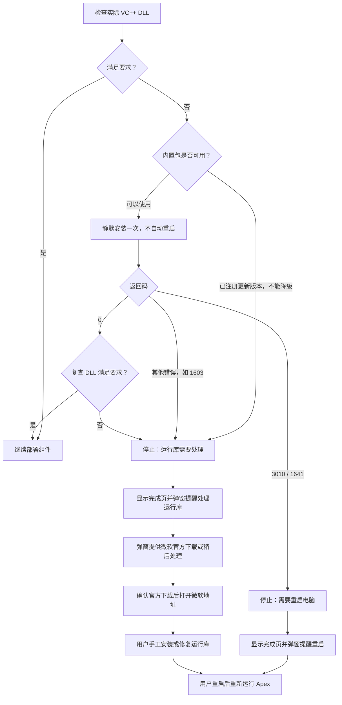

# 14.13.4 Apex 用户手册

本文面向需要安装和维护 TDengine All-in-One 的用户，说明 Apex 的工作方式、目录规划、Windows/Linux/Docker 安装流程、升级、故障排查和最佳实践。

本文以仓库当前实现、安装脚本和 docs/ 下的设计及操作说明为准。安装包、镜像和下载页面可能随发布版本变化；如果页面显示的文件名或版本与示例不同，应以当前发布页和安装器输出为准。

## 14.13.4.1 快速使用指南

### 14.13.4.1.1 下载入口和版本固定

TDengine All-in-One 下载中心按平台、架构和版本展示对应安装器。可从以下页面进入：

- [Windows All-in-One 下载页](https://www.taosdata.com/download-center?product=TDengine+All-in-One&version=2.0.1.2&platform=Windows&architecture=x64)
- [Linux All-in-One 下载页](https://www.taosdata.com/download-center?product=TDengine+All-in-One&version=2.0.1.2&platform=Linux&architecture=x64)
- [Docker All-in-One 下载页](https://www.taosdata.com/download-center?product=TDengine+All-in-One&version=2.0.1.2&platform=Docker&architecture=x64)

命令行安装默认使用 latest。
如需测试内网指定的 RC 版本，请参照：

```bash
curl -fsSL https://nexus.tdengine.net/repository/platform/apex/v0.3.60-rc2/install.sh   | APEX_BASE_URL=https://nexus.tdengine.net/repository/platform/apex bash -s -- -m apex -v 0.3.60-rc2
```

如需下载指定版本的 Apex，请参照：

```bash
curl -fsSL https://downloads.taosdata.com/apex/v0.3.60/install.sh   | APEX_BASE_URL=https://downloads.taosdata.com/apex bash -s -- -m apex -v 0.3.60
```

### 14.13.4.1.2 Windows 主机安装

#### 前置条件

- 使用 x64 Windows。
- All-in-One 的 Host/Docker 部署需要支持 AVX2 的 CPU；TSDB-Enterprise 和 IDMP-Enterprise 不受此项检查影响。
- C 盘至少保留约 8 GB 可用空间（快速安装页提示的产品目录 `C:\TDengine` 需求）。Apex 的程序和数据目录另有至少 500 MB 可用空间的安装器预检查。
- Host 模式的 Windows 用户名和用户目录默认需要 ASCII 字符；计算机名（hostname）始终需要 ASCII 字符。
- 如果必须保留非 ASCII 用户目录，可启用 Windows 区域设置中的“Beta 版：使用 Unicode UTF-8 提供全球语言支持”，重启后再试；计算机名仍应改为英文、数字和连字符的组合。
- 检查 All-in-One 所需端口，关闭冲突服务，并确认 Defender 或第三方杀毒软件不会隔离安装器、服务文件或脚本。

#### 使用 TDengineSetup

1. 从下载中心页面下载 TDengineSetup-x64.exe。

> 如需测试内网指定的 RC 版本，请使用发布说明提供的 RC 版本目录和安装器文件名构造下载地址，并确认该文件已发布。

2. 以管理员身份运行 TDengineSetup-x64.exe（Host 模式需要管理员权限）。
3. 默认欢迎页选择“下一步”执行推荐的快速安装：在本机安装 TDengine，完成后自动打开产品页面；该页会提示通常约需 10 分钟、安装到 `C:\TDengine` 且需要约 8 GB 空间。选择“自定义安装”可回到部署方式、profile 和 endpoint 配置。
4. 自定义安装时选择 主机 / Host，再选择部署 profile：All-in-One、TSDB-Enterprise 或 IDMP-Enterprise。
5. 如果选择 IDMP-Enterprise，输入已有 TSDB endpoint，如 `192.168.1.20:6041`；不要填写 `http://192.168.1.20:6041`。
6. 等待预检查、Apex 文件准备和 TDengine 部署完成。
7. 记录安装器结束界面显示的 runid；部署日志支持横向滚动，长命令不会被强制换行。

#### Windows VC++ 运行库特殊处理

Apex 以实际 DLL 版本判断运行库是否满足要求。正常继续部署；需要重启时停止并提示用户重启；其他运行库问题停在有明确原因和操作入口的完成页。该逻辑仅针对 VC++ 运行库，不应套用到所有组件错误。



完成页顶部只显示短标题和一句说明，具体失败原因和版本证据保留在日志区域。需要处理时提供“微软官方下载”和“打开日志目录”按钮；官方下载按钮仅打开[微软 x64 运行库地址](https://aka.ms/vs/17/release/vc_redist.x64.exe)，不自动执行下载文件。请安装或修复运行库，完成后重启电脑，再重新运行 Apex；无需卸载其他版本的运行库。普通安装错误不表示一定能通过修复解决，应结合日志排查。

Apex 保留 `/quiet /norestart`，不自动重启、不循环重装；每次运行最多尝试一次内置运行库安装。返回 `0` 后仍需复查 DLL。进入“需要重启电脑”完成页时，自动弹出重启提醒；进入“VC++ 运行库需要处理”完成页时，弹窗直接提供“微软官方下载”和“稍后处理”按钮：确认后打开微软官方下载，或稍后处理。关闭提醒后，完成页仍保留操作说明和日志。窗口重绘不会重复弹出提醒。无法使用图形向导时，提示框模式也会提醒处理运行库，并提供官方下载入口。

预检查分两个阶段：TDengineSetup 向导自身先检查管理员权限、x64 架构、系统版本、程序/数据目录磁盘空间和版本降级；ASCII 用户名/主机名、端口占用和杀毒软件等检查在随后的部署阶段执行。任一阶段失败都会停止安装并给出原因。

TDengineSetup 默认将程序放在 C:\Program Files\TDengine\Apex，将数据放在 C:\ProgramData\TDengine\Apex。图形安装器会检查更新并锁定数据目录；升级时不要直接删除 ProgramData。

需要由安装器使用自备部署清单时，可传入 `/deployment=<path>`（也支持 `--deployment`）。该入口仅适用于本机 Windows x64、local transport 的原生 All-in-One 单节点部署，且必须包含 TSDB、IDMP 和 TDgpt；不能与 `/skip-deploy`、`/offline`、`/baseurl`、`/idmp-endpoint` 等冲突参数组合。清单内容会在安装器启动时校验。

#### 安装后验证

```powershell
apex version
apex-component-status.ps1
```

也可以直接调用生命周期脚本：

```powershell
apex-component-start.ps1 -Components tsdb,idmp
apex-component-stop.ps1 -Components tdgpt
```

生命周期脚本 `apex-component-uninstall` 调用产品卸载器，通常保留产品数据；Windows TSDB 静默卸载会特别保留 `data`、`cfg` 和 `log`。`apex-component-purge` 除卸载产品外，还会清除组件数据、配置、日志和残留文件，是破坏性操作。TDengineSetup 卸载 Apex 程序时默认保留 ProgramData。

### 14.13.4.1.3 Linux 主机安装

#### 前置条件

- 使用 Linux x64 或 arm64；Host 模式需要 root。
- Linux Host 的 All-in-One 和 IDMP 需要 glibc 2.28 或更高版本；x86_64 的 All-in-One 还需要 AVX2（ARM64 不受此项限制）。
- 保证有 curl、tar 和可用磁盘空间不少于 20GB。
- 端口预检查至少需要 ss、lsof 或 netstat 之一，优先使用 ss。
- 单机内置配置使用 transport: local，无需安装 SSH Server。
- 远程或多节点部署使用 ssh transport，需要 SSH 服务、凭据和目标端网络连通性。

安装 All-in-One：

```bash
curl -fsSL https://downloads.tdengine.com/apex/latest/install.sh |  bash -s -- -m apex
```

安装其他 profile：

```bash
APEX_DEPLOY_PROFILE='TSDB-Enterprise' bash install.sh -m apex
APEX_DEPLOY_PROFILE='IDMP-Enterprise' APEX_IDMP_ENDPOINT='127.0.0.1:6041' bash install.sh -m apex
```

安装脚本会下载发布包、安装 Apex CLI、同步 Manifest 和脚本、准备制品并调用部署脚本。
上面的命令对应以下分步操作步骤：

```bash
apex check -f deployment.yaml
apex validate -f deployment.yaml --manifests "$APEX_HOME/manifests"
apex prepare -f deployment.yaml --manifests "$APEX_HOME/manifests"
apex apply -f deployment.yaml --manifests "$APEX_HOME/manifests"
```

如果使用动态版本，先保存 validate 输出的 resolvedDeploymentYaml，再把它传给 prepare 和 apply。

#### 远程 SSH 部署

Deployment 中远程节点至少应配置 host、platform 和 SSH 认证信息。例如先验证连接：

```bash
apex check -f deployment.yaml
ssh -i ~/.ssh/id_ed25519 -p 22 root@192.168.1.122 true
```

不要为了让本机单节点部署“看起来像远程”而配置回环 SSH；将节点改为 transport: local 更简单。

#### 安装后验证与管理

```bash
apex version
apex-component-status.sh
apex-component-start.sh tsdb,idmp
apex-component-stop.sh tdgpt
```

重新部署可以执行：

```bash
~/.apex/deploy-scripts/linux/deploy.sh
```

若目标 Deployment 文件不是默认文件，则使用 apex deploy -f deployment.yaml --yes。

### 14.13.4.1.4 Docker 部署：Linux、macOS、Windows

#### 公共前置条件

- 安装并启动 Docker Engine（Linux）或 Docker Desktop（macOS/Windows）。
- 确认 docker version 和 docker compose version 成功。
- 为 TDengine 容器预留至少 6 GiB 可用内存，并为数据、日志和镜像层预留磁盘。
- 释放 All-in-One 所需 TCP/UDP 端口，或确认冲突确实是可接受的 Docker/IDE 监听。

Docker 安装脚本会检查 Docker CLI、端口、内存、Registry 和 Compose 健康状态。Linux/macOS 端口检测顺序为 ss、lsof、netstat；Windows 使用 PowerShell 网络查询，再回退到 netstat。

#### Linux

Linux Docker 模式需要 root：

```bash
curl -fsSL https://downloads.tdengine.com/apex/latest/install.sh | bash -s -- -m docker
```

安装脚本会把 Apex CLI 和 Docker 资产放在安装目录及 `apex_home/docker/`，然后自动执行部署。Linux Docker 模式需要 root；macOS 必须以普通用户运行。

#### macOS

macOS 只能使用 Docker 模式，不能执行 -m apex 裸机安装：

```bash
curl -fsSL https://downloads.tdengine.com/apex/latest/install.sh | bash -s -- -m docker
```

启动 Docker Desktop 后以普通用户执行；检测到 root（包括 `sudo`）会拒绝运行。Docker 模式会安装 Apex CLI 供部署和 Telemetry 使用。

#### Windows

先启动 Docker Desktop，再运行 `TDengineSetup-x64.exe` 并在向导中选择 `Docker`，或使用 standalone `install.ps1 -Mode docker`。standalone Windows Docker 模式不要求管理员权限；不要将其与安装器启动器可能出现的 UAC 行为混为一谈。Docker 模式不受 Host 模式的非 ASCII 用户名、用户目录和 hostname 限制，但仍需保证 Docker Desktop、镜像源、端口和磁盘正常。

再次运行 `TDengineSetup-x64.exe` 的 `Docker` 模式可同时更新 Apex 二进制和当前版本的容器化部署资产；无需手动从 GitHub 拉取 `tdengine-idmp-deployment`。升级后请将旧 `.env` 与新的 `.env.example` 比较合并，并保留既有持久化卷。

虽然 `docker-compose-tdengine.yml` 通常不会频繁修订，但为便于长期维护，建议定期以 Docker 模式运行 `TDengineSetup-x64.exe`，主动获取与当前 Apex 版本配套的最新容器化资产。资产同步完成后，再进入 Docker 目录，使用 `tdengine.ps1 start --mode full` 或 `tdengine.ps1 stop` 启停服务，不要直接操作 Compose 的启停命令。

#### Docker 资产和常用操作

安装完成后，进入 apex_home/docker/。脚本安装通常是 `%USERPROFILE%\.apex\docker`，TDengineSetup 安装则是 `C:\ProgramData\TDengine\Apex\docker`。首次使用时复制 `.env.example` 为 `.env`，按现场需求修改端口、镜像和数据卷配置。

强烈不建议直接在该目录中使用 `docker compose -f docker-compose-tdengine.yml up`、`stop` 或 `down` 启停 TDengine 服务。此类直接操作可能绕过 Apex 对部署模式、镜像、健康检查、旧版本兼容和数据卷的处理。请使用随 Apex 提供的控制脚本 tdengine.sh/ps1，由脚本统一完成服务启停、镜像准备和状态处理。

```bash
cd ~/.apex/docker
cp .env.example .env
./tdengine.sh start
```

停止服务：

```bash
./tdengine.sh stop
```

Windows PowerShell 使用对应的 `tdengine.ps1`：

```powershell
Set-Location 'C:\ProgramData\TDengine\Apex\docker'
.\tdengine.ps1 start
.\tdengine.ps1 stop
```

需要查看状态和日志时，可以使用只读的 Compose 命令：

```bash
docker compose -f docker-compose-tdengine.yml ps
docker compose -f docker-compose-tdengine.yml logs --tail=200
```

不要使用 `down -v` 清理服务；该命令可能删除持久化卷。镜像源会按 lan、cn、overseas 检测，可使用 APEX_NETWORK_REGION 固定区域，或使用 APEX_DOCKER_REGISTRY 指定 Registry。

### 14.13.4.1.5 CLI 进阶操作

```bash
apex version
apex check -f deployment.yaml
apex validate -f deployment.yaml --manifests manifests
apex validate --manifests manifests --check-urls
apex prepare -f deployment.yaml --manifests manifests
apex apply -f deployment.yaml --dry-run
apex deploy -f deployment.yaml --yes
apex clean -f deployment.yaml --yes
```

--step、--from-step、--steps 可控制 apply 的步骤；--dependencies-only 或 `--dependency <id>` 可用于只处理依赖资源。首次操作建议先用 --dry-run，确认节点、组件、路径和命令后再执行。

完整参数（如 validate 的 -o/--output、prepare 的 --verify/--summary/--offline-dir、deploy 的 --dry-run/--offline）可通过 `apex <command> --help` 查看。

完整主机 `deploy` 或没有任何步骤/依赖选择参数的真实 `apply` 成功后，Apex 会在同一 `apex_home/state/default-deployment/deployment.yaml` 原子保存 Default Deployment。它是独立的 Resolved Deployment，固定实际使用的精确组件版本、节点、transport、目标目录与 Installation Mode（包含 `--install-mode` 覆盖）；修改或删除源文件不会改变这份快照。独立 `validate`、`prepare`、dry run、部分 apply、失败或取消均不发布快照。快照不包含全部制品或 Component Manifest，也不替代目标安装状态检查。

快照移除全局和节点 SSH 密码以及 hostPasswords 的内容，只保留私钥路径，并将相对路径固定到原始 Deployment 位置。文件同时记录依赖被省略密码的 SSH 节点；本地节点不受此限制。Unix 快照目录为 `0700`、文件为 `0600`；Windows 使用受保护的原生 ACL，仅允许当前用户、SYSTEM 和 Administrators 访问。

实际部署在首次上传、依赖安装、非 health 命令或安装记录变更之前，会先在同一目录受保护地写入 `incomplete.yaml`。写入失败即停止目标修改。执行前的校验/准备失败、拒绝模式变更、取消及 dry run 不改变旧默认值的可用性；执行开始后的失败、取消、进程终止或可修改目标的部分 apply 均保留旧快照和阻止标记。`--step`、`--from-step`、`--steps` 选中 healthCheck 时仍检查依赖；仅依赖已满足且没有实际变更的 health 执行保留原状态，并跳过 SSH 缓存清理。依赖选择仍会同步制品，因此即使没有待安装资源也可能留下标记。

只有后续完整部署及快照发布均成功才会清除标记；health 检查或包操作不能解除它。需要继续操作时显式使用 `-f`，或排除故障后重新完成完整部署；不需要手动清标记，也没有自动采纳状态或回滚软件的操作。`clean` 保留控制器整个 state（包括快照、标记和 operation.lock）及目标安装记录；即使控制器 home 位于本机目标 cache/scripts 或旧暂存目录内也会保留。清理后缺少 Manifest 或缓存仍按原有前置条件报错。

如果软件部署成功但快照发布失败，命令会明确警告 `software deployment succeeded, but Default Deployment was not updated`，保留上一份完整快照，退出码仍为 `0`；部署阶段报告仍反映软件成功。此时包命令不能依赖本次部署生成的默认快照：请通过 `-f` 指定 Deployment，并排查警告中的状态目录问题后重新完成部署。

`deploy` 交互确认时输入非 `y`/`yes` 会取消部署并返回退出码 `3`；自动化场景使用 `--yes` 跳过确认。

### 14.13.4.1.6 常见部署场景

| 场景 | 推荐入口 | 说明 |
| --- | --- | --- |
| Windows 单机安装 | TDengineSetup-x64.exe，选择 Host | 图形化安装器；适合生产 Windows 主机。 |
| Linux 单机安装 | install.sh -m apex | 需要 root；内置单节点配置使用 local transport。 |
| 远程或多节点主机安装 | Apex CLI 的 ssh 节点配置 | 控制端准备制品，再通过 SSH 分发和执行。 |
| Linux Docker | install.sh -m docker | 需要 root、Docker Engine 和 Compose；安装 Apex CLI 用于部署和 Telemetry。 |
| macOS Docker | install.sh -m docker | 以普通用户运行，使用 Docker Desktop；不支持 Host 主机模式，安装 Apex CLI 用于部署和 Telemetry。 |
| Windows Docker | TDengineSetup-x64.exe 或 install.ps1 -Mode docker | 使用 Docker Desktop；standalone 脚本不要求管理员权限，安装器启动器可能根据入口触发 UAC。 |
| 无网络的 Linux/Windows 主机 | Host 离线 Bundle | 在同 OS 和架构的联网机器制作，再复制到离线主机（Linux 支持 x64/arm64，Windows 支持 x64）。Docker 和 macOS 不支持此离线流程。 |

默认部署 profile 是 All-in-One，包含 TSDB、IDMP、TDgpt。TDmodel 只有在产品发布/部署配置启用且目标 Host 是 Ubuntu 24.04 Linux 时才会纳入；当前安装器默认通常不包含 TDmodel，会选择不含 TDmodel 的部署清单。安装器摘要中的组件列表是最终依据，不能仅凭 All-in-One 名称推断。也可以选择 TSDB-Enterprise 或 IDMP-Enterprise。IDMP-Enterprise 需要已有 TSDB REST endpoint，格式为 host:port，默认是 127.0.0.1:6041，不要填写 URL scheme。安装脚本默认 profile 为 All-in-One；可用 `APEX_DEPLOY_PROFILE` 指定其他 profile。

Host 模式安装 All-in-One 或 IDMP 时，Apex 会在 `scripts/.idmp-ai-env` 写入 IDMP AI 服务的前端地址，并由 `tdengine-idmp-chat` 服务读取：本机回环地址使用 `http://localhost:6042`，有明确访问主机时使用该主机的 `6042` 端口。Docker 模式由 Docker 控制脚本自行设置该变量。

只需要 TDgpt 时可以使用 `manifests/deployment-tdgpt-only.yaml`：该示例沿用 `all-in-one/stable` 版本目录中的 TDgpt 版本（`version: auto`），只部署 TDgpt 及其运行时依赖，不安装 TSDB 和 IDMP。

### 14.13.4.1.7 组件交付模式与可选包

支持 package 交付的组件可在 Deployment 角色中选择 `installMode: compact` 或 `installMode: full`；省略时默认 `compact`。例如：

```yaml
roles:
  - id: node1-tsdb
    component: tsdb
    version: auto
    installMode: compact
```

`full` 是否可用取决于该组件版本和平台的 Manifest；不支持时校验会失败，不会静默退回 `compact`。TSDB 的 `compact` 使用 core 包，可选 extension 可单独管理；Windows TSDB extension 当前不支持单独移除。TSDB core 重新安装可能清理已有 extension，之后需要重新安装 extension。

对使用 package 的组件，目标节点会在 `<spec.apexDir>/state/<component>.yaml` 保存成功安装的版本、模式和主安装包 SHA256（未配置 `spec.apexDir` 时使用目标端默认 Apex 目录）。缓存文件或 `artifact-index.yaml` 只表示制品已准备好，不表示目标机已安装；Apex 仍会执行 Manifest 声明的主包检查。制品哈希变化、成功记录缺失或记录处于 `installing` 状态时，检查可能触发重新安装；安装中断或失败不会写入新的成功哈希。分步执行时若目标端缓存中的制品缺失或哈希不符，应先重新运行 `prepare` 再重试 `apply`。

完整主机 `deploy` 或完整 `apply` 成功后，可直接对最近一次部署管理可选包：

```bash
apex package list
apex package install explorer
apex package remove explorer
```

省略 `-f` 时，Apex 使用当前 `apex_home` 下最近一次成功部署保存的 Default Deployment；也可通过 `-f <deployment.yaml>` 显式选择部署。默认快照不存在、因不完整部署被阻止，或所选 SSH 节点的凭据未包含在快照中时，请传入原始 Deployment 文件。无论使用哪种方式，本地组件 Manifest 仍须可用。

将 `explorer` 替换为所用组件 Manifest 中实际声明的可选包名。`package list` 只检查状态；`install` 只安装所选包及所需资源，不运行组件生命周期步骤；`remove` 默认要求确认，可用 `--yes` 自动确认。`full` 模式节点不能独立安装或移除可选包；混合部署中的 `compact` 节点仍可继续操作。包操作不会删除缓存制品。

同一 `apex_home` 中，主机 `deploy`、`apply` 和 `package install/remove` 共用跨进程操作锁，从加载部署到操作完成持续保护；显式 `-f` 同样受保护。冲突的修改操作会立即报错并显示 `apex_home`，请等待已有操作结束后重试。`package list` 遇到正在进行的操作会显示等待提示，待其结束后再加载部署并查询，可通过取消命令停止等待。

锁位于 `<apex_home>/state/operation.lock`，由操作系统在进程退出或被终止时自动释放；锁文件会保留，勿删除或替换。`clean` 的常规缓存、脚本和旧 staging 清理保留该 home 的 `state` 目录。不同 `apex_home` 或不同控制器之间不共享此锁，不能用它防止这些控制器同时修改同一目标机器。此锁不覆盖 Docker Compose 部署。

本地制品缓存另有独立的缓存锁（`<cache>/.apex-cache.lock`）。`prepare`、`apply`、`deploy` 和 `package install` 在整个执行期间独占该锁；即使使用不同的 `apex_home`，只要通过 `--cache` 指向同一缓存目录，第二个命令也会立即报错“in use by another Apex process”，请等待前一个命令结束后重试。`prepare --verify` 不会创建锁文件，但锁文件存在时同样需要获取该锁，因此在其他命令运行期间也会报错。

`validate`、`prepare`、`apply` 和 `deploy` 也可传入 `--install-mode compact|full`，将该模式用于 Deployment 的所有组件角色，但不改写源 YAML。实际执行 `apply` 或 `deploy` 时，若目标机可信安装记录表明现有模式不同，会提示确认；自动化使用 `--yes`。确认仅允许继续，并不代替组件安装器的转换能力。

### 14.13.4.1.8 受限部分并行部署

默认执行模式是串行。经过审计的单节点部署可在 `spec.execution` 中请求 `mode: partial-parallel`，并用 `parallelGroup` 明确选择一个前置角色和一组后续角色；同时必须通过 `auditFile` 提供审核文件及目标状态声明。Windows 内置 All-in-One 清单采用 TSDB 先完成、IDMP 与 TDgpt 随后并行的方式。

这不是通用的全组件并行开关：部分步骤或资源选择、缺少审核、目标不符合条件、组件清单不满足隔离要求时，Apex 会回退到串行并在计划的执行原因中记录。Windows 并行还要求本机 local transport、默认 Apex 目录、TSDB/IDMP/TDgpt 三组件以及管理员权限和 64 位 x64 运行环境。审核的两个声明均为 true 时跳过安装足迹分类，计划会记录这一点；未声明干净目标时需要确认已有安装足迹。准入不读取卸载注册表，单有注册表残留不足以确认升级。声明是操作员授权，不证明安装隔离；制品校验、安装锁、安装模式确认及健康检查仍然执行。

升级准入发现可信状态文件、产品路径或服务后即停止足迹检查，不枚举进程；未发现足迹或必要的只读检查不可用时回退串行，取消操作仍会终止部署。

CLS（License/授权相关服务）主要用于 All-in-One 和 IDMP 场景。单独 TSDB 的部署目前不适用通过 CLS 进行授权管理；选择 profile、规划端口和确认授权链路时，应结合实际业务场景慎重判断，不要因为部署了 TSDB 就默认启用或依赖 CLS。

## 14.13.4.2 Apex 工作原理

### 14.13.4.2.1 Apex 解决什么问题

Apex 是一个由 Manifest 驱动的部署编排工具。它不重新实现 TSDB、IDMP、TDgpt 等产品的安装细节，而是：

1. 读取用户的 Deployment YAML，确定节点、平台、传输方式、组件和版本。
2. 读取对应的 Component Manifest，确定安装包、资源包、依赖、校验和及生命周期命令。
3. 准备并校验所有制品。
4. 按组件依赖顺序，在本机或远程节点执行安装、配置、初始化、启动和健康检查。
5. 生成计划、报告和日志，供用户复核或故障排查。

组件安装器仍由各产品提供。Apex 负责“选哪些、放到哪里、先后顺序是什么以及是否成功”，不替代产品自身的服务管理和数据格式。

除了“一键部署”，Apex 还将容器化部署资产随安装器版本统一交付和维护。以 Windows Docker 为例，每次使用 `TDengineSetup-x64.exe` 选择 `Docker` 运行时，安装器除更新 Apex 二进制外，还会同步当前版本的部署脚本和容器化资产，例如 Compose 文件、Docker 控制脚本、`.env.example` 与初始化 SQL。用户无需再到 GitHub 拉取或更新 `tdengine-idmp-deployment` 仓库，即可获得与该 Apex 版本配套的部署资产。

该同步不应替代用户自己的配置和数据管理：升级前仍应备份并在升级后核对 `.env`、自定义 Compose 改动和持久化卷。

### 14.13.4.2.2 两类 YAML

Deployment YAML 描述一次部署的拓扑和执行环境，常见字段包括：

- spec.nodes：节点名称、地址、transport 和 platform。
- spec.nodes[].roles：节点上的组件及版本；版本可以是精确版本，也可以在使用 Version Catalog 时写成 auto。
- spec.apexDir：目标节点上的 Apex 工作根目录；未设置时默认与 apex_home 相同——Linux/macOS 为目标端用户家目录下的 $HOME/.apex，Windows 为 C:\ProgramData\TDengine\Apex。
- spec.ssh 和节点级 ssh：仅供 ssh transport 使用，未覆盖的节点字段继承全局设置。
- spec.release：Deployment Profile 和 channel，例如 profile: all-in-one、channel: stable。
- spec.postDeploy：所有节点完成组件部署后的额外动作。

在线 `validate`（包括 `deploy` 的校验阶段）会刷新 URL 模板推导出的精确路径上已有的版本化 Component Manifest。替换前复用部署校验规则，检查当前部署请求的所有平台、依赖、可选资源和生命周期步骤；下载或候选校验失败时保留原文件并提示 warning，取消或超时直接返回错误。内容相同时不重写文件。

刷新不自动迁移文件：手工改名、移动或 URL 模板 basename 变化后，若推导路径不存在，仍可使用索引命中的本地清单。普通静态清单、独立 `prepare` / `apply` 不主动刷新；`validate --offline` 不访问远端。首次下载仍使用只创建、不覆盖的行为。

Component Manifest 描述某个组件版本如何部署，包含：

- 支持的安装包和资源包平台 key，如 linux-x64、windows-x64。
- 文件名、下载 URL 和 SHA256。
- 组件依赖、必选资源和可选资源。
- install、configure、init、start、healthCheck 生命周期步骤。
- 命令的 workingDir 和 Apex 可替换的命令占位符。

Manifest 可在 `spec.minApexVersion` 声明最低 Apex 版本。所选组件的 Manifest 声明此字段时，`validate`、`prepare`、`apply`、`deploy` 及 package 命令都会检查当前 Apex 版本；低于要求时需先升级 Apex。开发版 `dev` 无法比较版本，会警告最低版本要求未验证。

用户通常只需要维护 Deployment YAML；组件 Manifest 由发布包提供，或在验证阶段按版本下载。完整字段定义见 docs/yaml.md。

### 14.13.4.2.3 端到端工作流

标准流程为：

```text
check → validate → prepare → apply
```

deploy 是上述四步的一键封装，任何一步失败都会停止后续步骤。

| 阶段 | 做什么 | 不做什么 |
| --- | --- | --- |
| check | 读取 Deployment YAML，检查 YAML 基础结构、节点和传输配置，并测试节点通道。 | 不加载 Component Manifest、不访问网络、不检查制品。 |
| validate | 校验 schema、组件版本、平台、依赖、资源、安装包字段和生命周期命令。必要时解析 Version Catalog。 | 不下载或安装产品制品。 |
| prepare | 下载在线制品或从离线目录导入制品，校验 SHA256，写入 cache 和 artifact-index.yaml。 | 不连接目标节点，不安装产品。 |
| apply | 读取已准备的索引，生成计划，分发文件，执行生命周期命令并进行健康检查。 | 不自行下载制品，也不扫描离线目录。 |

手动分步时应先完成 prepare，再运行 apply。apply 找不到索引或索引中缺少制品时，会提示先准备，而不是临时下载。

### 14.13.4.2.4 local 与 ssh

transport: local 在运行 Apex 的机器上直接执行命令。单机 Host 的内置 Deployment 通常使用它，因此不需要 SSH Server、SSH key 或 root@127.0.0.1 回环连接。

transport: ssh 是默认值，适合控制端与目标节点分离的场景。Apex 会通过 SSH 创建目标端 Apex 工作目录，上传已校验的制品和脚本，再执行生命周期命令。需要准备用户名、端口、私钥或密码，并确认目标节点允许连接。

一个 Deployment 可以同时包含 local 和 SSH 节点。节点的 platform 决定选择哪一组安装包、资源和生命周期步骤，而不是控制端的操作系统。

### 14.13.4.2.5 平台、资源和命令选择

安装器、资源和制品必须使用完整平台 key，例如 linux-x64、windows-x64。生命周期步骤先查完整平台 key，找不到时才回退到 OS key，如 linux、windows。如果完整平台 key 存在但值是空列表，表示明确的 no-op，不会继续回退。

命令默认在目标端的 spec.apexDir 中执行。命令对象或资源对象配置 workingDir 后，以显式目录为准。资源的 checkCommand 和 installCommand 缺失或为 null 时，Apex 会依据资源文件生成默认命令；显式设置为空字符串 "" 才是禁用该命令。

### 14.13.4.2.6 Version Catalog

Deployment 可以用精确版本锁定组件，也可以使用：

```yaml
spec:
  release:
    profile: all-in-one
    channel: stable
```

并在角色中使用 version: auto。validate 会读取或下载 apex_home/cache/versions.json，将 profile/channel 解析为精确版本，并输出 resolved Deployment。之后 prepare 和 apply 只接受已经解析的 Deployment，不会在执行阶段重新解析版本，避免同一次部署发生版本漂移。

缓存已存在时：

- 交互终端未指定策略，会提示是否刷新，默认使用缓存。
- 非交互环境必须显式使用 --use-cached-versions 或 --refresh-versions。
- --offline 只使用已有的 versions.json，缺失时直接失败，绝不下载。
- --use-cached-versions 不访问网络；--refresh-versions 下载成功后原子替换缓存。

动态 YAML（spec.release + version: auto）要求组件本身支持按版本动态下发 Manifest 和制品。各组件首个支持动态 YAML 的版本为：

| 组件 | 首个支持动态 YAML 的版本 |
| --- | --- |
| TSDB | 3.4.2.8 |
| IDMP | 2.0.1.0 |
| TDgpt | 3.4.2.9.0904 |

低于上述版本的组件不支持 Manifest 和制品按版本动态下发，部署时应在 role 中固定精确版本，并确保本地组件 YAML（Component Manifest）中存在该版本对应的 installers 条目（包含安装包 file、url 和 sha256）；缺少对应版本条目时，validate/prepare 会因找不到制品定义而失败。
新旧版本混用时，未支持动态 YAML 的组件按上述方式固定精确版本即可，只有 auto 角色会被 Version Catalog 解析。

### 14.13.4.2.7 制品、报告和 Telemetry

制品分为产品安装包和运行时资源包。每个制品通过 file、url 和 sha256 标识；离线导入按 file 精确匹配，不支持 pattern 模糊匹配。必选制品缺失或校验失败会中止，缺少可选资源通常只产生 warning。

部署计划和结果通常写入 apex_home/reports/：

- deployment-plan.yaml：结构化执行计划。
- deployment-plan.txt：便于阅读的计划摘要。
- deployment-report.txt：部署结果和失败摘要。

一次安装或部署会在 `<apex_home>/logs/YYYYMMDD-HHMMSS-<operation>-<shortId>/` 保留本次操作的 Run 日志和命令证据；`operation` 由命令决定，常见值包括 `install`、`deploy`、`apply` 和 `remove`。失败时先看报告和日志中的节点、组件、阶段、退出码与 stderr，再决定是否重试。SSH 部署的日志保存在运行 Apex 的控制端，不会通过 Telemetry 自动上传；分享日志或支持包前必须脱敏。

Telemetry 默认开启，但采用 best-effort 策略：发送失败不改变安装或部署退出码。一次尝试包含四个阶段：0 bootstrap、1 download/prepare、2 install 或 Compose 执行、3 post-deploy/health validation。同一尝试共享 runId，每个阶段只有一个确定性的终态事件。

不希望发送 Telemetry 时，可在配置中设置 telemetry_enabled: false，或设置环境变量 APEX_TELEMETRY_DISABLED=1。--dry-run 也不会发送部署事件；需要替换 endpoint 时使用 APEX_TELEMETRY_ENDPOINT 或配置文件中的 telemetry_endpoint。

### 14.13.4.2.8 完整示例：All-in-One 一次 deploy 的全过程

本节以 All-in-One profile 的单机部署为例，把前面各节的概念串成一条完整链路。示例 Deployment（manifests/deployment-single-node.yaml 的简化；是否加入 tdmodel 取决于当前 profile 和平台支持）：

```yaml
apiVersion: tdengine.taosdata.com/v1
kind: Deployment
metadata:
  name: TDengine Deployment on Single Node
spec:
  release:
    profile: all-in-one
    channel: stable
  nodes:
    - name: node1
      transport: local
      host: localhost
      platform: linux-x64
      roles:
        - id: node1-tsdb
          component: tsdb
          version: auto
        - id: node1-idmp
          component: idmp
          version: auto
        - id: node1-tdgpt
          component: tdgpt
          version: auto
```

理解整条链路的关键是：Deployment YAML 只声明"要什么"（哪些节点、哪些组件、哪个 profile），并不包含"怎么装"。Apex 的四个阶段本质上是在逐级把这份声明具体化——先确认结构和通道可用，再校验并把 auto 版本解析为精确版本，然后把安装包下载并校验到本地，最后才到目标节点上执行安装命令。各阶段的输入、操作和输出如下。

#### check：结构与通道检查

- 输入：Deployment YAML。
- 操作：解析 YAML，检查 apiVersion、kind 和基础字段；统计节点和角色；按每个节点的 transport 测试通道——本例 transport: local 直接在本机执行，不依赖 SSH Server；ssh 节点则建立连接并验证全局与节点级 ssh 配置的合并结果。
- 不做：不加载组件 Manifest、不访问网络、不检查制品。
- 输出：deployment、deploymentYaml、nodes、roles、nodeChecks；任一节点失败时错误记入 nodeChecks[].error 并停止后续阶段。

#### validate：校验与版本解析

- 输入：Deployment YAML、组件 Manifest 目录（--manifests 或 apex_home/manifests）、Version Catalog（apex_home/cache/versions.json）。
- 操作：按 profile、平台和 Deployment 角色加载涉及的组件 Manifest（例如 tsdb、idmp、tdgpt；仅在发布/部署配置启用且平台支持时包括 tdmodel），校验双方的 schema、组件 ID 与版本是否匹配、组件依赖是否满足（例如 idmp 依赖 tsdb）、节点平台是否受支持、installer 和资源条目的 file/url/sha256 是否完整、生命周期阶段与命令占位符是否可解析。同时读取 spec.release 的 profile 和 channel，把各角色的 version: auto 解析为精确版本。
- 输出：resolved Deployment（所有 version 已是精确版本），成功输出中的 resolvedDeploymentYaml 可直接传给后续阶段，也可用 -o 保存为文件。
- 不做：不下载制品、不连接目标节点、不执行安装。

#### prepare：制品落地

- 输入：resolved Deployment 和各组件 Manifest 中的 file、url、sha256（prepare 拒绝仍含 version: auto 的 Deployment）。
- 操作：在线模式下把 url 中的 `${base_url}` 展开后逐个下载安装包与资源包，并按 sha256 校验；离线模式改为用 --offline-dir 按 file 精确匹配导入，不支持模糊匹配。本例会为已选 profile 和平台实际涉及的组件条目准备安装包。
- 输出：apex_home/cache/ 下校验通过的制品，以及供 apply 使用的 cache/artifact-index.yaml 索引。必选制品缺失或校验失败直接报错；可选资源缺失只产生 warning。
- 不做：不连接目标节点、不安装任何产品。

#### apply：分发与执行

- 输入：resolved Deployment、组件 Manifest、cache/artifact-index.yaml。索引不存在或缺少制品时直接失败并提示先执行 prepare，不会临时下载。
- 操作：生成部署计划；通过节点 transport 在目标端创建 spec.apexDir 工作目录并分发 artifacts/ 和 scripts/；按组件依赖顺序对每个角色依次执行 install、configure、init、start、healthCheck 生命周期命令。以 tsdb 为例：install 解包安装包并调用产品自带安装器，configure 和 init 在该组件 Manifest 中是空列表（明确的 no-op），start 通过 systemctl 启动服务，healthCheck 运行健康检查脚本。所有节点的组件完成后，最后执行 spec.postDeploy 中的命令。
- 输出：apex_home/reports/ 下的 deployment-plan.yaml、deployment-plan.txt 和 deployment-report.txt，`<apex_home>/logs/YYYYMMDD-HHMMSS-<operation>-<shortId>/` 下的运行日志和逐条命令证据，以及终端上的节点和组件状态摘要。
- 特例：--dry-run 只生成计划和命令预览，不连接目标节点、不分发制品、不执行命令。

把四个阶段的产物串起来，整条数据流是：

```text
deployment.yaml
  ──check──▶ 节点通道可用
  ──validate──▶ resolvedDeployment（精确版本）
  ──prepare──▶ cache/artifact-index.yaml + 已校验制品
  ──apply──▶ 目标节点安装完成 + reports/ 与 logs/YYYYMMDD-HHMMSS-<operation>-<shortId>/
```

apex deploy 就是这四步的一键串联：validate 后打印解析出的组件版本并等待确认（--yes 跳过），随后自动把同一个 resolved Deployment 传给 prepare 和 apply；任一步失败立即停止，不会带着未知状态继续执行后续阶段。

## 14.13.4.3 安装路径和工作路径

### 14.13.4.3.1 三种目录

下面三个概念需要区分，但注意默认路径的收敛关系：

1. **控制端 Apex Home**：保存 CLI 运行时的配置、Manifest、脚本、缓存、报告和日志。
2. **Artifact cache**：保存已下载或导入的制品及索引，默认是 Apex Home 下的 cache。
3. **目标节点 Apex 目录**：部署时由 spec.apexDir 决定，保存要在目标节点执行的制品和脚本。未配置 spec.apexDir 时，其默认值与 apex_home 相同（Linux/macOS 为 $HOME/.apex，Windows 为 C:\ProgramData\TDengine\Apex），因此单机 local 安装中两者是同一个目录：目标端 artifacts/ 共用控制端 cache/，scripts/ 直接放在 Apex Home 下。

产品实际安装目录、服务目录和业务数据目录由产品安装器及 Component Manifest 决定，不应根据 Apex Home 推断。

### 14.13.4.3.2 控制端默认路径

| 内容 | Linux/macOS 脚本安装 | Windows TDengineSetup |
| --- | --- | --- |
| Apex CLI | /usr/local/bin/apex；无写权限时改为 $HOME/.local/bin/apex | C:\Program Files\TDengine\Apex\apex.exe |
| Apex Home | $HOME/.apex | C:\ProgramData\TDengine\Apex |
| 配置 | apex_home/config.yaml | C:\ProgramData\TDengine\Apex\config.yaml |
| 制品缓存 | apex_home/cache | C:\ProgramData\TDengine\Apex\cache |
| Docker 资产 | apex_home/docker | C:\ProgramData\TDengine\Apex\docker |

Windows TDengineSetup 的 Program Files 是程序目录，ProgramData 是运行时数据目录。当前 TDengineSetup 的数据目录固定为 ProgramData，不可修改：传入 /apexhome、/apex-home 或 --apexhome 会被明确拒绝并提示数据目录位置（-H 不是 TDengineSetup 的参数）。不要把旧版本文档中的 C:\apex 视为当前图形安装器默认值。新安装请使用 TDengineSetup，不要改用旧的 PowerShell Host 安装脚本。

脚本安装可以通过以下方式修改控制端路径：

```bash
./install.sh -m apex -H /data/apex-home -C /data/apex-cache
```

也可使用 APEX_HOME、APEX_CACHE_DIR 和 APEX_INSTALL_DIR 调整 Linux/macOS 脚本入口。Windows TDengineSetup 的数据目录固定为 ProgramData；升级旧脚本安装时先备份旧目录，再迁移到 TDengineSetup 管理的目录。

### 14.13.4.3.3 Apex Home 结构

典型控制端目录如下：

```text
<apex_home>/
├── config.yaml
├── config.yaml.new
├── manifests/
├── scripts/
├── deploy-scripts/
├── cache/
│   ├── versions.json
│   ├── artifact-index.yaml
│   └── <verified-artifacts>
├── reports/
├── logs/YYYYMMDD-HHMMSS-<operation>-<shortId>/
│   ├── summary.txt
│   ├── apex.log
│   ├── report.yaml
│   ├── components/<组件>/<节点>/<阶段>.log
│   └── operations/apex/local/install.log
└── docker/
    ├── tdengine.sh 或 tdengine.ps1
    ├── docker-compose-tdengine.yml
    ├── .env.example
    └── init-anode.sql
```

config.yaml 可配置 apex_home、base_url、versions_url、component_manifest_urls、install_mode、telemetry_enabled 和 telemetry_endpoint。base_url 缺省为 downloads.tdengine.com，通常不需要写入配置；组件 URL 中的 base_url 占位符会在运行时替换。install_mode 记录当前安装模式（apex 或 docker），versions_url 和 component_manifest_urls 用于覆盖 Version Catalog 与组件 Manifest 的默认来源，一般只在内部源或测试环境设置。升级时现有配置不会被简单覆盖，新默认配置或冲突内容可能写入 config.yaml.new，应人工比较后合并。

### 14.13.4.3.4 目标节点目录

Deployment 的 spec.apexDir 是目标节点工作目录。未配置时默认与 apex_home 相同：Linux/macOS 节点为目标端用户家目录下的 $HOME/.apex（SSH 节点由 Apex 在执行时探测远端 $HOME 解析），Windows 节点为 C:\ProgramData\TDengine\Apex。注意通过 -H 或 APEX_HOME 自定义 apex_home 不会联动修改该默认值，需要时应在 Deployment 中显式设置 spec.apexDir。典型内容为：

```text
<spec.apexDir>/
├── artifacts/
└── scripts/
```

组件的生命周期命令默认从该目录执行。apex clean 删除的是目标节点的 Apex 工作目录，不等于卸载 TSDB、IDMP 或其他产品；组件卸载与清除应使用生命周期脚本。

## 14.13.4.4 离线部署

本节仅说明 Apex 离线包本身的行为，不涵盖商业版 All-in-One 的完整离线安装与授权流程。

离线流程只支持 Host 模式，支持 Linux x64/arm64 和 Windows x64。Linux 离线 OS 测试白名单目前包括 Ubuntu、麒麟 V10、麒麟信安 OS Linux 3、openEuler、Anolis、Rocky 和 RHEL；麒麟信安 OS Linux 3 已纳入白名单，但仍需满足对应组件的 glibc、CPU 和制品平台要求。Docker 模式、macOS 离线部署以及跨 OS/架构直接复用 Bundle 都不支持。

### 14.13.4.4.1 制作 Bundle

在与离线目标相同 OS 和架构的联网机器上执行。推荐一步完成下载、校验和打包：

```bash
bash install.sh --build-offline-bundle -m apex -o ./apex-offline-linux-x64.tar.gz
```

Windows：

```powershell
.\install.ps1 -BuildOfflineBundle -Mode apex -Output .\apex-offline-windows-x64.zip
```

也可以分步执行：

```bash
bash install.sh --download-only -m apex
bash install.sh --pack-offline -m apex -o ./apex-offline-linux-x64.tar.gz
```

```powershell
.\install.ps1 -DownloadOnly -Mode apex
.\install.ps1 -PackOffline -Mode apex -Output .\apex-offline-windows-x64.zip
```

--pack-offline 只打包 artifact-index.yaml 列出的制品。cache 中其他历史遗留文件会保留，但不会因为存在于 cache 就自动进入 Bundle。离线 Bundle 包含 CLI、安装脚本、Manifest、部署脚本、组件脚本、cache、artifact-index.yaml 和 bundle.meta.yaml。

制作指定 profile：

```bash
APEX_DEPLOY_PROFILE='TSDB-Enterprise' bash install.sh --build-offline-bundle -m apex -o ./apex-offline-tsdb-linux-x64.tar.gz
```

使用 sudo 时注意 $HOME 可能变成 /root。为避免 Bundle 制作或安装到错误目录，建议显式指定 -H 和 -C：

```bash
sudo bash install.sh --offline -m apex -b ./apex-offline-linux-x64.tar.gz -H /data/apex-home -C /data/apex-cache
```

### 14.13.4.4.2 在离线目标安装

将对应 Bundle 复制到目标机。Linux 可以直接指定包：

```bash
sudo bash install.sh --offline -m apex -b ./apex-offline-linux-x64.tar.gz -H /data/apex-home
```

Windows：

```powershell
.\install.ps1 -Offline -Mode apex -Bundle C:\staging\apex-offline-windows-x64.zip -H C:\ApexData
```

这里的 `install.ps1` 是离线 Bundle 的执行入口，不是官网下载中心推荐的 Windows 在线 Host 安装入口。Windows 在线 Host 新安装应使用 `TDengineSetup-x64.exe`。

离线安装的 profile 优先级为：显式 APEX_DEPLOY_PROFILE、-f 指定的 Deployment、Bundle 的 bundle.meta.yaml、默认 All-in-One。如果制作包时指定了非默认 profile，优先保留并使用包内元数据；切换 profile 时应重新 prepare 并重新打包。

离线模式会校验 OS/架构、Manifest 和 cache 完整性。缺少制品时直接失败并列出需要的 file，不会尝试 HTTP 下载。

## 14.13.4.5 常见问题与升级

### 14.13.4.5.1 端口冲突

安装和重新部署都会执行端口预检查。All-in-One、TSDB-Enterprise 和 IDMP-Enterprise 检查的端口集合不同，并可能同时检查 TCP 和 UDP。

端口集合由 profile 决定，按组件分组：

- TSDB 组：`6030`、`6041`、`6043`、`6044`（TCP/UDP）、`6045`（TCP/UDP）、`6046`–`6050`、`6055`、`6057`、`6060`
- IDMP 组：`6034`、`6037`–`6040`、`6042`、`6059`（CLS）
- TDgpt 组：`6035`、`6061`–`6070`

All-in-One 检查以上全部三组；TSDB-Enterprise 只检查 TSDB 组（注意不包含 CLS 的 `6059`）；IDMP-Enterprise 只检查 IDMP 组。Docker 模式按 All-in-One 集合检查。实际清单以当前发布包和预检查输出为准。

- 先根据输出查看监听进程，再停止冲突服务或修改部署配置。
- Cursor、VS Code 等 Remote SSH 产生的本地转发默认会被识别并忽略。
- 设置 APEX_PORT_PREFLIGHT_STRICT=1 后，IDE 转发也按真实冲突处理。
- 交互模式下确认冲突确实可接受时输入完整的 confirm。
- APEX_NONINTERACTIVE=1 下不会等待确认，发现冲突会直接失败。

Linux/macOS 没有 ss、lsof、netstat 任一工具时，预检查本身会失败；先安装系统工具再重试。

### 14.13.4.5.2 制品下载失败或 SHA256 不匹配

先运行：

```bash
apex validate -f deployment.yaml --manifests manifests
apex prepare -f deployment.yaml --manifests manifests
```

检查 base URL、代理、DNS、网络区域和组件 Manifest 中的 url。SHA256 不匹配时不要跳过校验，也不要手工重命名一个来源不明的文件；删除损坏缓存后重新下载，或从可信联网机器重新制作离线 Bundle。

需要诊断 URL 时可运行：

```bash
apex validate --manifests manifests --check-urls
```

### 14.13.4.5.3 SSH 连接失败

确认 Deployment 的节点确实使用 transport: ssh，然后检查：

- 目标地址、SSH 端口、用户名和私钥权限。
- 目标机 SSH Server 和防火墙。
- 全局 spec.ssh 与节点级 nodes[].ssh 的合并结果。
- host key 校验策略和首次连接提示。

单机本地部署不需要 SSH；可以把节点改为 transport: local，不必安装 SSH Server。

### 14.13.4.5.4 Docker 无法启动

依次检查：

1. docker version 和 docker compose version 是否成功。
2. Docker Desktop/Engine 是否已启动，当前用户是否有权限访问 Docker socket。
3. 可用内存是否达到 6 GiB，磁盘和数据卷是否可写。
4. 所需端口是否被旧容器或其他进程占用。
5. Registry、代理和 APEX_NETWORK_REGION/APEX_DOCKER_REGISTRY 是否符合现场网络。
6. docker compose ... ps 和 docker compose ... logs 中的健康检查错误。

不要因为重启容器失败就直接执行 docker compose down -v；该命令可能删除持久化卷。

### 14.13.4.5.5 Windows 安装器被 Defender 或杀毒软件拦截

Windows Host 安装会做 Defender、AMSI 和第三方杀毒软件相关预检查。若 CLI、脚本或服务文件下载后立即消失：

- 查看 Defender/杀毒软件隔离记录。
- 由管理员按企业安全流程将可信发布目录加入允许列表。
- 重新下载并校验官方安装器，不要从临时来源替换文件。
- 优先保留安装器输出的 Run ID 和日志，供安全团队或技术支持核对。

### 14.13.4.5.6 Version Catalog 相关失败

version: auto 必须先经过 validate。缓存已存在时，自动化脚本应明确选择：

```bash
apex validate -f deployment.yaml --use-cached-versions
```

需要获取最新 Catalog 时使用：

```bash
apex validate -f deployment.yaml --refresh-versions
```

之后将输出的 resolved Deployment 传给 prepare/apply。prepare 和 apply 不读取 versions.json，也不接受未解析的 auto。

### 14.13.4.5.7 升级一个月前或更早安装的 Apex

升级 Apex 不应只替换一个二进制。推荐流程如下：

1. 记录现有版本：apex version，并保存当前 Deployment YAML、profile、组件版本和健康状态。
2. 停止正在进行的部署，确认产品服务和 Docker 容器处于可控状态。
3. 备份 config.yaml、config.yaml.new、apex_home/manifests、apex_home/cache、部署 YAML，以及 Docker 的 .env、Compose 文件和持久化数据。
4. Linux 重新下载对应版本的安装脚本；Windows Host 从下载中心获取对应的 TDengineSetup-x64.exe。生产环境优先固定目标 Apex 版本，不要无意间切到 latest。
5. 运行安装器。现有配置和用户 Manifest 会保留；新发布内容与已有文件冲突时，可能以同名 .new 文件提供，比较后再合并。
6. 检查升级后的 config.yaml 是否仍指向正确的 apex_home、base_url、install_mode 和 component_manifest_urls。
7. 运行 apex version、validate 和 apex apply --dry-run；确认计划无误后再重新 prepare/apply 或执行 deploy。
8. 完成产品健康检查，确认服务、端口、数据目录和报告均正常，再清理旧缓存。

安装过程会同步当前版本的脚本和运行时数据，但不应简单覆盖用户自定义配置。升级前保留 .new 文件和 cache，便于失败时比较和恢复。

旧 Windows Host 如果曾通过 PowerShell 脚本安装，常见 CLI 和数据目录分别在 %LOCALAPPDATA%\Apex\bin\apex.exe 与 %USERPROFILE%\.apex。升级前完整备份这两个位置以及产品数据；随后使用 TDengineSetup 进行当前版本安装，并按新 ProgramData 目录比较、合并配置和 Manifest。不要继续使用旧脚本作为新版本 Host 安装入口。

### 14.13.4.5.8 Windows Docker 升级

Windows Docker 升级分为 Apex 工具升级和产品镜像升级两件事：

1. 记录当前 Apex 版本、apex_home/docker 路径、Compose 文件、.env 和持久化卷位置。
2. 备份 .env、用户改过的 docker-compose-tdengine.yml 和持久化数据。不要只备份容器，因为容器本身不是数据备份。
3. 停止或暂停业务写入，确认当前容器状态和日志无未处理错误。
4. 使用目标版本的 `TDengineSetup-x64.exe`，选择 `Docker`，更新 Apex 和 Docker 资产。若旧版本资产名称不同，不要直接把旧目录与新目录混用。
5. 将自定义环境变量合并到新 .env，逐项检查镜像 tag、端口、卷和网络配置。
6. 使用当前版本的控制脚本重新拉取镜像并重建、启动容器：

```powershell
Set-Location "$env:USERPROFILE\.apex\docker"
& .\tdengine.ps1 stop
& .\tdengine.ps1 start --mode full
docker compose -f docker-compose-tdengine.yml ps
```

7. 查看健康检查和日志，确认服务版本、端口、数据卷挂载和 Anode 初始化状态。
8. 旧镜像和旧容器确认不再需要后再清理；不要使用会删除卷的命令，除非已经完成独立备份并明确需要删除数据。

如果升级后仍使用旧 Compose 配置，可能出现早期资产命名、镜像源或环境变量不兼容。优先以新版本 .env.example 和 Compose 文件为基准逐项迁移，而不是覆盖新文件或盲目沿用整个旧目录。

### 14.13.4.5.9 组件卸载、purge 与 apex clean

三者边界不同：

| 操作 | 作用 | 是否清理 Apex Home |
| --- | --- | --- |
| 组件 uninstall | 停止组件并调用产品卸载器；通常保留产品数据，具体以产品版本为准。Windows TSDB 静默卸载明确保留 `data`、`cfg` 和 `log`。 | 否 |
| 组件 purge | 停止、卸载并清理组件数据、配置、日志和残留程序文件。 | 否 |
| apex clean | 删除 Deployment 目标端的 Apex 工作目录。 | 清理目标端 Apex 目录，不等于组件卸载。 |

注意：apexDir 未配置时默认与 apex_home 相同（Linux/macOS 为 `$HOME/.apex`，Windows 为 `C:\ProgramData\TDengine\Apex`）。在单节点 local 安装中，该默认目录与控制端 Apex Home 是同一个目录，此时 apex clean 会连同配置、cache、报告和日志一起删除；执行前确认确实要移除整个 Apex Home。

purge 仅支持全部组件。Linux 和 Windows 的破坏性操作默认要求输入完整 confirm；自动化分别使用 --yes 和 -Yes。建议先使用 dry-run：

Windows TSDB 的 extension 目前不支持单独 `package remove`；移除 TSDB 本体时，静默 `uninstall` 保留 `data`、`cfg`、`log`，而 `purge` 才清除这些数据。TSDB core 覆盖安装 `full` 或 `core+extension` 后可能清理旧 extension，需要按需重新安装 extension。

```bash
bash scripts/apex-componentctl.sh purge --all --yes --dry-run
bash scripts/apex-componentctl.sh purge --all --yes
```

TDgpt 快捷操作可能同时管理 TaosAnode 和模型。只需要 Anode 时选择 taosanode，避免启动所有模型带来额外内存占用。

### 14.13.4.5.10 日志、报告和失败处理

失败后按以下顺序处理：

1. 记录终端中的错误摘要、节点、组件、阶段和 Run ID。
2. 查看 apex_home/reports/deployment-report.txt 和部署计划。
3. 查看本次运行目录下的 `summary.txt` 和 `apex.log`。`summary.txt` 先给出结果、耗时、失败节点/组件/阶段、原因和相关日志路径；`apex.log` 保存从入口到结束的主时间线。组件命令的详细 stdout/stderr 按组件、节点和阶段保存，例如 `components/tsdb/node-1/install.log`。
4. 对可疑命令先执行 apex apply ... --dry-run，对组件先执行 status。
5. 修复根因后重新运行对应阶段；不要在未知状态下反复执行破坏性的 purge。

Windows 安装器的运行耗时从本次运行记录创建开始，到安装/部署完成并显示结果页结束；完成后等待点击“完成”或关闭窗口的时间不计入。它不等于从双击 EXE 开始的人工计时，运行记录创建前的启动和提权等待可能不在其中。

日志与报告位置速查：

| 内容 | 路径 |
| --- | --- |
| 结构化执行计划 | apex_home/reports/deployment-plan.yaml |
| 计划摘要（易读） | apex_home/reports/deployment-plan.txt |
| 部署结果与失败摘要 | apex_home/reports/deployment-report.txt |
| 单次运行的摘要 | `<apex_home>/logs/YYYYMMDD-HHMMSS-<operation>-<shortId>/summary.txt` |
| 单次运行的主日志 | `<apex_home>/logs/YYYYMMDD-HHMMSS-<operation>-<shortId>/apex.log` |
| 组件阶段详细输出 | `<apex_home>/logs/YYYYMMDD-HHMMSS-<operation>-<shortId>/components/<组件>/<节点>/<阶段>.log` |
| Apex MSI 详细安装记录 | `<apex_home>/logs/YYYYMMDD-HHMMSS-<operation>-<shortId>/operations/apex/local/install.log` |
| 机器可读运行状态 | `<apex_home>/logs/YYYYMMDD-HHMMSS-<operation>-<shortId>/report.yaml` |

`report.yaml` 是 Apex 内部使用的状态文件（权限 0600），不建议手工编辑。Windows Apex MSI 原生日志直接写入 `operations/apex/local/apex-msi.log`，安装结束后由 Apex EXE 汇总到同目录 `install.log`；汇总成功后删除原文件，失败时原文件留在同目录。组件安装详细输出保存在日志文件中，不逐行刷到安装器页面；页面仍显示执行命令和阶段结果。原生日志保留自己的时间戳，不额外叠加 Apex 时间戳。

分析某次部署的耗时时，可直接读取已有的本地运行证据：

```bash
apex analyze -f "$HOME/.apex/logs/YYYYMMDD-HHMMSS-deploy-<shortId>" --top 10
```

`analyze` 优先使用结构化的 `report.yaml`；缺少报告时才回退到 `apex.log` 的兼容性解析，并明确标记为非权威、可能不完整。总耗时是实际 wall-clock 时间，命令、组件和阶段耗时是工作量汇总；并行执行时这些区间可能重叠，不能相加当作总耗时。该命令不连接目标节点、不修改部署、不通过 Telemetry 上报耗时，也不会清理缓存或构造基准环境。

密码、私钥和其他敏感值不应写入 Deployment、命令行历史或日志。提交支持包前应按企业安全要求脱敏。

### 14.13.4.5.11 卸载 Apex 自身

卸载 Apex 与 14.13.4.5.9 节的操作边界不同：组件 uninstall/purge 删除的是产品，apex clean 删除的是目标节点的 Apex 工作目录，而卸载 Apex 是删除部署工具本身。三者互不相同，按需组合使用。

**Windows（TDengineSetup 安装）**

使用安装器卸载，或通过 Windows 控制面板的"应用与功能"卸载：

```powershell
# 卸载 Apex 程序，保留 C:\ProgramData\TDengine\Apex 中的配置、Manifest 和 cache
TDengineSetup-x64.exe /uninstall

# 卸载并删除 ProgramData 数据目录（破坏性操作，先备份）
TDengineSetup-x64.exe /uninstall /remove-data
```

卸载会移除 MSI、程序目录、系统 PATH 项、APEX_HOME 环境变量和卸载注册表项；默认保留 ProgramData 数据目录，便于重新安装后继续使用原有配置。

**Linux/macOS（install.sh 安装）**

脚本安装没有卸载命令，需要手动清理：

1. 如需同时移除产品，先执行组件 uninstall 或 purge（见 14.13.4.5.9 节），并运行 apex clean 清理各目标节点的 Apex 工作目录。
2. 删除 CLI 二进制：默认是 /usr/local/bin/apex；无写权限时安装在 $HOME/.local/bin/apex；如设置过 APEX_INSTALL_DIR，以该目录为准。
3. 删除 Apex Home（默认 $HOME/.apex），其中包含配置、Manifest、cache、报告和日志。
4. 编辑 ~/.profile，删除带有 `# Apex CLI and component scripts` 标记的 PATH 配置块。
5. 如果安装时通过 -H 使用了自定义 Apex Home，install.sh 还会在 $HOME/.apex/config.yaml 保留一份配置副本，一并删除。

卸载 Apex 不会自动卸载 TSDB、IDMP 等产品，也不会删除 Docker 容器、镜像和卷；需要清理产品或容器时请分别使用组件生命周期脚本和 Docker 控制脚本。

## 14.13.4.6 最佳实践

### 14.13.4.6.1 Windows Host

- 优先使用最新版本的 TDengineSetup-x64.exe，保留安装器校验信息。
- 使用管理员权限运行；提前清理 C 盘空间、ASCII 用户名/主机名和杀毒软件策略。
- 将 C:\ProgramData\TDengine\Apex 纳入备份范围，但不要把它与产品业务数据备份混为一谈。
- 保留 config.yaml、.new 配置、Deployment YAML、Manifest、cache 索引和每次升级的 Apex 版本。
- 先用 apex apply --dry-run 查看目标节点、组件顺序、工作目录和命令，再执行部署。
- 升级前停止业务变更，升级后同时检查 Windows 服务、端口、健康检查和产品日志。
- 对 uninstall、尤其是 purge 和 TDengineSetup /remove-data 做审批和独立备份。

### 14.13.4.6.2 Docker

- 使用 $HOME/.apex/docker/tdengine.sh 统一启动、停止和升级镜像，不通过 docker compose 启停、不手工修改正在运行容器内部的文件。
- 将 .env、Compose 自定义项和持久化数据放在明确目录，并对数据卷做独立备份和恢复演练。
- Windows Docker 使用 `TDengineSetup-x64.exe` 更新 Apex 及配套部署资产，不需要手动拉取 `tdengine-idmp-deployment`；升级后仍应比较并合并 `.env` 和用户修改过的 Compose 配置。
- 即使 `docker-compose-tdengine.yml` 很少变化，也建议定期运行 `TDengineSetup-x64.exe` 并选择 Docker 模式以获取最新资产，再使用 `tdengine.ps1 start|stop` 管理服务。
- 生产环境固定镜像 tag、Apex 版本和 Registry，不直接依赖不可追踪的 latest。
- 根据所在网络设置 APEX_NETWORK_REGION 或 APEX_DOCKER_REGISTRY，不要在脚本中散落多个镜像源。
- 安装前保证至少 6 GiB 可用内存，并为业务数据、日志和镜像层预留磁盘。
- 升级时先备份 `.env` 和数据，再使用 `tdengine.sh/tdengine.ps1 stop`、`start --mode full` 由控制脚本完成镜像更新和重建，最后检查 Compose 状态、健康状态和日志。
- 清理旧镜像前确认没有其他 Compose 项目使用它；避免使用 down -v 造成数据卷丢失。
- Docker 模式不支持离线安装、升级。

### 14.13.4.6.3 通用部署习惯

- 将 Deployment YAML 纳入版本管理，敏感密码和私钥通过安全凭据机制注入。
- 对在线部署使用 validate --check-urls，对离线部署使用精确版本和 Bundle 元数据。
- 多节点部署明确每个节点的 platform 和 transport，不要依赖控制端平台自动推断。
- 首次部署采用 check → validate → prepare → apply 分步模式，稳定后再用 deploy 自动化。
- 为每次部署保留 Run ID、报告和版本清单，升级或支持请求时可重建现场。
- 对可选模型资源单独评估磁盘、内存和启动时间，不要默认启用所有模型。
- 区分 CLS 的适用范围：All-in-One 和 IDMP 可按产品方案使用 CLS；单独部署 TSDB 不建议默认采用 CLS 授权管理，部署前应确认实际授权方案和业务依赖。

## 14.13.4.7 Apex 历史行为变化

本章根据仓库 main 分支提交历史整理，帮助旧版本用户理解目录、功能和产品行为的变化。提交历史反映演进过程，不替代当前操作契约；遇到冲突时以本手册前面描述的当前实现、发布包内容和安装器输出为准。

仓库早期提交约从 2026-07-08 开始，截至 2026-11-19 已经历多次目录重组、部署模式扩展和兼容性修复。

### 14.13.4.7.1 目录结构演进

| 阶段 | 代表目录/文件 | 用户可感知的变化 |
| --- | --- | --- |
| 初始阶段（2026-07-08） | manifests/、templates/、安装方案文档 | 以部署清单、组件清单和配置模板为主，没有完整 CLI 工程。 |
| CLI 成型（2026-07-09） | cmd/apex/、internal/、testdata/、docs/、Makefile | 形成 CLI、校验、计划、制品处理、执行器、报告和测试结构。 |
| 主机部署脚本加入（2026-07-16） | install.sh、install.ps1、deploy-scripts/、scripts/、tests/ | 安装器开始负责引导 Apex，平台脚本负责 Host 部署。 |
| Docker 和发布体系加入（2026-07-17 至 2026-07-24） | Registry 配置脚本、Docker 资产和发布工具 | Docker 成为独立安装模式，由脚本、Compose 资产和部署脚本共同完成。 |
| Windows 安装器加入（2026-08-25） | cmd/apexsetup/、internal/installer/、installer/wix/ | Windows 从 PowerShell 脚本扩展为可使用 TDengineSetup 图形安装器。 |
| Windows 安装器更名（2026-09-10） | ApexSetup-x64.exe → TDengineSetup-x64.exe | 安装器文件名和产品名更名；安装目录、数据目录和命令行选项不变。 |
| 当前结构（2026-11） | internal/、installer/、deploy-scripts/、scripts/、manifests/、tools/、tests/ | 源码、运行时脚本、安装器、发布流水线、示例和测试分层维护；可选包、安装模式、统一运行日志、耗时分析和受限部分并行执行也已纳入 CLI 与安装器流程。 |

代表性提交包括初始工程 9a1e358、Go CLI 初始化 a733681、目录调整 50efc00、主机部署脚本 6f9f5cb 和 Windows TDengineSetup 6de45d3。

### 14.13.4.7.2 功能演进

#### 从静态部署到 Manifest 驱动

早期主要依赖固定组件和 Deployment YAML；随后加入版本化 Component Manifest、schema/版本/平台/依赖校验、资源安装、SHA256 校验、生命周期步骤和部署报告。2026-08-06 起，validate 可以在本地 Manifest 缺失时按配置下载版本化 Manifest，--offline 则禁止下载。之后增加 URL 检查、Version Catalog、version: auto 和 resolved Deployment。

旧版本“直接替换固定 Manifest”的习惯，逐步变为“先 validate，再使用解析后的 Deployment 执行”。

#### 从回环 SSH 到 local/SSH 双传输

早期执行器主要围绕 SSH 连接和远程执行。加入本地 transport 后，单机部署可以直接执行，不再要求本机运行 SSH Server。SSH 仍用于远程和多节点部署，且全局与节点级配置会合并。

因此旧版本为单机配置 root@127.0.0.1 SSH 的做法，在当前内置单节点配置中不是必要条件。

#### 从单一入口到 Host、Docker 和离线流程

2026-07-16 加入 install.sh、install.ps1 和平台部署脚本；旧的 install.cmd 后来被移除。2026-07-17 增加 Windows Docker；2026-08-17 起加入 Host 离线 Bundle，之后增加 --build-offline-bundle 一步流程。当前 Docker 不支持 Host 离线 Bundle，macOS 也不支持 Host 离线部署。

#### Docker 行为增强

Docker 先后加入 Registry 探测、镜像源配置、重启处理、Compose 健康检查重试和失败恢复提示。2026-08-04 起资产名称逐步统一为 tdengine；随后增加 init-anode.sql 下载及目录冲突恢复。2026-09-04 将 Docker 内存预检查与 tdengine.sh 的 6 GiB 要求对齐。2026-10 起，Linux Docker 明确要求 root，macOS Docker 拒绝 root（包括 sudo），Windows standalone Docker 脚本不要求管理员权限；Linux/macOS Docker 安装流程使用 Apex CLI 执行部署和 Telemetry。

### 14.13.4.7.3 平台和产品行为演进

#### Windows Host

Windows 早期主要通过 PowerShell 部署，后来增加 PowerShell 5.1 兼容、服务启动超时、残留进程处理、本地化服务查询、Defender/AMSI 和第三方杀毒软件提示。2026-08-14 起明确检查 C 盘至少 20 GB，并限制 Host 模式下的非 ASCII 用户名或用户目录；Docker 模式不受这些 Host 限制。2026-08-25 起引入图形安装器，后续加入 profile 选择、语言传递、更新检查和数据目录锁定。安装器最初名为 ApexSetup-x64.exe，2026-09-10 起更名为 TDengineSetup-x64.exe；更名只影响文件名和产品名，安装目录、数据目录和命令行选项不变。2026-11-03 起安装器新增快速安装首页，将 C 盘产品空间提示调整为约 8 GB，并保留自定义安装入口。

#### 组件生命周期

2026-08-19 至 2026-08-21 增加并完善组件生命周期控制器。当前快捷脚本支持启动、停止、状态、卸载和清除；这些操作只管理组件，不删除 Apex CLI、Apex Home 或 cache。卸载和清除逐步加入确认、安全清理及 Linux/Windows 行为对齐。

#### Telemetry、日志和错误

2026-07-29 首次加入部署 Telemetry；2026-08-05 至 2026-08-18 增加统一日志、失败证据、报告目录和 Docker 阶段语义。2026-10 起每次操作使用带本地时间、操作名和短 ID 的可读日志目录，SSH 证据保留在控制端。当前安装器、部署脚本和 CLI 共享 Run/Telemetry 上下文，默认终端输出保持简洁，详细 stdout/stderr 留在日志和报告中；Telemetry best-effort，不改变部署结果，且不会自动上传完整日志。

#### 网络区域和制品来源

2026-08-01 增加 lan、cn、overseas 区域检测，据此选择默认 Artifact 下载地址和 Docker 镜像源。后续公共下载默认统一到 downloads.tdengine.com，同时保留 APEX_BASE_URL、APEX_NETWORK_REGION 和 APEX_DOCKER_REGISTRY 覆盖入口。升级旧环境后应重新检查内部源、代理和 Registry。

### 14.13.4.7.4 路径、配置和升级演进

1. 2026-07-14 引入 apex_home 和本地配置，将 cache、脚本和运行数据从代码默认值抽离。
2. 2026-07-15 至 2026-07-27 增加自定义 Apex Home、Windows 安装路径和安装提示。
3. 2026-08-11 增加升级时保留用户 config.yaml 和 Manifest 的机制，冲突内容可写入 .new 文件。
4. 2026-08-17 起，部署报告统一写入 Apex Home，离线 Bundle 复用安装配置流程。
5. 2026-08-26 至 2026-08-27，发布目录从扁平文件转为 latest/ 和版本目录，并区分 Windows MSI 程序目录与 ProgramData 数据目录。
6. 2026-09-02 至 2026-09-09，Apex Home、cache、在线/离线配置合并和升级覆盖规则进一步统一；升级时会补充缺失包配置键，但不应简单覆盖用户值。
7. 2026-10 起，组件支持 `compact`/`full` 交付模式和 `package list/install/remove` 可选包管理；在线 `validate` 还会刷新版本化 Component Manifest，离线 OS 白名单加入麒麟信安 OS Linux 3。Windows TSDB 静默卸载保留 `data`、`cfg` 和 `log`，`purge` 才清除这些数据。
8. 2026-10-30 起，离线 OS 白名单加入 RHEL。2026-11 起，Windows 安装器支持快速/自定义安装和 `/deployment` 自备清单，升级会替换 ProgramData 中的安装包脚本；部署增加受限部分并行执行及 `apex analyze` 耗时分析，证据时间线保留毫秒。
9. 2026-11 起，完整主机部署成功后会保存受保护的 Default Deployment，包命令可省略 `-f`；Component Manifest 也可声明 `spec.minApexVersion`，由 Apex 在所选 Manifest 上执行版本兼容检查。

代表性迁移提交包括 40c30aa（保留配置与 Manifest）、ae7ae21（离线 Bundle）、3315ad5（版本 Profile）、b90fd16（生命周期）、70488bc（路径统一）和 a35fb08（配置路径与数据目录职责调整）。

#### 近期行为修正（2026-10）

- macOS Docker 模式明确拒绝以 root 运行，应去掉 `sudo`、以普通用户执行 `install.sh`。
- Windows Docker standalone 模式不要求管理员权限；Host 模式仍需要管理员权限。
- Windows 安装器按阶段显示真实部署进度；安装或部署中途取消时，会在当前 Telemetry 阶段报告取消事件。
- Windows 部署脚本内部函数已拆分并更名，以降低 Defender/AMSI 阻止脚本加载的概率；用户可见命令和参数不变。
- Linux 部署脚本不再假设 `/etc/os-release` 一定包含 `VERSION_ID`；缺失该字段的系统会按未测发行版处理并提示确认。
- TDgpt venv 资源包下载地址已迁移到 `tdengine-tdgpt-enterprise` 目录；使用旧自建 Manifest 时需同步 URL。
- 在线 `validate` 会刷新 URL 模板推导路径上的版本化 Component Manifest；`prepare`、`apply` 和 `--offline` 不主动访问远端刷新。
- 组件可使用 `compact`/`full` 交付模式和 `package` 子命令管理可选包；Windows TSDB extension 暂不支持单独移除。
- All-in-One 的 TDmodel 默认通常关闭；仅在产品配置启用且 Host 为 Ubuntu 24.04 Linux 时才会加入。Linux/macOS x86_64 的 AVX2 检测也已覆盖 macOS 的 `sysctl` 路径。
- Host 安装 IDMP 时会为 `tdengine-idmp-chat` 写入 `IDMP_FRONTEND_URL`；package 组件会把成功安装的主包 SHA256 写入目标端 state，制品变化时不再错误地跳过检查。
- Windows 快速安装首页提示约 8 GB 产品空间；Apex 程序/数据目录仍有独立的 500 MB 安装器空间检查。
- Windows 安装器升级会替换 ProgramData 中由安装包管理的脚本、Manifest 和部署资产，同时保留 cache、logs 等运行时数据。

### 14.13.4.7.5 旧行为迁移表

| 旧版本特征 | 当前迁移重点 |
| --- | --- |
| 单机通过回环 SSH 部署 | 改用 transport: local；远程节点继续用 SSH。 |
| 只维护固定 Component Manifest | 先 validate，必要时获取版本化 Manifest；离线环境提前准备精确文件。 |
| 直接替换 Apex 二进制 | 使用完整安装器流程，保留配置、Manifest、cache 和 .new 文件。 |
| 只有 install.sh/install.ps1 | Windows 可使用 TDengineSetup；明确区分 Host 和 Docker。 |
| 旧安装器名 ApexSetup-x64.exe | 安装器已更名为 TDengineSetup-x64.exe；用法、安装目录和数据目录不变。 |
| 手工删除组件目录 | 使用生命周期命令，并区分组件 purge、apex clean 和产品数据清理。 |
| 依赖旧 Docker 资产名或固定镜像源 | 重新获取当前 tdengine 资产，检查 Registry、内存预检和 Compose 健康状态。 |
| 组件只有一个整体安装包 | 默认使用 `compact`；通过 `installMode: full` 或 `--install-mode full` 选择完整交付，使用 `apex package` 管理 compact 节点上的可选包。 |
| 认为所有 Linux 都可直接离线安装 | 先核对 OS/架构和离线测试白名单；麒麟信安 OS Linux 3 已支持，未测发行版仍需确认并承担兼容性风险。 |

## 14.13.4.8 附录：命令速查

| 目的 | Linux/macOS | Windows |
| --- | --- | --- |
| Host 在线安装 | `./install.sh -m apex` | `TDengineSetup-x64.exe`，选择 Host |
| Docker 在线安装 | `./install.sh -m docker` | `TDengineSetup-x64.exe`，选择 Docker |
| 制作离线包 | `./install.sh --build-offline-bundle -m apex -o bundle.tar.gz` | `.\install.ps1 -BuildOfflineBundle -Mode apex -Output bundle.zip` |
| 离线安装 | `./install.sh --offline -m apex -b bundle.tar.gz` | `.\install.ps1 -Offline -Mode apex -Bundle bundle.zip` |
| 查看版本 | `apex version` | `apex version` |
| 检查节点 | `apex check -f deployment.yaml` | `apex check -f deployment.yaml` |
| 完整校验 | `apex validate -f deployment.yaml` | `apex validate -f deployment.yaml` |
| 覆盖组件交付模式 | `apex validate -f deployment.yaml --install-mode compact` 或 `--install-mode full` | 同左 |
| 准备制品 | `apex prepare -f deployment.yaml` | `apex prepare -f deployment.yaml` |
| 预览部署 | `apex apply -f deployment.yaml --dry-run` | `apex apply -f deployment.yaml --dry-run` |
| 一键部署 | `apex deploy -f deployment.yaml --yes` | `apex deploy -f deployment.yaml --yes` |
| 清理 Apex 目录 | `apex clean -f deployment.yaml --yes` | `apex clean -f deployment.yaml --yes` |
| 查看可选包 | `apex package list -f resolved-deployment.yaml --manifests manifests` | 同左 |
| 安装可选包 | `apex package install <name> -f resolved-deployment.yaml --manifests manifests` | 同左 |
| 移除可选包 | `apex package remove <name> -f resolved-deployment.yaml --manifests manifests --yes` | 同左 |
| 卸载 Apex | 手动删除 CLI、Apex Home 和 PATH 配置（见 14.13.4.5.11 节） | `TDengineSetup-x64.exe /uninstall`（见 14.13.4.5.11 节） |

更多字段、离线参数、组件生命周期和发布版本说明：

- docs/cli.md
- docs/yaml.md
- docs/offline-deployment-guide.md
- docs/component-lifecycle-scripts-zh.md
- docs/release.md
- [TDengine All-in-One 产品安装手册](https://idmpdocs.taosdata.com/administration/all-in-one-deploy/)
