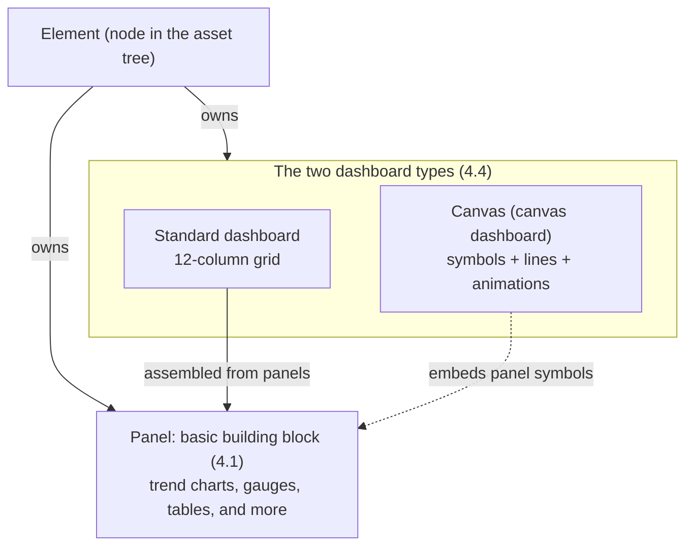

# 4 Visualization

Visualization in TDengine IDMP is designed around a single organizing principle: industrial users think in terms of assets, not signals. An operator monitoring a production line is thinking about Boiler 3, Cooling Loop A, or Compressor Station 7 — not about disconnected metric columns in a database. TDengine IDMP builds visualization around this reality.

## Core Concepts: Panels, Dashboards, and Canvas

TDengine IDMP visualization is built from three core concepts: **panels**, **dashboards**, and **canvas**. The panel is the basic building block of visualization; standard dashboards are assembled from panels; the canvas is the other dashboard type, and its drawing area can host panels through **panel symbols**.

**The panel is the basic building block of all visualization.** Every panel belongs to an element in the asset tree and draws its data from the attributes of that element and its descendant elements. Panels are data-driven chart components, including trend charts, bar charts, pie charts, gauges, stat values, tables, state timelines, maps, and more than a dozen chart types. See [4.2 Chart Types](./02-chart-types/index.md).

**Standard dashboards are assembled from panels.** A standard dashboard belongs to an element. It gathers panels from the current element and its child elements into a single view through a 12-column grid, giving operators and engineers an at-a-glance view of an asset or process. See [4.4 Dashboards](./04-dashboards.md).

**The canvas is the other dashboard type.** A canvas is a free-layout drawing area: process screens are assembled from symbols via drag-and-drop for SCADA-style equipment and process status monitoring; once a symbol is bound to an element attribute, live data automatically drives the symbol's state, animations, and display. A canvas can be built manually, generated by AI from a natural-language description, or replicated from a screenshot of an existing screen. See [Chapter 5](../05-canvas/index.md).

**Panels can be embedded in a canvas.** The symbol library of the canvas editor provides a "panel symbols" category: drag a saved panel of the current element (optionally including child elements) onto the canvas, and the panel renders live within the process screen; in view mode, clicking the panel symbol navigates to the panel detail view. A panel can therefore be assembled into a standard dashboard or embedded in a canvas as a panel symbol.

:::note
Canvas screens created by AI generation or screenshot replication do not contain chart panels; view trend data in the trend card that pops up when a symbol is double-clicked.
:::

**Standard dashboards and canvases are complementary: standard dashboards serve data analysis, while canvases serve status monitoring.**

| Scenario | Recommendation |
|---|---|
| Cross-metric, cross-machine trend comparison and aggregate statistics, with unified time range, zoom, legend toggling, and filter conditions | Standard dashboard |
| At-a-glance overview of equipment and process status following the plant layout — SCADA-style screens where running/stopped/alarm states switch automatically with data, driven by animations | Canvas |
| Viewing live charts of selected attributes within a process screen | Canvas + panel symbols |

**Panels and dashboards are both reusable as templates.** Any panel or dashboard can be converted into a template, bound to an element template, and applied in bulk to assets of the same type — new assets automatically receive their standard panels, and updating a template propagates the change across the entire fleet. See [4.7 Panel and Dashboard Templates](./07-panel-dashboard-templates.md).

The diagram below summarizes how these concepts relate:

## Built on the Best of Modern Visualization

TDengine IDMP's visualization layer draws heavily from modern generic tools like Grafana. The panel types, configuration experience, and dashboard layout are intentionally familiar: trend charts, bar charts, pie charts, gauges, stat panels, scatter charts, state timelines, tables, maps, and more — all with the rich visual configuration that engineers and analysts expect from a modern tool.

Panels are fully interactive. You can zoom in on a time range, toggle individual series on and off via the legend, switch between light and dark modes, download panels as images, and share them as time-limited links. Dashboards are assembled by drag-and-drop, with free-form panel arrangement and resizable panels. The visualization settings for each panel type follow Grafana conventions closely, making the system immediately approachable for teams that have used Grafana before.

This familiarity is deliberate. There is no reason to redesign what generic visualization tools have already done well. What TDengine IDMP adds is the industrial context layer on top of that foundation.

## Asset-Centric Visualization

The fundamental limitation of generic tools like Grafana in industrial environments is their signal-first design. In Grafana, every dashboard starts with an empty canvas — you manually select a data source, write a query, choose a visualization type, and configure the panel. For a single dashboard this is manageable. For hundreds of machines across dozens of sites, each with dozens of sensors, it becomes untenable. Teams end up rebuilding the same dashboards over and over, with inconsistencies accumulating across sites and teams.

TDengine IDMP inverts this model. Visualization is asset-centric: every element in the asset tree has its own panels and dashboards, and the data available to those panels is already organized around the element's attributes. When you navigate to an element, you are not starting from scratch — you are looking at a structured view of that specific asset, with its context already in place.

This has several practical consequences:

**Templates drive consistency at scale.** Panel templates and dashboard templates can be defined for an asset class (e.g., Pump, Meter, Wind Turbine) and applied across every element of that type. When a new asset is added, its standard panels are already defined. When a visualization standard changes, updating the template propagates the change across the entire fleet.

**Hierarchy enables multi-level views.** Because elements are organized in a tree — Enterprise → Site → Production Line → Machine → Sensor — visualization naturally follows the same structure. A plant-level dashboard aggregates across all machines on a line; a machine-level dashboard shows individual sensor trends. Users navigate the hierarchy to find the right level of detail for their current task, without maintaining separate dashboards for each level.

**Context is always present.** Every panel knows which element it belongs to, what the attribute's engineering unit is, what the defined limits are, and what the asset's position in the hierarchy is. This context flows automatically into trend coloring, limit markers, unit conversions, and AI-generated analysis — without any manual configuration per panel.

## Powerful Trend Analysis

TDengine IDMP's trend chart goes far beyond simple time-series plotting. It is the primary entry point for a full suite of advanced analytical capabilities — and so is the scatter chart, which supports correlation analysis across attributes.

**Time shift and overlay.** Any trend line can be shifted by a configurable time offset — hours, days, or custom durations — and overlaid on the current data. Comparing today's behavior against last week's, or against the equivalent period before the last maintenance cycle, requires no additional tooling.

**Batch comparison.** When events are defined for a process (e.g., batch start and end), the trend chart can overlay multiple batch occurrences on a normalized time axis. This immediately reveals how the current batch compares against historical ones — where it deviated, where it matched, and which batches define the best-known operating profile.

Beyond these, the trend chart, scatter chart, and Analysis Workbench serve as entry points to a broad set of advanced analytics: forecasting, anomaly detection, missing-data imputation, clustering, regression, correlation analysis, window analysis, and event/batch analysis. These capabilities are covered across Chapters 8 and 9: Chapter 8 focuses on real-time analysis and AI-driven capabilities, while Chapter 9 focuses on interactive process analytics performed directly in charts. The key design point is that these capabilities are not separate applications — they are launched directly from the chart, in context, against the data you are already looking at.

## AI-Powered Visualization

TDengine IDMP's AI engine is integrated directly into the visualization layer in three ways.

**AI-generated panels.** When you navigate to an element's Panels tab, the AI engine analyzes the element's attributes, their types, units, and limits, and suggests the most relevant panels for that asset. A wind turbine element gets suggested power curve scatter plots and rotor speed trend charts. An electricity meter gets current and voltage trend charts and a power consumption stat panel. You can accept a suggestion with one click, request more suggestions, or describe a panel in natural language and have the AI generate it directly.

**Panel Insights.** Any existing panel can be analyzed by the AI engine to produce a written interpretation of what the data shows. The insight report identifies trends, anomalies, threshold violations, and patterns visible in the current time range — translating chart data into language that engineers and managers can act on. This moves visualization from "showing you what happened" to "helping you decide what to do next."

**AI Chat with visual output.** From the AI Chat interface, users can ask questions about their industrial data in natural language. The AI can respond with generated panels, tables, or trend visualizations directly embedded in the chat response, drawing on the full asset context of the underlying data model.

Together, these capabilities reflect a core design philosophy: the goal of industrial visualization is not to display data — it is to generate understanding. Generic dashboards accumulate; TDengine IDMP panels are curated, contextualized, and continuously enriched by the intelligence layer above them.

import DocCardList from '@theme/DocCardList';

<DocCardList />
