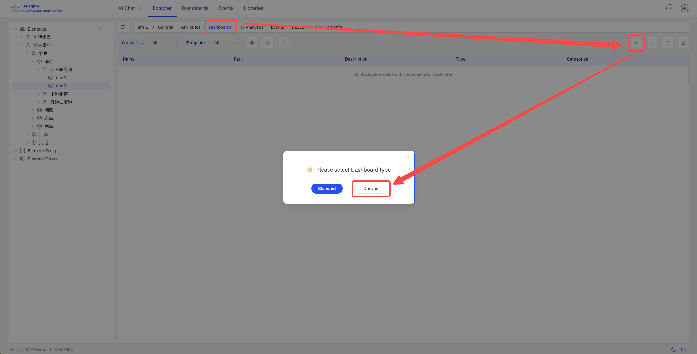
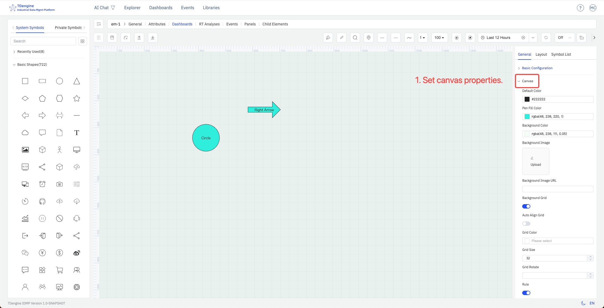
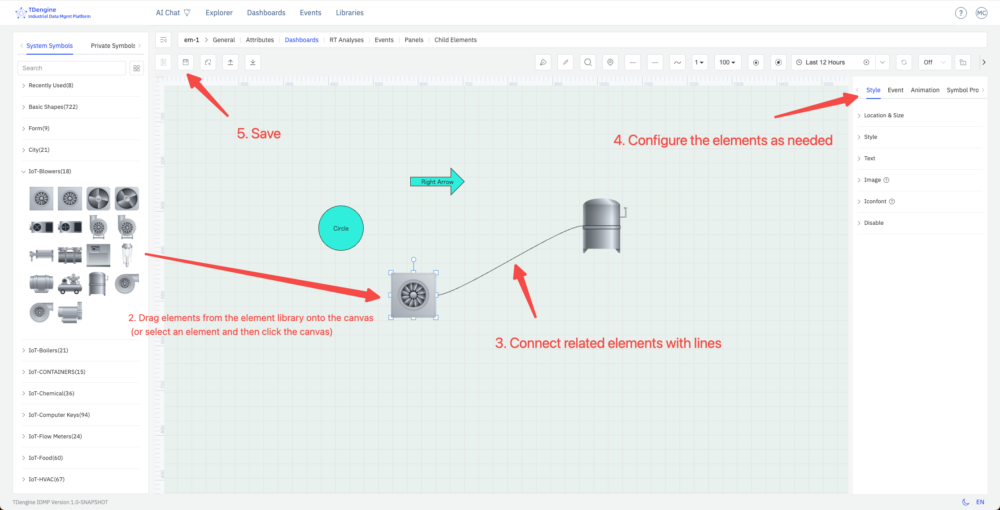

# 5.1 Creating a Canvas

Select the element, switch to the **Dashboards** tab, click **+ (New Dashboard)** in the toolbar, and choose **Canvas** in the dialog that appears to enter the canvas editing interface.

Designing the canvas involves the following steps:

1. Set the properties of the canvas, including layout, color, background color, grid, etc.
   
2. Select symbols from the symbol library and drag them onto the canvas.
3. Edit and configure symbols, including:
   - Configure text, color, background color, etc. for symbols
   - Configure [events](./08-function-points/06-events.md) for symbols, setting event types (such as click, symbol value change), event actions (such as setting symbol properties, playing animations), and trigger conditions (such as threshold judgments) to enable data-driven display effects of symbols
   - Add [animation effects](./08-function-points/05-animation.md) to symbols. The system has built-in animations such as up and down jumping, left and right jumping, heartbeat, rotation, etc., and custom animations are supported.
   - Configure symbol [values](./08-function-points/03-property-values.md), including value, progress, progress color, state, etc., and bind them to IDMP element properties so that collected data can drive the display of symbols in real time.

4. Connect related symbols with lines, and configure line types and line animations.
5. During the editing process, you can preview, and after editing, save it.

These steps do not need to be performed in a fixed order and can be rearranged.

:::tip
Instead of assembling a screen by hand, AI can [generate a canvas](./09-ai-generate.md) from a natural language description, or [replicate](./10-ai-replicate.md) an existing canvas screen or a screenshot of another platform's dashboard into an editable canvas.
:::
