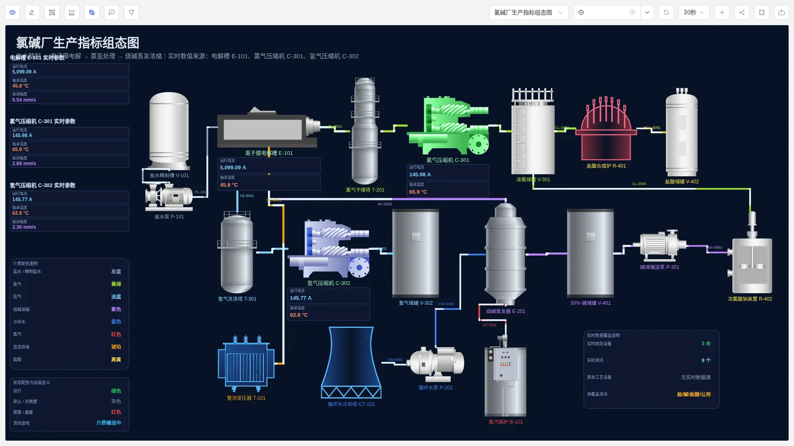
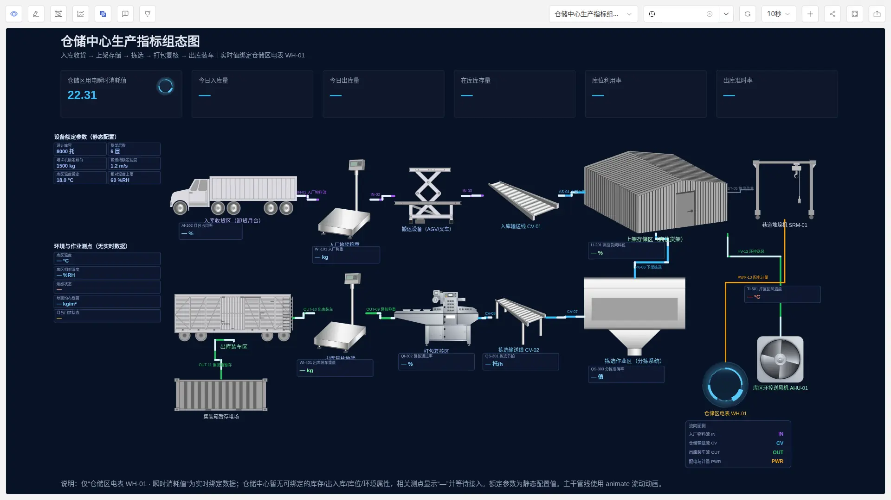

# 5.9 AI-Generated Canvas

TDengine IDMP can build a canvas from a natural language description in the AI Assistant. The result is an editable canvas skeleton with equipment symbols, pipe connections, and data bindings, which can be opened directly or fine-tuned in the 2D canvas editor.

The feature is designed to generate a skeleton rather than a finished screen: the AI interprets the request, selects symbols, and plans the bindings, while symbol geometry and canvas data are produced by a deterministic compilation step. Every generated canvas therefore opens as a fully editable canvas in the existing editor.

## 5.9.1 Prerequisites

Confirm the following conditions before generating a canvas:

- An [AI connection](../08-ai-powered-insights/01-connecting-to-llm.md) is configured and the AI service is available.
- The element that provides the data is selected in the Explorer, or its exact name and ID are given in the request.
- The attributes to bind are already defined on the target element. Bound attribute names always come from the element context; the AI never guesses them.
- The current user is allowed to create dashboards for that element.
- The AI Assistant is only available in the right-hand workspace of the Explorer. Full-screen panel, element, and dashboard editors hide the AI Assistant, so start the request from the Explorer.

## 5.9.2 Procedure

AI generation runs in the AI Assistant and consists of three stages: describe the requirement, review the layout plan, and confirm the creation.

1. Select the target element in the Explorer and open the [AI Assistant](../08-ai-powered-insights/06-natural-language-queries.md) on the right.
2. Describe the monitoring requirement in plain language, including the monitoring theme and the metrics to bind. For example:

   ```text
   Create a fairly complex "chlor-alkali plant production canvas" bound to the real data of my child elements, with animations and colors.
   ```

3. When the request is sent, the AI reads the element tree, attribute list, and child templates, maps business meaning to attributes, and searches the approved symbol library. If information is missing, the AI applies defaults from the selected industry pattern and asks at most one question.
4. The AI returns a layout plan summary in the conversation: the region structure, the equipment and symbol list, the binding list (attribute to symbol or KPI card), and the expected unbound items.
5. Review the summary. To change regions, equipment, or bound metrics, state the change before confirming. Adjustments only rewrite the layout plan and never write any resource.
6. Click **Execute** on the confirmation card. Canvas creation always requires confirmation; this confirmation is enforced by the system and is not affected by the **Confirm before execution** switch in **Personal Settings**.
7. After creation, the AI reports the dashboard name, the symbol count, the bound-slot count, the list of unbound items, and a reminder to fine-tune the canvas in the 2D editor.

When the layout plan fails validation, the AI fixes the reported problems and resubmits once. If the create request already reached the backend but the outcome is unknown or the write failed, the system does not retry automatically; verify whether a dashboard was created before starting again. When the name conflicts with an existing dashboard, the creation is rejected; use a different name and submit the request again.

## 5.9.3 Structure of the Generated Canvas

The generated canvas is stored as one canvas dashboard, so all content lives in a single canvas organized by region. Typical regions are listed below.

| Region | Content |
|---|---|
| Title region | Canvas title and subtitle, fixed at the top |
| Process region | Equipment symbols and connecting pipes arranged along the process flow, with pipe ends attached to symbol edges |
| KPI region | Key indicator cards showing live values and units |
| Notes and legend region | Text notes such as medium colors and state color definitions |
| Tag list region | Tag and analyzer tables for dense P&ID screens |

The following canvas was generated from a prompt for a chlor-alkali plant. The left side holds indicators and legends, and the center shows equipment and pipe topology:



The next canvas was generated from a prompt for a warehouse center. Only the meter reading is bound to live data; other measurements show placeholders:



## 5.9.4 Data Bindings and Unbound Items

Generation follows an explore-then-bind rule: every bound attribute name comes from the element context and matches the exact attribute casing.

- **Direct binding:** the value text of a symbol is bound to the live attribute value and refreshes as data is collected.
- **Placeholder fallback:** when no attribute matches the business meaning, the symbol keeps a placeholder (shown as "—") and the rest of the canvas is still generated.
- **Unbound list:** the result lists every slot that was left unbound, so data onboarding or manual binding can follow.
- **Binding coverage:** bound slots as a share of total slots indicates generation quality. The acceptance target for the sample scenarios is a bound-slot rate of at least 70%; this figure is a reference target for acceptance and does not gate generation.
- **Trends:** double-click a bound symbol to open a trend card. The time range follows the current canvas range, so no separate trend region is needed.

## 5.9.5 Viewing and Editing the Result

The generated dashboard appears in the **Dashboards** tab of the selected element and behaves like any manually created dashboard:

1. Switch to the **Dashboards** tab in the Explorer and locate the AI-generated dashboard.
2. Click **View** to open the canvas, or click **Edit** to open the 2D canvas editor.
3. Adjust symbol position, size, style, animation, connections, and bindings in the editor. The generated content carries the full set of editable fields, so saving behaves exactly like a manual canvas.
4. To share or reuse it, follow the standard dashboard operations. Canvas dashboards are not converted into dashboard templates.

## 5.9.6 Limitations

Keep the following limitations in mind:

- Generation quality depends on the reasoning capability of the configured model and on how completely the element attributes are modeled.
- Complex process screens with many devices and dense piping take longer to generate; keep the conversation open while it runs.
- Generation only creates a new dashboard. It never modifies, overwrites, or deletes existing resources.
- Canvas dashboards do not embed chart panels; trends are provided by the double-click trend card on bound symbols.
- The current version does not support conversational editing of a generated canvas. Adjust layout and bindings in the 2D canvas editor.
- Plan for manual fine-tuning instead of expecting a single generation to be the final deliverable.
