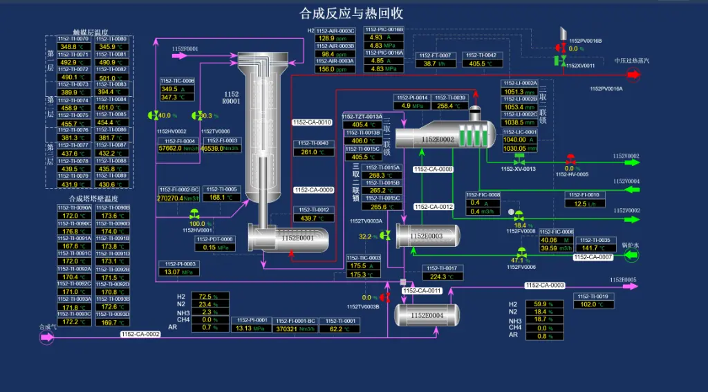
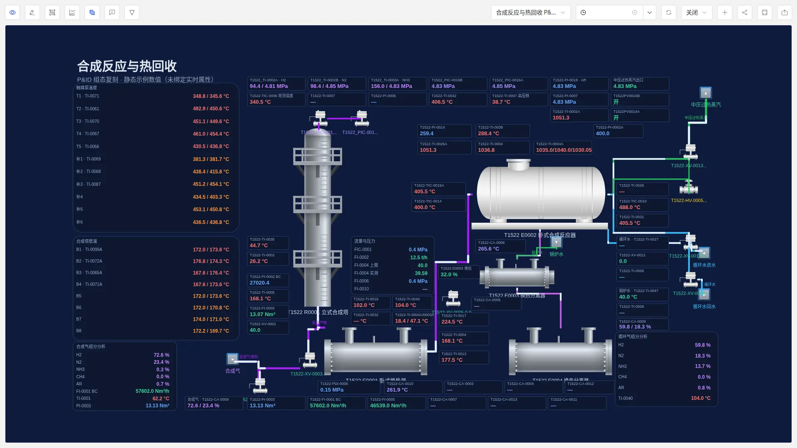
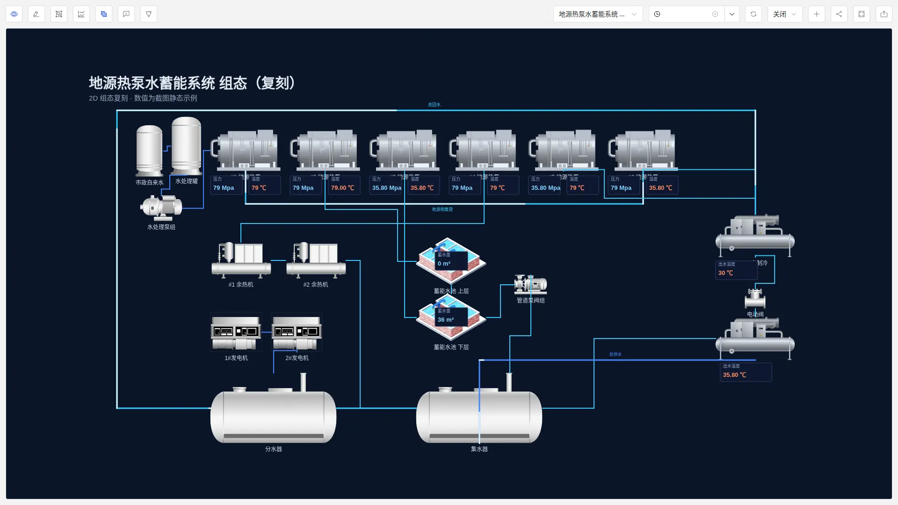
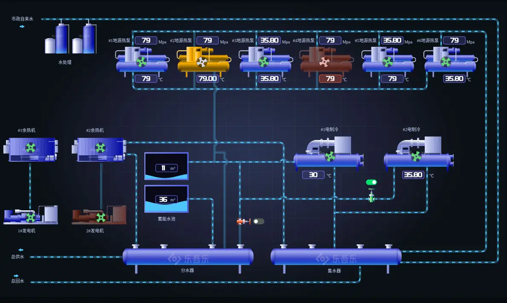

# 5.10 Replicating a Canvas Screen

Replication builds a canvas from a screenshot of an existing canvas or process diagram. The AI recognizes the equipment, pipe topology, and tag labels in the image and rebuilds them as an editable canvas. Use it to move screens that only exist as images into IDMP: dashboards exported from other platforms, screenshots of printed drawings, or archived legacy canvases.

The result is a canvas skeleton with the same structure as the source image. Equipment layout, pipe connections, and on-screen labels are recreated as native symbols and connectors, which can then be adjusted and bound to real data in the 2D canvas editor.

Replication reuses the same capability as [AI-generated canvas](./09-ai-generate.md): there is no separate replication button. Attach the image and state the replication intent in the prompt to trigger it.

## 5.10.1 Prerequisites

Confirm the following conditions before replicating a canvas screen:

- An [AI connection](../08-ai-powered-insights/01-connecting-to-llm.md) is configured and the AI service is available.
- If image interpretation is required, set an image-capable connection as the [default vision model](../08-ai-powered-insights/01-connecting-to-llm.md) in connection management. When the main model already accepts image input, the default vision model can be omitted and the main model reads the image directly.
- The screenshot is a PNG, JPEG, WebP, or GIF file of at most 4 MB, and at most four images are attached per request.
- The element that should own the canvas is selected in the Explorer and the AI Assistant is expanded. Full-screen panel, element, and dashboard editors hide the AI Assistant.

## 5.10.2 Procedure

Replication uses the image attachment capability of the AI Assistant:

1. Select the target element in the Explorer and open the [AI Assistant](../08-ai-powered-insights/06-natural-language-queries.md) on the right.
2. Click **+** at the bottom left of the input box, choose **Add image**, and pick the canvas screenshot in the file selector. Attached images appear as thumbnails above the input box and can be removed one by one.
3. State the replication intent in the input box, for example:

   ```text
   Please replicate this canvas screen.
   ```

4. After sending, the AI recognizes the equipment, pipe routing, and tag labels in the image, then plans the equipment list, connection topology, and labels.
5. The AI returns a layout plan summary in the conversation: the equipment and symbol count, pipe connections, on-screen labels, and expected follow-up items.
6. Review the summary. To change the equipment list or arrangement, state the change before confirming.
7. Click **Execute** on the confirmation card. Replication also always requires confirmation and is not affected by the **Confirm before execution** switch in **Personal Settings**.
8. After creation, the AI reports the dashboard name and symbol statistics, and reminds you to continue adjusting and binding in the 2D editor.

The following screenshot of an external canvas is used as the replication input:



The replicated canvas rebuilds the equipment layout, pipe topology, and tag labels of the source image:



## 5.10.3 What Is Recreated

Replication targets a structurally faithful, still-editable canvas and focuses on the following aspects:

- Equipment symbol positions and relative layout, arranged in the regions and order of the source image.
- Pipe connections and routing, with pipe ends attached to the visible edges of equipment.
- Tag identifiers, labels, and units shown in the image, preserved as recognized.
- Medium colors and flow-direction animations, approximated from the visual style of the image.

Replication is not pixel-exact: font details, decorative elements, and proportions can differ from the source, and explanatory text outside the drawing is not rebuilt as a separate region.

## 5.10.4 About Data Bindings

Replication rebuilds the screen structure only. The current version does not create live data bindings for replicated canvases:

- Values in the canvas are static examples that reproduce the visual form of the source image and are not real measurements.
- When the system has no matching tags or element attributes, the AI does not guess attribute names and does not create invalid bindings.
- After replication, bind symbols to element attributes in the 2D canvas editor. Once bound, values refresh with the collected data.

The following replicated canvas comes from a large-screen screenshot of another platform and shows static example values:



Its source image is shown below:



## 5.10.5 Improving Replication Quality

Result quality depends directly on how readable the input image is. Prepare screenshots as follows:

- Use the original resolution and avoid resizing or recompressing the image.
- Keep the full process topology; do not crop equipment, pipe ends, or tag labels.
- Keep tag text legible. Small tags are easily misread. When a default vision model is configured, the system splits the first PNG or JPEG screenshot into overlapping high-resolution tiles before parsing, which improves small-text recognition; WebP and GIF images, and any further attached images, are not tiled.
- Replicate one screen at a time. Complex screens with dense equipment and piping take longer to generate, so replicate them region by region and join the results in the editor.
- Mention the focus in the prompt, such as the main equipment list or the primary process path, so the AI prioritizes the key structures.

## 5.10.6 Constraints and Limitations

The following constraints apply to canvas replication.

| Item | Constraint or description |
|---|---|
| Input format | PNG, JPEG, WebP, or GIF, at most 4 MB per image |
| Input count | At most four images per request; replication handles one screen at a time |
| Recognition accuracy | Depends on image clarity and topology completeness; blurry or heavily occluded screens limit accuracy |
| Data binding | Replicated canvases contain no live bindings; values are static examples |
| Generation time | Complex screens with many devices and dense piping take longer |
| Write behavior | Each replication creates a new canvas dashboard and never modifies existing resources |
| Text preservation | Only visible tag identifiers and units are kept; occluded or illegible content is not inferred |

A replicated canvas is identical to a manually created canvas and can be viewed, edited, shared, or deleted from the element **Dashboards** tab.
