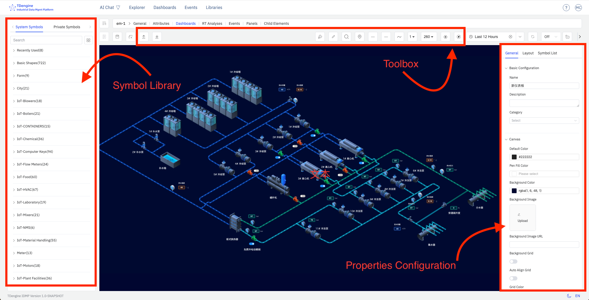

# 5 Canvas

The canvas is a visualization type in IDMP that stands alongside the standard dashboard: a standard dashboard combines analytical panels in a grid layout, while a canvas is a free drawing area where process screens are assembled from symbols through drag-and-drop. It allows business personnel to achieve Web-based SCADA and configuration solutions with "zero code," visually presenting the current operating status of devices and processes. Currently, it supports 2D and 2.5D, with plans to support 3D in the future. It seamlessly integrates with IDMP's asset model, enabling rapid solution delivery and reducing development costs. It has the following features:

1. **Intuitive and easy-to-use drag-and-drop editing**: No technical background required, easily create monitoring screens like building blocks
2. **Intelligent data-driven**: Configure once to automatically update the screen with real-time data, reducing repetitive operations
3. **Rich animation effects**: Built-in multiple animations, support customization, making the monitoring screen vivid and intuitive
4. **Flexible state management**: Automatically switch device states such as running/stopped/alarm based on data changes
5. **Expandable symbol library**: Built-in system symbols, support for uploading custom graphics (JS, SVG, images, etc.), and the ability to embed existing panels into the screen, meeting special needs
6. **Powerful performance**: A single screen can support tens of thousands of symbols, meeting the needs of large industrial scenarios

Below is a typical canvas editing interface:

The entire editing screen consists of several major parts:

1. **Canvas**: The canvas is the central drawing area where symbols are dragged and dropped for editing and drawing. The canvas has various properties, such as background color, grid, ruler, etc., all of which can be personalized.
2. **Symbols**: These are the basic units of the canvas, the fundamental elements of graphical expression. Various devices and components on the diagram are symbols. Symbols have various properties, such as color, background color, size, displayed text, progress, value, state, etc.
3. **Toolbar**: Located at the top of the editor, it provides drawing tools such as pen, pencil, magnifier, and eagle eye map (thumbnail), style tools such as format painter, line start arrow, line end arrow, line width, and view scale, as well as default configuration and operations such as import/export and save.
4. **Symbol library**: Located on the left of the editor, it provides three categories of assets — system symbols, private symbols, and panel symbols — and allows users to upload their own drawn graphics.
5. **Configuration**: Configure the canvas and each symbol on the canvas, such as color, background color, font, events, animations, etc., to modify their display and interactive behavior.

This document only provides a brief introduction to the basic concepts and basic operations. More details need to be discovered through extensive use.

Besides building screens by hand, AI can generate a canvas from a natural language description, or replicate an existing canvas screen or a screenshot of another platform's dashboard into an editable canvas. See [5.9 AI-Generated Canvas](./09-ai-generate.md) and [5.10 Replicating a Canvas Screen](./10-ai-replicate.md).

import DocCardList from '@theme/DocCardList';

<DocCardList />
