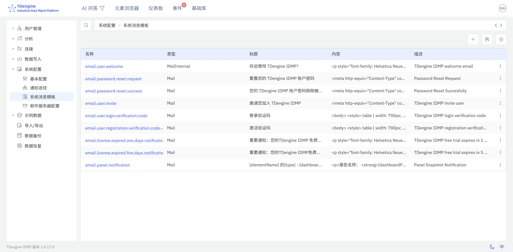
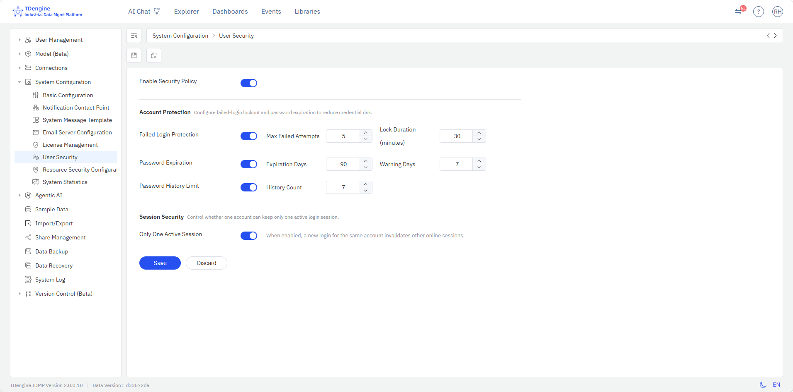
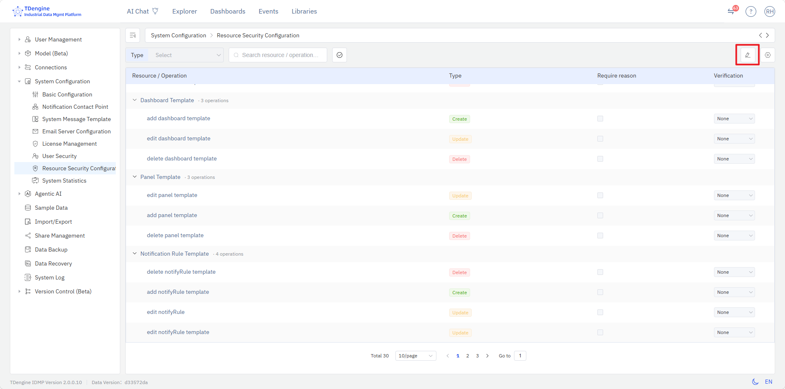
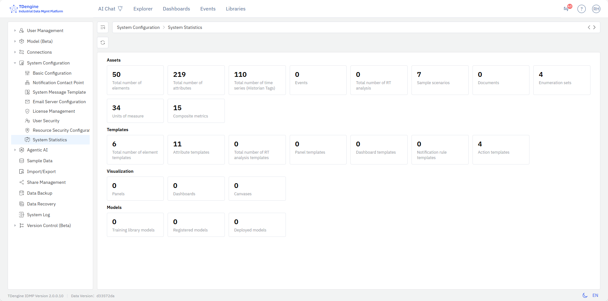

# 14.5 System Configuration

System Configuration is accessed from **Admin Console → System Configuration**. It has eight sections: Basic Configuration, Notification Channel, System Message Template, Email Server Configuration, License Management, User Security Configuration, Resource Security Configuration, and System Statistics. For License Management, please refer to [Chapter 14.12](./30-activate.md).

## 14.5.1 Basic Configuration

Basic Configuration contains system-level global settings:

| Setting  | Description        |
| --- | --- |
| **Language**   | Default display language for the interface    |
| **Enable User Behavior Collection** | Whether to collect anonymized usage data for product improvement   |
| **Upload Crash Reports**   | Whether to automatically upload crash reports                           |
| **Auto Refresh Elements Explorer**  | Whether the asset explorer automatically refreshes when elements change |
| **System Log**  | Whether to enable generation of tamper-proof system operation logs and support filtering, querying, and exporting |
| **Quality Analysis Menu** | Whether to enable a standalone Quality Analysis menu |
| **Public Access URL** | The public access URL for the current system |
| **Week Start** | Whether the first day of the week is Sunday or Monday |
| **Element Sort Rule** | The global default element sort rule: System Default, Element Name, or Creation Time |
| **System Color** | Configuration of the default system color |
| **Quality Bit Config** | Global mapping from quality codes to quality categories (Good/Questionable/Bad); see details below |

### Element Sort Rule Specification

Element sort rule defines the default ordering used by the element tree and the child-element list when no explicit sort is specified. Available options:

| Option | Sort basis |
| --- | --- |
| **System Default** | Sort by the element's `element_order` field. This field is generated automatically when an element is created and is adjusted dynamically when users **move up**, **move down**, or **pin to top** an element. Therefore, "System Default" is essentially "creation order plus user-defined ordering" — new elements are ordered by creation, and users can manually adjust their relative positions on top of that. |
| **Element Name** | Sort by element name in ascending lexicographic order. |
| **Creation Time** | Sort by element creation time (newest first). |

:::info
This setting only serves as the **global default**. In the element tree, users can override it for a specific node via the **sort** button next to the element node; in the child-element list, they can also specify a sort order via the column header.
:::

Click the edit (pencil) icon to modify these settings.

### Quality Bit Config Specification

The Quality Bit Config defines the global mapping from quality codes to quality categories: using **range rules** (start code - end code → category), it classifies the integer quality codes carried by data into three quality categories — **Good**, **Questionable**, and **Bad** — and specifies a default category for codes that match no rule. Once an element attribute is bound to quality data, the system automatically reads this configuration to evaluate data quality: panels such as trend, bar, scatter, pie, table, stat, and gauge, as well as the attribute list, render data points by quality category, helping users quickly identify untrustworthy data.

Quality codes come from the quality column configured in an attribute's data reference, in the format `connection/database/table/column:quality_column`. The quality column must be of type `INT`. Data ingested via OPC UA or CSV import can also carry quality bits. See [Attributes](../03-data-modeling/02-attributes.md).

**Viewing the Configuration**

The Quality Bit Config item is displayed in read-only mode by default, showing a summary of the ranges (for example, `1 good / 1 questionable / 1 bad ranges`), the unmatched default category, and each range's name, category, and range.

Click the edit (pencil) icon to enter edit mode. This requires permission to manage system configuration.

**Editing the Configuration**

Each range rule contains the following fields:

| Field | Description |
| --- | --- |
| **Name** | Optional display name of the range or quality code (e.g., `I/O Timeout`), up to 100 characters. When a name is configured, panels and tooltips display the quality by name; otherwise the raw code is shown |
| **Category** | The quality category assigned to quality codes within the range: `Good`, `Questionable`, or `Bad` |
| **Range** | A closed interval from the start code to the end code, both non-negative integers. A single code can be expressed as `246 - 246` |

Actions at the top of the editor:

| Action | Description |
| --- | --- |
| **Unmatched default category** | The category applied to quality codes that fall outside all ranges. Defaults to `Bad` |
| **Add Range** (+ icon) | Appends a row to the table, defaulting to range `0 - 0` and category `Bad` |
| **Restore Defaults** (restore icon) | Resets the editor content to the built-in default configuration. You still need to click save for it to take effect |
| **Delete** (trash icon in each row) | Deletes the corresponding range row |

**Validation Rules**

The following rules are validated on save. Violations highlight the offending rows in red and show a message below the table, and saving is blocked:

- The start code must not be greater than the end code
- Ranges must not overlap. To express "a large range with a few exceptional codes", split it into multiple ranges

**Default Configuration**

| Range | Category |
| --- | --- |
| 0 - 0 | Good |
| 1 - 1 | Questionable |
| 2 - 2 | Bad |

The unmatched default category is `Bad`, meaning any unconfigured quality code is treated as bad quality. If your site uses the native quality code system of PI, OPC, or a similar system (for example, `246` for I/O Timeout or `308` for Doubtful), you can add those codes as named range rules as needed.

If the System Log is enabled, a confirmation dialog appears when you click save, where you can enter an operation reason. After the save succeeds, the change is recorded in the system log.

**Display Effects**

The configuration takes effect for all online users immediately after saving. Open panels and the attribute list re-render automatically within seconds according to the new configuration — no page refresh needed.

| Quality Category | Chart Panels (Trend/Bar/Scatter/Pie) | Stat/Gauge | Table and Attribute List |
| --- | --- | --- | --- |
| Good | Drawn normally in the original series color | No marker | No marker |
| Questionable | Marked in orange but still drawn | Orange `!` appended to the value | Orange `!` next to the value |
| Bad | Greyed out | Red `*` appended to the value | Red `*` next to the value |

Additional notes:

- Chart panels hide bad-quality data points by default. Click the **Show Abnormal Points** button to display them greyed out. Questionable points are always shown.
- The quality column in table panels and the attribute history dialog displays `code name` (for example, `308 Doubtful`); if no name is configured, only the code is shown.
- Hovering over the quality marker next to the latest value in the attribute list shows a tooltip with `Quality: code name`.

**Permissions**

The Quality Bit Config is readable by all logged-in users for quality rendering in panels and the attribute list; only administrators can modify it.

## 14.5.2 Notification Channel

A **Notification Channel** defines a destination that IDMP sends notifications to. Multiple contact points can be configured. The first user to activate the system has their email address automatically added as a contact point.

To create a contact point, click **+** and fill in:

| Field                 | Description                                                               |
| --------------------- | ------------------------------------------------------------------------- |
| **Name**        | A unique name for this contact point                                      |
| **Notify Type** | The delivery channel:`Email`, `Feishu`, `WeCom`, `DingTalk`, `Slack`, `Microsoft Teams`, or `Webhook` |
| **Address**     | The target address — email address, Feishu webhook URL, or HTTP endpoint |
| **Description** | Optional description                                                      |

Because Webhook is supported, virtually any notification destination can be configured — including Teams, DingTalk, PagerDuty, and other systems that accept HTTP callbacks.

## 14.5.3 System Message Template

System Message Templates define the content of system-generated messages for events such as user invitations, password resets, and alert notifications.

IDMP ships with built-in templates for common notification scenarios. Click a template name to view or edit its content. Templates support variable substitution to include dynamic values such as usernames, URLs, and event details.



## 14.5.4 Email Server Configuration

Email Server Configuration defines the SMTP server that IDMP uses to send **event alert email** and **panel scheduled notifications**. Click the edit (pencil) icon to update the settings.

:::note
Transactional email — system activation (verification code), user invitations, password resets, and license-expiration notifications — is
delivered by the TDengine-hosted shared mail service (Capability Gateway). It does not use the settings on
this page, and no SMTP parameters need to be set in `application.yml`.
These settings affect **only** event alert email and panel scheduled notifications: while unset, those two
kinds of notification cannot be delivered, and the UI marks email-type contact points as unavailable under
"Notification Channel".
:::

Two authentication types are supported: **Password** (username/password basic authentication) and **OAuth2 Application Identity** (XOAUTH2 application-identity authentication, for mail services that have disabled basic authentication, such as Microsoft 365 and Gmail). After selecting OAuth2, fill in the credentials for the chosen provider; IDMP acquires and refreshes the access token automatically (valid for about 60 minutes), with no redirects and no user interaction.

| Field                           | Description                                                                |
| ------------------------------- | -------------------------------------------------------------------------- |
| **Host**                  | SMTP server hostname or IP address (`smtp.office365.com` for Microsoft 365) |
| **Port**                  | SMTP server port (e.g., 465 for TLS, 587 for STARTTLS, 25 for unencrypted) |
| **Auth Type**             | SMTP authentication type: `Password` (username/password basic authentication) or `OAuth2 Application Identity` (XOAUTH2) |
| **Username**              | SMTP authentication username (shown when Auth Type is Password with authentication enabled) |
| **Password**              | SMTP authentication password (same as above)                               |
| **Sender**                | The "From" email address used in outgoing messages; in OAuth2 mode it must be a mailbox authorized to send (Microsoft 365 requires it to match the authenticated identity) |
| **Encryption Mode**       | `TLS`, `STARTTLS`, or `None` (`STARTTLS` for Microsoft 365)                 |
| **Enable Authentication** | Whether SMTP authentication is required (shown for Password mode only; always on for OAuth2) |

After selecting OAuth2 Application Identity, the password fields are hidden and the following fields appear (conditionally, by provider):

| Field                           | Description                                                                |
| ------------------------------- | -------------------------------------------------------------------------- |
| **Provider**             | `Microsoft 365` (default), `Gmail Service Account`, `Gmail Refresh Token`  |
| **Client ID**            | The "Application (client) ID" of the app registration                      |
| **Client Secret**        | The "Value" of the app registration's client secret; displayed as the mask `********` after saving — keep it unchanged if you do not want to modify it |
| **Tenant ID**            | Required for Microsoft 365: the "Directory (tenant) ID" of the app registration (a GUID) |
| **Service account key JSON** | Required for Gmail Service Account: the full key JSON containing `client_email` and `private_key`; displayed masked |
| **Refresh token**        | Required for Gmail Refresh Token: the refresh token obtained via one-time authorization; displayed masked |
| **Token Endpoint** / **Scope** | Advanced overrides; leave empty to use the provider default — only needed for special scenarios such as sovereign clouds |

For the prerequisite configuration steps in the Azure portal for Microsoft 365, see 14.5.4.2, and for Gmail see 14.5.4.3; for injecting the configuration at deployment time via `application.yml` / environment variables, see 14.5.4.4.

IDMP delivers email over two separate paths:

| Email type                                                          | Delivery path                                          | Needs these settings |
| ------------------------------------------------------------------- | ------------------------------------------------------ | -------------------- |
| System activation (verification code), user invitations, password resets, license-expiration notifications | TDengine shared mail service (Capability Gateway)      | No                   |
| Event alert email, panel scheduled notifications                    | The SMTP server configured on this page                | **Yes**              |

### 14.5.4.1 Using MailHog for Air-Gapped Environments

If the IDMP server cannot reach the internet, you can deploy [MailHog](https://github.com/mailhog/MailHog) internally as a lightweight SMTP relay for development and testing:

```bash
docker run -d -p 1025:1025 -p 8025:8025 --name mailhog mailhog/mailhog:v1.0.1
```

After starting MailHog, configure Email Configuration with:

| Field                              | Value Description                                                       |
| ---------------------------------- | ----------------------------------------------------------------------- |
| Host                               | Host machine IP (or service name if in the same Docker Compose network) |
| Port                               | `1025`                                                                |
| Username / Password                | Any value (MailHog disables authentication by default)                  |
| Encryption Mode / Enable Authentication | `None` / Disabled                                                       |
| Sender                             | Any valid email format (e.g.,`support@example.com`)                   |

Access the MailHog web interface at `http://<server-ip>:8025` to view captured emails.

### 14.5.4.2 Sending via Microsoft 365 (OAuth2 Application Identity)

Microsoft has **permanently disabled basic authentication** for client submission SMTP (`smtp.office365.com`): no matter how "Authenticated SMTP" is enabled for the mailbox or tenant, username+password submission always returns `535 5.7.3 Authentication unsuccessful`. Connecting to Microsoft 365 therefore requires **OAuth2 Application Identity**: IDMP acquires and refreshes the access token automatically via the client credentials flow (valid for about 60 minutes) and authenticates the SMTP session with the XOAUTH2 mechanism — it needs neither the sender mailbox's password nor any interactive MFA code.

:::note
Outbound SMTP OAuth and **user sign-in single sign-on (SSO) are separate concerns**: configuring user SSO for IDMP does not configure outbound email. All steps in this section target application-identity authentication for outbound mail.
:::

Configuration happens in three phases: first complete the app registration and authorization in the **Azure portal (Microsoft Entra ID)** (Steps 1–4, requiring a tenant administrator), then register the service principal and grant mailbox permissions in **Exchange Online** (Steps 5–6), and finally fill in the credentials in the IDMP Email Server Configuration page.

#### Step 1: Register an application (Entra ID portal)

1. Open [entra.microsoft.com](https://entra.microsoft.com) (or Azure portal → Microsoft Entra ID).
2. Go to **Identity → Applications → App registrations → + New registration**.
3. Fill in:
   - **Name**: e.g. `IDMP Mail Sender` (display only);
   - **Supported account types**: choose **Accounts in this organizational directory only (single tenant)** — IDMP uses single-tenant client credentials; do not choose multi-tenant or personal accounts;
   - **Redirect URI**: leave empty (not needed for client credentials).
4. Click **Register**. On the overview page, immediately copy these two values (they go into the IDMP form):

| Value in the Azure portal         | IDMP form field                                      |
| ---------------------------------- | ---------------------------------------------------- |
| Application (client) ID            | Client ID                                            |
| Directory (tenant) ID              | Tenant ID (a GUID, not the `xxx.onmicrosoft.com` domain) |

#### Step 2: Create a client secret

1. On the app page, go to **Certificates & secrets → Client secrets** tab → **+ New client secret**.
2. Choose any description (e.g. `idmp-smtp`) and an expiry per your policy (24 months maximum; some tenants cap it at 6/12 months).
3. After clicking **Add**, **immediately copy the "Value" column (a long secret string) — it can never be retrieved again once you leave the page**. The "Secret ID" is not the secret; do not copy the wrong one.

This value goes into the IDMP form field **Client Secret**. It must be rotated before expiry — set a calendar reminder and record the expiry and replacement process. After expiry, sending fails with `AADSTS7000215`, which IDMP surfaces in the error message. Never let the client secret appear in documents, screenshots, or troubleshooting logs.

#### Step 3: Add the SMTP.SendAsApp application permission

1. Go to **API permissions → + Add a permission** → switch to the **"APIs my organization uses"** tab (**critical: not Microsoft Graph in the Microsoft APIs list**).
2. Search for **Office 365 Exchange Online** → open it → choose **Application permissions** (not Delegated).
3. Expand **SMTP**, check **SMTP.SendAsApp** — note the exact permission name is `SMTP.SendAsApp`, not `SMTP.SendAs` → click **Add permission**.

:::note
If Office 365 Exchange Online cannot be found, the tenant has no Exchange Online subscription — confirm the subscription first and come back.
:::

#### Step 4: Grant admin consent

1. Back on the **API permissions** page, the SMTP.SendAsApp status column shows "Not granted for …".
2. Click **"Grant admin consent for \{organization\}"** at the top → **Yes**.
3. The status turns green "Granted for \{organization\}" — done.

:::warning
This step cannot be skipped — an application permission without admin consent is as good as not granted.
:::

#### Step 5: Register the service principal in Exchange Online and grant mailbox permissions

**This is the most easily missed step**: granting the permission in Entra ID alone is not enough — if no matching service principal is registered for the app in Exchange Online, authentication fails even when the API permission and admin consent are all correct. This step is done in PowerShell by an Exchange Online administrator.

First confirm that the sender mailbox is a real Exchange Online user mailbox (visible under Exchange admin center → Recipients → Mailboxes; a Teams sign-in address alone is not evidence of a mailbox entitlement). Then connect to Exchange Online PowerShell from a local machine (Cloud Shell may report no valid Azure subscription; connecting requires an administrator account with MFA):

```powershell
Install-Module ExchangeOnlineManagement -Scope CurrentUser -Repository PSGallery
Import-Module ExchangeOnlineManagement
Connect-ExchangeOnline -UserPrincipalName <admin-upn>
```

Next, obtain the **Object ID from the "Enterprise applications" page** (Entra ID → Identity → Applications → Enterprise applications → select the app → Overview → Object ID):

:::warning
Use the Object ID from the **Enterprise applications** page — **not** the Object ID on the App registrations page. They are different; using the wrong one fails the registration.
:::

Register the service principal and grant permissions on the sender mailbox (`FullAccess` + `SendAs`):

```powershell
# Application client ID (Step 1) and enterprise application Object ID
$AppId = "<application-client-id>"
$AppObjectId = "<enterprise-application-object-id>"
$Sender = "<sender-mailbox>"

# Check first; run New-ServicePrincipal only if no match exists
Get-ServicePrincipal | Where-Object { $_.AppId -eq $AppId }

New-ServicePrincipal -AppId $AppId -ObjectId $AppObjectId `
  -DisplayName "IDMP Mail Sender"

$Sp = Get-ServicePrincipal | Where-Object { $_.AppId -eq $AppId }

# Grant permissions on the sender mailbox (FullAccess + SendAs)
Add-MailboxPermission -Identity $Sender `
  -User $Sp.Identity -AccessRights FullAccess -AutoMapping:$false

Add-RecipientPermission -Identity $Sender `
  -Trustee $Sp.Identity -AccessRights SendAs

# Verify: AccessRights should include FullAccess with Deny = False
Get-MailboxPermission -Identity $Sender -User $Sp.Identity |
  Format-List User,AccessRights,Deny
```

Stop and resolve any error before continuing; the SendAs grant shows a confirmation prompt — accept it.

#### Step 6: Verify the mailbox SMTP authentication switch

When SMTP authentication is disabled by policy on the mailbox side, the result is still 535 even with all permissions correct:

- **Microsoft 365 admin center**: Users → Active users → select the sender mailbox → Mail → Manage email apps, confirm **Authenticated SMTP** is checked;
- or query and explicitly enable it via PowerShell (mailbox-level settings override the organization-level default):

```powershell
# True = disabled
Get-CASMailbox -Identity "<sender-mailbox>" | fl SmtpClientAuthenticationDisabled

# If True, explicitly enable it for this mailbox
Set-CASMailbox -Identity "<sender-mailbox>" -SmtpClientAuthenticationDisabled $false

# Organization-level default (True is fine as long as the mailbox level is explicitly $false)
Get-TransportConfig | fl SmtpClientAuthenticationDisabled
```

An authorized regular user mailbox is the safest choice for the sender (shared mailboxes usually work too, but for the first verification run prefer a regular mailbox).

#### Configure and verify in IDMP

After the Azure side is done, fill in the Email Server Configuration page:

| Field         | Value                                                                       |
| ------------- | --------------------------------------------------------------------------- |
| Host          | `smtp.office365.com`                                                        |
| Port          | `587`                                                                       |
| Encryption Mode | `STARTTLS`                                                                |
| Auth Type     | `OAuth2 Application Identity`                                               |
| Provider      | `Microsoft 365`                                                             |
| Tenant ID     | the "Directory (tenant) ID" copied in Step 1                                |
| Client ID     | the "Application (client) ID" copied in Step 1                              |
| Client Secret | the client secret "Value" copied in Step 2                                  |
| Sender        | the mailbox authorized to send (matching the authenticated identity, e.g. `alert@yourdomain.com`) |

- Click **Check**: IDMP acquires a real token and probes the SMTP authentication; on failure the error message contains the raw AADSTS code for troubleshooting;
- After the check passes, click **Save**, then send a test email and confirm its receipt, and verify each email path in turn (event alerts, scheduled panel notifications, user invitations, password resets, etc.). If a test fails, capture the error stage and the complete response for troubleshooting — with credentials and tokens removed;
- The client secret is displayed as the mask `********` after saving — keep it unchanged if you do not want to modify it;
- **The sender must match the authorized mailbox**: Microsoft 365 requires MAIL FROM to equal the XOAUTH2 identity, otherwise submission is rejected with `550 5.7.60`;
- Sovereign-cloud tenants (21Vianet / US Government) must override the **Token Endpoint** advanced field with the corresponding endpoint (e.g. 21Vianet: `https://login.partner.microsoftonline.cn/<tenant-id>/oauth2/v2.0/token`); leave it empty for the global cloud.

#### Common error reference

| Error / code                           | Cause                                                                                     | Fix                                                                 |
| -------------------------------------- | ------------------------------------------------------------------------------------------ | -------------------------------------------------------------------- |
| `535 5.7.3 Authentication unsuccessful` | Using password mode (basic authentication disabled by Microsoft); or SMTP AUTH disabled by tenant policy | Switch Auth Type to OAuth2 Application Identity; check the mailbox-level switch in Step 6 |
| `535` (Entra permission and admin consent both correct) | No service principal registered for the app in Exchange Online, or FullAccess / SendAs not granted on the sender mailbox | Register the service principal and grant mailbox permissions per Step 5 |
| `AADSTS7000215`                        | Client secret invalid or expired                                                           | Rotate the secret per Step 2 and update it in IDMP                   |
| `550 5.7.60` (no Send As permission)   | Sender does not match the authorized mailbox; or SendAs not granted                       | Set the sender to the authorized mailbox; check Steps 3–5            |

### 14.5.4.3 Sending via Gmail (OAuth2 Application Identity)

Gmail SMTP (`smtp.gmail.com`) supports XOAUTH2 application-identity authentication; Workspace administrators typically disable app passwords and other basic authentication methods, making OAuth2 the recommended path for unattended sending. IDMP offers two Gmail paths — choose by account type:

| Path | Applies to | Interaction | Longevity |
| --- | --- | --- | --- |
| **Gmail Service Account** (recommended) | Google Workspace organizational mailboxes | Zero interaction after configuration; tokens acquired and refreshed automatically | Long-lived (key revocable and rotatable) |
| **Gmail Refresh Token** | Personal Gmail accounts | One-time browser authorization up front | Revocable; expires in 7 days while the app is in Testing status |

Both paths use the same SMTP parameters: `smtp.gmail.com:587 + STARTTLS`, with the sender mailbox as the XOAUTH2 identity.

#### Path A: Google Workspace service account

Applies when the organization uses Google Workspace, the sender is a real mailbox in the domain, and a domain administrator can configure domain-wide delegation.

**Step 1: Enable the Gmail API**

1. Open [console.cloud.google.com](https://console.cloud.google.com), create or select a project (e.g. `idmp-mail`).
2. Go to **APIs & Services → Library** → search for **Gmail API** → **Enable**.

**Step 2: Create a service account and download the JSON key**

1. **IAM & Admin → Service Accounts → Create service account**, name it e.g. `idmp-mail-sender` (no project roles needed).
2. Open the service account → **Keys → Add key → Create new key → JSON**, and download the key file.
3. This JSON (containing `client_email` and `private_key`) is what goes into the IDMP form field **Service account key JSON**. The key file is as sensitive as a mailbox password — do not commit it to a repository or let it appear in documents, screenshots, or troubleshooting logs.
4. On the service account details page, copy its **Client ID** (Unique ID) — it is needed for domain-wide delegation in the next step.

**Step 3: Workspace domain-wide delegation**

1. Sign in to [admin.google.com](https://admin.google.com) as a super administrator.
2. Go to **Security → Access and data control → API controls → Manage domain-wide delegation → Add new**.
3. Paste the service account Client ID from Step 2 into "Client ID"; enter `https://mail.google.com/` as the "OAuth scopes" → **Authorize**.

:::note
Domain-wide delegation may take a few minutes to a few hours to take effect (up to 24 hours in extreme cases). The scope must be exactly `https://mail.google.com/` — an extra space or a missing trailing slash breaks the delegation match.
:::

#### Path B: Personal Gmail refresh token

Applies to personal Gmail accounts (no Workspace admin access). IDMP does not embed an authorization page; the refresh token must be obtained once on the Google side.

**Step 1: Configure the OAuth consent screen**

1. Open [console.cloud.google.com](https://console.cloud.google.com), create or select a project.
2. **APIs & Services → OAuth consent screen**: choose "External" as the user type and fill in the required fields such as the app name.
3. **Publish the app to "In production"** — while the app is in "Testing" status, issued refresh tokens **expire after 7 days**, which is unsuitable for production.

**Step 2: Create an OAuth client**

1. **APIs & Services → Credentials → Create credentials → OAuth client ID**, with "Desktop app" as the application type.
2. After creation, copy the **Client ID** and **Client Secret** (the two IDMP form fields).

**Step 3: Authorize once and obtain the refresh token**

1. Open [developers.google.com/oauthplayground](https://developers.google.com/oauthplayground), click the gear icon at the top right and check **Use your own credentials**, then enter the Client ID and Client Secret from Step 2.
2. Under **Input your own scopes**, enter `https://mail.google.com/` → **Authorize APIs** → sign in with the sending Gmail account and consent. If the consent page warns "Google hasn't verified this app", click **Advanced → Go to the app (unsafe)** to proceed — an app used only by yourself does not need Google verification.
3. Back in the Playground, click **Exchange authorization code for tokens** and copy the returned **refresh token** (the IDMP form field **Refresh token**).

:::warning
Refresh tokens expire after **7 days** while the app is in Testing status (long-lived once published to production); changing the account password or manually revoking access also invalidates the token (surfacing as `invalid_grant` / `535`), requiring Step 3 to be repeated. Prefer Path A for production.
:::

#### Configure and verify in IDMP

| Field | Path A (service account) | Path B (refresh token) |
| --- | --- | --- |
| Host / Port / Encryption Mode | `smtp.gmail.com` / `587` / `STARTTLS` | same |
| Auth Type | `OAuth2 Application Identity` | same |
| Provider | `Gmail Service Account` | `Gmail Refresh Token` |
| Service account key JSON | the full JSON downloaded in Path A Step 2 | — (not shown) |
| Client ID / Client Secret | — (not shown) | the values copied in Path B Step 2 |
| Refresh token | — (not shown) | the refresh token obtained in Path B Step 3 |
| Sender | the impersonated mailbox in the domain (must actually exist) | the Gmail address that completed the authorization |

- Click **Check** to verify; after it passes, click **Save**, send a test email and confirm its receipt, then verify each email path in turn (event alerts, scheduled panel notifications, user invitations, password resets, etc.);
- **The sender must match the authorized identity**: the impersonated mailbox for Path A, and the authorizing account itself for Path B — a mismatch is rejected by Gmail;
- The service account key JSON and the refresh token are displayed as the mask `********` after saving — keep them unchanged if you do not want to modify them;
- **Path A is sensitive to server clock**: the JWT assertion is signed with the local time, so NTP time synchronization is required — a skew beyond 1–2 minutes is rejected by Google (surfacing as `invalid_grant`).

#### Common error reference

| Error / symptom | Cause | Fix |
| --- | --- | --- |
| `invalid_grant` at the token stage | Refresh token expired (7 days in Testing), revoked, or the account password changed | Re-obtain per Path B Step 3; switch to Path A for production |
| `535 5.7.8 Username and Password not accepted` | Token or key invalid; sender does not match the authorized identity; domain-wide delegation not effective or scope mismatch | Check the sender; verify the scope and propagation time in Path A Step 3 |
| Intermittent `invalid_grant` on Path A (config unchanged) | Server clock skew beyond 1–2 minutes | Calibrate NTP and retry |
| Key JSON validation failure (on save) | The pasted content is not a complete JSON containing `client_email` / `private_key` | Re-download the key file and paste it in full |

### 14.5.4.4 Deployment injection (application.yml / environment variables)

Besides configuring the page, cloud (kube) deployments can inject the SMTP configuration at deployment time via the `tda.mail.deployment.*` block (environment variables `TDA_MAIL_DEPLOYMENT_*`), with the delivery mode set to `DEPLOYMENT_SMTP`. On startup the application validates credential completeness and seeds the configuration into the system configuration store; the store is authoritative afterwards and the page displays it.

:::note
The delivery-path description above — transactional email going through the shared mail service (Capability Gateway) — applies to the default delivery modes. Once the delivery mode is set to `DEPLOYMENT_SMTP`, all email (including transactional email) is sent through the deployment-injected SMTP server.
:::

Example injection for Microsoft 365 OAuth2 (set as environment variables in the deployment secret):

```bash
TDA_MAIL_MODE=DEPLOYMENT_SMTP
TDA_MAIL_DEPLOYMENT_HOST=smtp.office365.com
TDA_MAIL_DEPLOYMENT_PORT=587
TDA_MAIL_DEPLOYMENT_FROM=alert@yourdomain.com
# OAuth2 credentials (mutually exclusive with USERNAME/PASSWORD — configure exactly one set)
TDA_MAIL_DEPLOYMENT_OAUTH_PROVIDER=MICROSOFT_365
TDA_MAIL_DEPLOYMENT_OAUTH_TENANT_ID=<directory-tenant-id>
TDA_MAIL_DEPLOYMENT_OAUTH_CLIENT_ID=<application-client-id>
TDA_MAIL_DEPLOYMENT_OAUTH_CLIENT_SECRET=<client-secret-value>
# Port 587 requires the STARTTLS combination (tls=false + start-tls=REQUIRED)
TDA_MAIL_DEPLOYMENT_TLS=false
TDA_MAIL_DEPLOYMENT_START_TLS=REQUIRED
```

Equivalent `application.yml`:

```yaml
tda:
  mail:
    mode: DEPLOYMENT_SMTP
    deployment:
      host: smtp.office365.com
      port: 587
      from: alert@yourdomain.com
      oauth-provider: MICROSOFT_365
      oauth-tenant-id: <directory-tenant-id>
      oauth-client-id: <application-client-id>
      oauth-client-secret: <client-secret-value>
      tls: false
      start-tls: REQUIRED
```

OAuth environment variables required per provider (all prefixed with `TDA_MAIL_DEPLOYMENT_`):

| Provider              | OAuth keys to inject                                                        |
| --------------------- | --------------------------------------------------------------------------- |
| Microsoft 365         | `OAUTH_TENANT_ID` / `OAUTH_CLIENT_ID` / `OAUTH_CLIENT_SECRET`                |
| Gmail Service Account | `OAUTH_SERVICE_ACCOUNT_KEY` (the JSON key is long — prefer mounting it from a secret file) |
| Gmail Refresh Token   | `OAUTH_CLIENT_ID` / `OAUTH_CLIENT_SECRET` / `OAUTH_REFRESH_TOKEN`           |

Notes:

- The OAuth credential keys are **mutually exclusive** with `TDA_MAIL_DEPLOYMENT_USERNAME` / `TDA_MAIL_DEPLOYMENT_PASSWORD`: one complete set selects that mode; a half-configured set or a mix of both fails startup (the error message names the missing or conflicting keys);
- The provider-side prerequisite configuration must still be completed as usual (Microsoft 365: 14.5.4.2 Steps 1–6; Gmail: 14.5.4.3) — deployment injection only replaces the credential entry on the page form;
- Seeding happens only when the system configuration store has no mail configuration yet; if one exists, the stored configuration is kept — to change credentials, edit on the page or clear the configuration and restart.

## 14.5.5 User Security Configuration

Click **System Configuration** → **User Security Configuration** to enter the user security configuration page. User security policies are disabled by default. Click **Enable Security Policies** to activate system-level user security policy management.


After enabling user security policy management, you can configure account protection, session security, and other settings. Changes take effect immediately upon saving.

| Security Setting | Description |
| --- | --- |
| **Login Failure Protection** | Set the maximum number of failed login attempts and the lockout duration after exceeding the limit |
| **Password Expiration** | Set the validity period (in days) for account passwords, and the number of days in advance to warn users before expiration. When enabled, users must change their passwords within the specified time range |
| **Password History Restriction** | Set the number of previous passwords that cannot be reused — the current password must differ from the specified number of previous passwords |
| **Session Security** | When enabled, a new login for the same account automatically invalidates all other online sessions, ensuring only one active session per account |



## 14.5.6 Resource Security Configuration

Click **System Configuration** → **Resource Security Configuration** to enter the resource security configuration page. Resource security configuration covers all resource types in the current system, specifically:

| Resource Type | Configurable Security Actions |
| --- | --- |
| **Elements** | Add, Edit, Delete, and Document Modification |
| **Dashboards** | Edit, Add |
| **Real-Time Analysis** | Edit, Add |
| **Events** | Edit, Delete |
| **Element Templates** | Add, Edit, Delete |
| **Event Templates** | Add, Edit, Delete |
| **Dashboard Templates** | Add, Edit, Delete |
| **Panel Templates** | Add, Edit, Delete |
| **Notification Rule Templates** | Add, Edit, Delete |

You can then configure global security management policies for all key resources in the system.



On the resource security configuration page, click the **Edit** button in the upper-right corner to enter editing mode. You can then set differentiated security policies for each resource type, including whether a change reason is required, and whether re-entering the password or performing multi-factor authentication (MFA) is required when executing change operations.


## 14.5.7 System Statistics

Click **System Configuration** → **System Statistics** to enter the system statistics page. This page provides a one-stop overview of key system statistics, including:

| Category | Statistics |
| --- | --- |
| **Assets** | Number of Elements, Attributes, Measurement Points, Events, Real-Time Analyses, Instance Scenarios, Documents, Enumeration Sets, UOMs, and Composite Metrics |
| **Templates** | Number of Element Templates, Attribute Templates, Real-Time Analysis Templates, Panel Templates, Dashboard Templates, Notification Rule Templates, and Action Templates |
| **Visualization** | Number of Panels, Dashboards, and Configurations |
| **Models** | Number of Training Library Models, Management Library Models, and Deployed Models |


